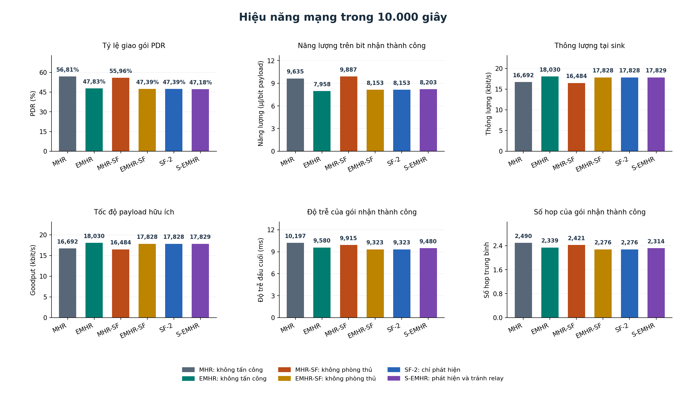
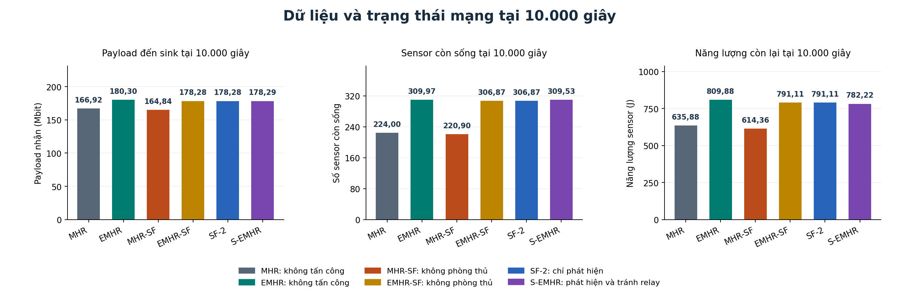
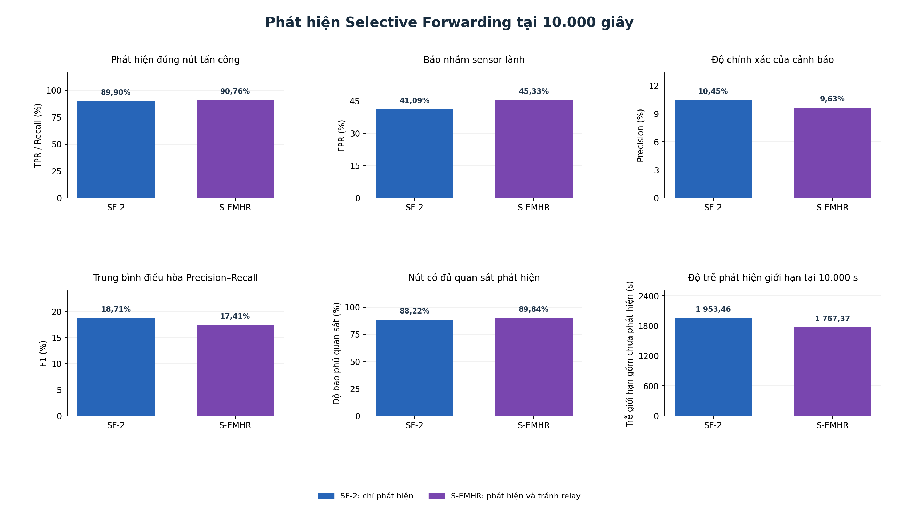
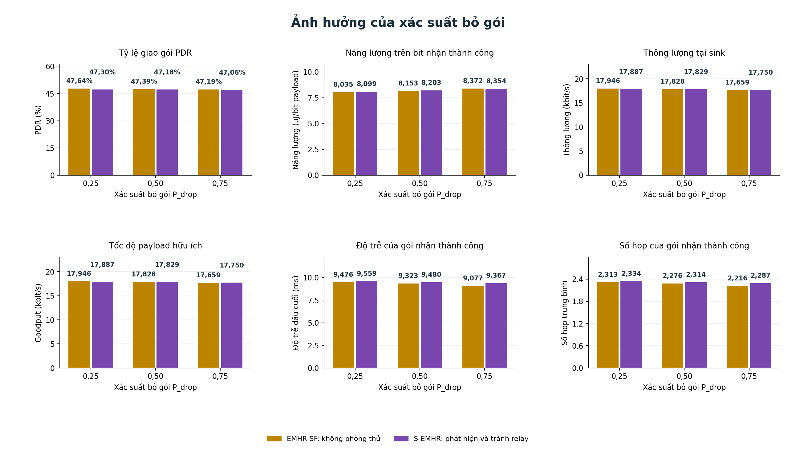
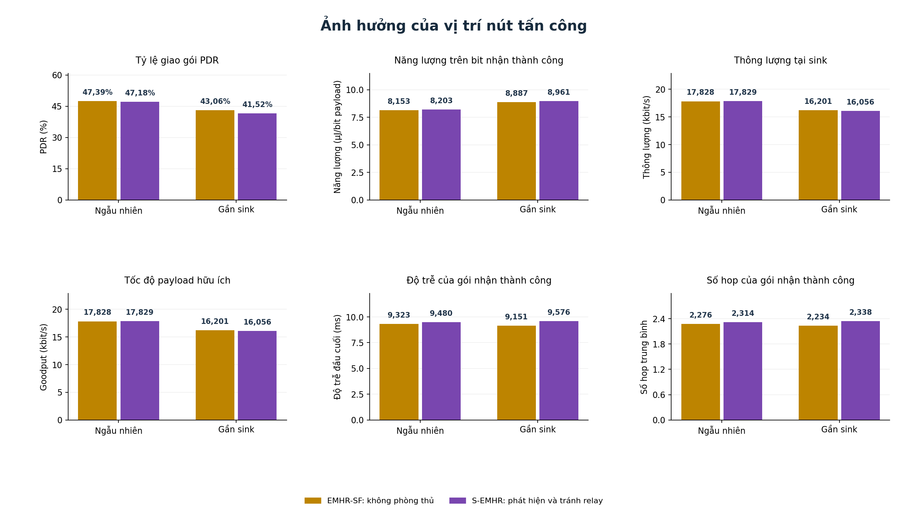
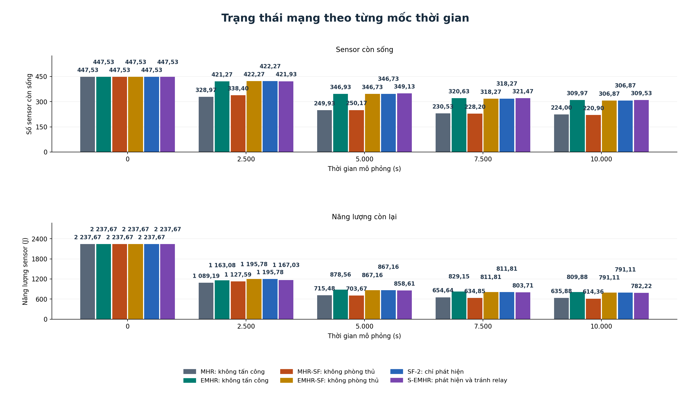
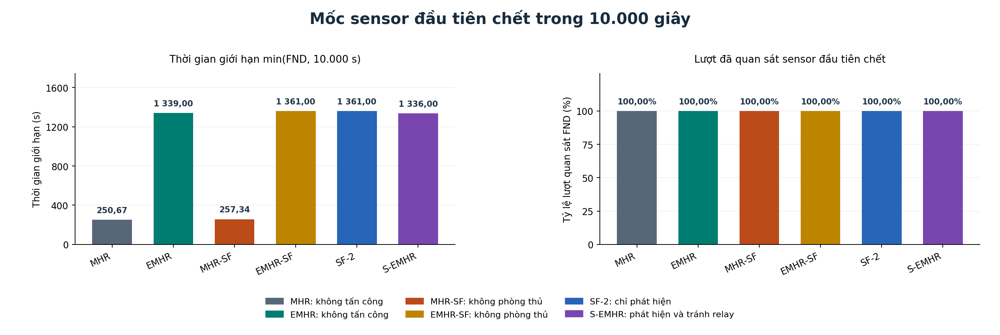
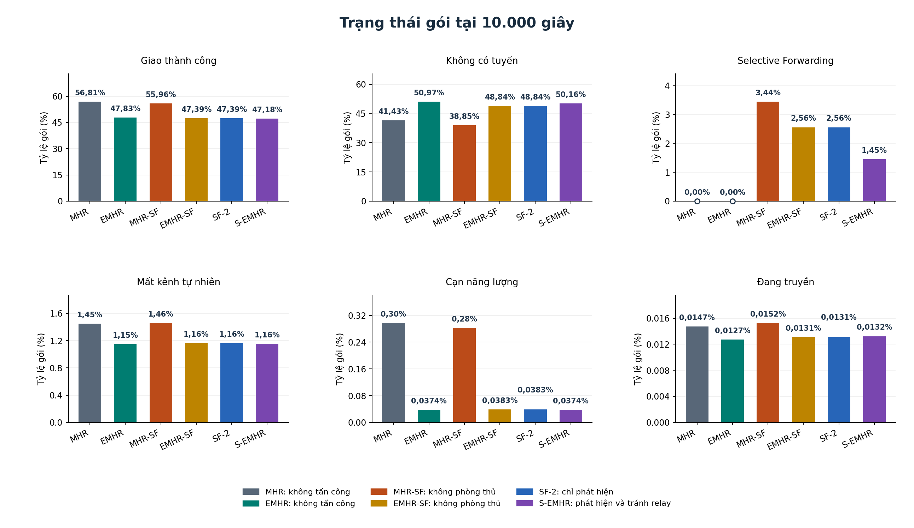
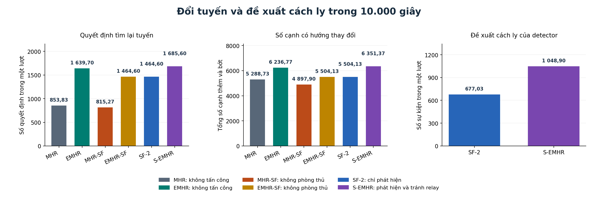

# Hiệu năng và bảo mật WSN trong 10.000 giây

**480/480 lượt; 16 cấu hình × 30 seed; lỗi=0; còn thiếu=0.**

[Dữ liệu từng seed](runs.csv) · [CSV bảo mật](detection.csv) · [Trạng thái từng relay](relay-stats.csv) · [Kiểm tra cột](bar-audit.csv) · [Mean/std/CI95](summary.csv) · [So sánh cặp](paired.csv) · [Kiểm chứng](verification.json) · [Chỉ mục dữ liệu từng lượt](run-index.json)

## Phương pháp và quy tắc chốt dữ liệu

Hoàn tất 480/480 lượt hợp lệ, 16 cấu hình × 30 seed (51001–51030), 0 lượt lỗi/còn thiếu. Mỗi seed tạo topology độc lập; cùng seed giữa các treatment giữ topology và các stream ngoại sinh. Không loại seed vì kết quả bất lợi. Đơn vị thống kê là lượt/seed, không phải node, gói hoặc cửa sổ. Profile chính thức: WSN_SECURITY_FIXED_HORIZON_10000S_V1; job scope EVALUATION_FIXED_HORIZON_10000S, config_profile CUSTOM, không dùng nhãn PILOT/TEST_ONLY cho evaluation.

Mỗi lượt quan sát t ∈ [0,10.000] giây, tối đa 1000 round, sinh gói mỗi 10 giây từ t=10 đến t=10.000. Xử lý toàn bộ sự kiện tại t=10.000 theo thứ tự hàng đợi SimPy, chốt detector tại thời điểm này, không chạy xả sau mốc. Gói đã sinh nhưng chưa có sự kiện kết thúc giữ pending_in_flight. PDR dùng toàn bộ gói sinh trong khoảng đo, bao gồm gói đang truyền ở mẫu số. Quy tắc cutoff được kiểm tra bằng ca một sensor: 1.000 gói sinh, 999 gói đến và 1 gói đang truyền.

Mỗi lượt có 400–500 sensor theo seed (450 danh định), 7 sink, vùng 3.000 × 3.000 m, E0=5 J, Eth=1 J, R=300 m, wire=payload=128 byte, chu kỳ 10 s và p_channel=0,01. Detector dùng beta=0.8, cửa sổ 20 s, timeout 0.02 s, minObs=2, tau=1, K=1, trust ban đầu=1 và cách ly 60 s.

Số attacker là tỷ lệ yêu cầu 2%, 5% hoặc 10% nhân với số sensor thực và làm tròn nửa lên. Attacker được chọn từ sensor. Manifest và CSV ghi số lượng và tỷ lệ thực. Các thuật toán cùng treatment dùng chung tập ID. Các vị trí khác nhau dùng quy tắc chọn ID tương ứng trên cùng topology.

Throughput = wire bit nhận duy nhất tại sink / 10.000 s; goodput = payload bit nhận / 10.000 s. Vì wire=payload, hai giá trị bằng nhau trong mô hình này. Năng lượng/bit = năng lượng sensor tiêu hao từ t=0 đến t=10.000 / payload bit nhận thành công. Delay và hop lấy đúng gói hoàn tất trước hoặc tại cutoff, không lấy giá trị cuối của lượt 100.000 s rồi đổi nhãn. Các trạng thái TP/FP/TN/FN, coverage, cảnh báo và cách ly đều chốt tại t=10.000.

Mean và độ lệch chuẩn mẫu (ddof=1) tính trên seed có chỉ số xác định; CI95 = mean ± t(0,975,n−1)×std/√n. CSV giữ n_expected/n_used/n_missing và NA cho mẫu số 0. So sánh cặp trên matched seeds, xác minh pairing hash/topology/attacker IDs, dùng paired t và Wilcoxon-Pratt, hiệu chỉnh Holm trên toàn họ chỉ số/cặp đã khai báo. CI95 của chênh lệch cặp giữ trong CSV; không thay CI bằng error bar trong ảnh. CI tỷ lệ là khoảng t cho mean theo seed và có thể vượt [0,1]; không cắt để che biến thiên.

Độ trễ phát hiện/cách ly thực theo attacker giữ NA nếu chưa thấy sự kiện. Chỉ số capped delay lấy min(delay,10.000) và dùng 10.000 cho attacker bị kiểm duyệt, rồi trung bình trong mỗi seed và qua 30 seed. Giá trị giới hạn không phải thời gian phát hiện thực của attacker chưa bị phát hiện. TPR/FPR tính trên toàn bộ sensor, coverage mô tả tập có đủ quan sát, không loại attacker không quan sát để tăng TPR.

FND là mốc sensor đầu tiên chết. HND là mốc có ít nhất ceil(N thực/2) sensor chết. LND là mốc toàn bộ sensor chết. Mốc chưa quan sát giữ time_s và payload là NA, với censored=true. Thời gian giới hạn là min(T, 10.000 s). Trung bình payload trước mốc dùng các lượt đã đạt mốc. Mốc mất chức năng dựa trên tỷ lệ liên thông vật lý hoặc tỷ lệ có tuyến.

Hai ô payload trước HND/LND cũ không đủ quan sát để so sánh. Bộ hình chính đã thay bằng payload đến sink, sensor sống và năng lượng còn lại tại 10.000 s. Bảng dưới giữ n_observed/n_runs cho mọi mốc và mọi cấu hình. Cấu hình/phương pháp nằm trong báo cáo và metadata; ảnh chỉ giữ tiêu đề, trục/đơn vị, legend và số phía trên cột.

Phạm vi 10.000 s được chọn theo yêu cầu người dùng sau khi đã xem checkpoint dài hạn, không phải đăng ký trước khi xem dữ liệu dài hạn. Toàn bộ 480 lượt này được chạy mới trong profile ngắn; không trộn mean hay delay/hop từ kết quả dài hạn. Báo cáo và dữ liệu 100.000 s cũ giữ riêng, không ghi đè.

Số quyết định tìm lại tuyến có nguyên nhân chính security chỉ đếm việc sửa một tuyến đã gán. Tuyến được chọn mới ngay khi sinh gói có thể tránh node cách ly mà không tạo sự kiện reroute. Vì vậy số đếm security bằng 0 không tự chứng minh S-EMHR không tránh relay hoặc không có chi phí bảo vệ; trạng thái bật/tắt tránh relay và các chi phí chưa mô phỏng được công bố riêng.

Tỷ lệ 100% ở ô quan sát FND nghĩa là 30/30 lượt đã có ít nhất một sensor chết.

Chuỗi thời gian được ghi mỗi 100 s để giảm chi phí lưu và tổng hợp; chu kỳ sinh gói vẫn là 10 s và mốc chết vẫn được ghi theo đúng sự kiện. Các chỗ còn ghi 1.000 s trong mẫu yêu cầu được thống nhất thành 10.000 s theo các mục cấu hình/nghiệm thu mới. Kế hoạch gốc có giới hạn 100.000 s; báo cáo hiện tại là phạm vi 10.000 s điều chỉnh theo yêu cầu, không tuyên bố thay thế đầy đủ nghiên cứu dài hạn. Bộ 1.000 s và 100.000 s cũ đều được bảo toàn.

Mẫu cuối được ghi khi hết sensor sống hoặc hết sensor sống nối vật lý tới sink. Biểu đồ trạng thái mạng trình bày các mốc 0, 2.500, 5.000, 7.500 và 10.000 s. Mỗi cột lấy trung bình các seed có mẫu tại mốc đó. CSV nguồn giữ các mẫu mỗi 100 s và số seed dùng để tính giá trị. Summary và chỉ số tại cutoff dựa trên toàn bộ vòng đời mô phỏng.

Đã kiểm tra mọi cột từ CSV đến ảnh. Mean bằng 0 giữ chiều cao 0, có vòng tròn tại đường gốc và nhãn số để phân biệt với thiếu dữ liệu. Mean không xác định trong các hình chính làm xuất báo cáo dừng để kiểm tra; không điền số giả. Các mốc HND/LND thiếu quan sát chỉ ở bảng kiểm duyệt, không tạo ô hình trống. Bảng kiểm tra hiển thị và bar_visibility_audit.csv ghi trạng thái từng cột. Nhóm không bật detector không được vẽ trong ô chỉ dành cho detector; đây là chọn đúng phạm vi chỉ số, không phải bỏ dữ liệu bất lợi.

Các biểu đồ bảo mật dùng cột bắt đầu từ 0, với giá trị trung bình ghi trên đầu mỗi cột. Khoảng tin cậy 95% và so sánh cặp nằm trong các bảng số liệu.

Protocol hiệu lực ghi rõ quy tắc cutoff 10.000 s. Bản đăng ký gốc được giữ nguyên hash; một chuỗi mô tả còn sót 1.000 trong mẫu được đính chính riêng ở protocol_effective.json. Không đổi cấu hình chạy, kết quả, run ID hoặc completion hash vì chỉnh mô tả này.

relay_security_per_seed.csv lưu bộ đếm nhận/chuyển tiếp/timeout/pending, trust và cờ nghi ngờ/cách ly của từng relay tại cutoff. Tỷ số F/N trong CSV này được ghi rõ là tỷ số tích lũy để đối chiếu, không phải forwarding ratio từng cửa sổ đã dùng cập nhật EWMA. Batch dùng full_trace=false để tiết kiệm tài nguyên; không tuyên bố đã lưu lại đầy đủ log từng gói hoặc lịch sử từng cửa sổ. Các bài kiểm tra module và demo chi tiết được giữ riêng trong dự án.

## Nhận xét ưu điểm và hạn chế

MHR không tấn công đạt PDR 56,807%, năng lượng/bit 9,635 µJ/bit và 224,00 sensor còn sống. EMHR tương ứng 47,832%, 7,958 µJ/bit và 309,97 sensor. MHR dùng tuyến hop tối thiểu trên graph vật lý; EMHR xét ngưỡng năng lượng relay. Số liệu cho thấy đánh đổi giữa duy trì relay, dữ liệu nhận và chi phí radio; không suy rộng ưu thế của MHR/SF-2 ra các mức độ nhạy chưa chạy.

Ở nhóm không tấn công, EMHR thay đổi goodput 8,02% và năng lượng/bit -17,41% so với MHR. Đọc PDR cùng lượng gói sinh: sensor chết làm giảm số gói sinh của MHR, nên PDR cao hơn riêng lẻ chưa đồng nghĩa nhận nhiều payload hơn. Khả năng giữ sensor sống và năng lượng/bit là ưu điểm quan sát được của EMHR trong cửa sổ này; ngưỡng relay cũng có thể làm một số nguồn còn pin mất tuyến hợp lệ.

Selective Forwarding làm PDR của MHR-SF còn 55,957% và EMHR-SF còn 47,391%. S-EMHR đạt 47,183%, thay đổi goodput 0,01% so với EMHR-SF và 8,16% so với MHR-SF. Đây là các giá trị trung bình tại cấu hình trung tâm; bảng cặp giữ CI95 và p đã hiệu chỉnh để đánh giá độ chắc chắn.

S-EMHR có năng lượng/bit 8,203 µJ/bit, trễ 9,480 ms và 2,314 hop; EMHR-SF tương ứng 8,153 µJ/bit, 9,323 ms và 2,276 hop. Tránh relay bị cách ly có thể thay đổi độ dài tuyến và số nguồn còn đường đi. Delay/hop chỉ mô tả gói đã đến sink, nên phải đọc cùng PDR, mất gói và reachability; tiết kiệm năng lượng nhờ bỏ gói sớm không tự chứng minh hiệu quả giao dữ liệu.

SF-2 quan sát thụ động và không tránh relay, nên các chỉ số giao dữ liệu/radio trùng EMHR-SF khi dùng cùng seed. Sự trùng nhau này phù hợp mô hình chưa thu chi phí giám sát; không có nghĩa detector ngoài thực tế không tiêu tốn tài nguyên.

SF-2 chỉ phát hiện đạt PDR 47,391%, S-EMHR đạt 47,183%. TPR của hai phương án là 89,902% và 90,763%; FPR 41,091% và 45,326%; precision 10,451% và 9,631%; coverage 88,220% và 89,836%. Giữ cả báo nhầm, bỏ sót và attacker chưa đủ cơ hội chuyển tiếp. Bộ detector đã khóa từ benign calibration hữu hạn; không coi đó là bảo đảm FPR ở mọi horizon và không tinh chỉnh lại bằng 30 seed evaluation.

Các bảng độ nhạy giữ tất cả sáu treatment tấn công đã đo. Thiết kế thay đổi một yếu tố mỗi lần chưa ước lượng tương tác giữa tỷ lệ attacker, P_drop và vị trí; không nối kết quả để khẳng định toàn bộ tích Descartes. Near-sink chọn theo khoảng cách Euclid đến sink gần nhất, phá hòa bằng ID sensor, độc lập với kết quả định tuyến.

Tại 10.000 s, số sensor sống còn tuyến hợp lệ trung bình là 42,33 với MHR, 46,80 với EMHR, 48,13 với EMHR-SF và 48,77 với S-EMHR. Bảng trung tâm đặt số sensor còn sống cạnh số nối vật lý và số có tuyến hợp lệ để phân biệt còn pin với duy trì khả năng truyền đến sink.

Trong toàn bộ 480 lượt mới, HND được quan sát ở 31/480 lượt, LND ở 0/480 lượt. Các mốc còn lại giữ NA/censored trong bảng. Bảng FND và biểu đồ sensor sống, năng lượng cho phép đánh giá suy giảm ngắn hạn.

Ở SF-2, detector tạo trung bình 677,03 đề xuất cách ly nhưng chế độ tránh relay tắt. S-EMHR có 1 048,90 đề xuất và bật ràng buộc tránh relay. Số quyết định tìm lại tuyến có nguyên nhân chính là an ninh lấy trực tiếp từ log: 0,00 với SF-2 và 0,00 với S-EMHR. Số đề xuất có thể lặp lại trên cùng node, gồm cả báo nhầm; không phải số attacker duy nhất hoặc số lần đổi tuyến thực sự. Nhóm không bật detector không xuất hiện ở ô đề xuất cách ly, nhưng số đếm 0 vẫn giữ trong CSV.

PDR toàn kỳ có thể chịu ảnh hưởng mạnh của relay dưới ngưỡng và nguồn còn sống nhưng mất tuyến. Đọc các biểu đồ độ nhạy cùng tỷ lệ unreachable, selective_forwarding, số sensor còn tuyến và năng lượng.

Ở cấu hình trung tâm, phần gói sinh ra bị Selective Forwarding là 2,5589% với EMHR-SF và 1,4506% với S-EMHR. Phần gói không có tuyến tương ứng 48,8366% và 50,1603%. Giảm mất gói do tấn công đi kèm thay đổi mất gói do không có tuyến; TPR cao hơn không tự bảo đảm PDR/goodput hoặc tuổi thọ cao hơn. Bảng trạng thái gói giữ cả hai nguyên nhân và các chi phí radio đã đo.

## Giới hạn diễn giải

Quan sát 10.000 giây phản ánh hiệu năng ngắn hạn. Khi HND/LND chưa xảy ra, dữ liệu này không xác định hoặc chứng minh đầy đủ tuổi thọ dài hạn.

Mô hình radio hiện tính năng lượng TX/RX, chưa có tiêu hao idle, MAC, ACK, hàng đợi, retransmission và chi phí giám sát/điều khiển. Các chi phí này giữ NA; không thể suy ra tổng chi phí triển khai thực hoặc mặc định S-EMHR rẻ hơn mọi mặt.

Sensor còn sống nhưng mất kết nối vẫn có thể tồn tại lâu vì chưa có idle. Do đó còn pin, còn sống, còn đường đi và khả năng giao dữ liệu là các đại lượng khác nhau.

Detector dùng quan sát lý tưởng từ SimPy, chưa mô phỏng overhearing/ACK thực. Cần kiểm chứng thêm với chi phí giao thức và horizon dài hơn để kết luận về triển khai.

## Hiệu năng cấu hình trung tâm

| Kịch bản | PDR (%) | Throughput (kbit/s) | Goodput (kbit/s) | µJ/bit | Trễ (ms) | Hop | Payload (Mbit) | Sensor sống | Năng lượng còn (J) | Sống và nối vật lý tới sink | Sống và có tuyến hợp lệ |
| --- | --- | --- | --- | --- | --- | --- | --- | --- | --- | --- | --- |
| MHR | 56,807 | 16,692 | 16,692 | 9,635 | 10,197 | 2,490 | 166,915 | 224,00 | 635,88 | 42,33 | 42,33 |
| EMHR | 47,832 | 18,030 | 18,030 | 7,958 | 9,580 | 2,339 | 180,303 | 309,97 | 809,88 | 279,53 | 46,80 |
| MHR-SF | 55,957 | 16,484 | 16,484 | 9,887 | 9,915 | 2,421 | 164,836 | 220,90 | 614,36 | 43,90 | 43,90 |
| EMHR-SF | 47,391 | 17,828 | 17,828 | 8,153 | 9,323 | 2,276 | 178,281 | 306,87 | 791,11 | 273,43 | 48,13 |
| SF-2 | 47,391 | 17,828 | 17,828 | 8,153 | 9,323 | 2,276 | 178,281 | 306,87 | 791,11 | 273,43 | 48,13 |
| S-EMHR | 47,183 | 17,829 | 17,829 | 8,203 | 9,480 | 2,314 | 178,293 | 309,53 | 782,22 | 284,63 | 48,77 |

## Bảo mật cấu hình trung tâm

| Kịch bản | TP | FP | TN | FN | tpr | fpr | precision | f1 | coverage | detection_capped_delay_s | isolation_capped_delay_s | detector_isolation_events | unique_isolated_by_cutoff | Tránh relay |
| --- | --- | --- | --- | --- | --- | --- | --- | --- | --- | --- | --- | --- | --- | --- |
| SF-2 | 20,233 | 174,967 | 250,067 | 2,267 | 89,902 | 41,091 | 10,451 | 18,713 | 88,220 | 1 953,457 | 1 953,457 | 677,033 | 195,200 | Tắt |
| S-EMHR | 20,433 | 193,000 | 232,033 | 2,067 | 90,763 | 45,326 | 9,631 | 17,406 | 89,836 | 1 767,370 | 1 767,370 | 1 048,900 | 213,433 | Bật |

## So sánh cặp tại cấu hình trung tâm

| Cặp (A − B) | Chỉ số | n cặp | Chênh lệch | CI95 thấp | CI95 cao | Thay đổi (%) | p t/Holm | p Wilcoxon/Holm |
| --- | --- | --- | --- | --- | --- | --- | --- | --- |
| S-EMHR − SF-2 | PDR (%) | 30 | -0,2083 | -0,3613 | -0,0553 | -0,44 | 1,00000 | 1,00000 |
| S-EMHR − SF-2 | Thông lượng (kbit/s) | 30 | 0,0012 | -0,0364 | 0,0388 | 0,01 | 1,00000 | 1,00000 |
| S-EMHR − SF-2 | Goodput (kbit/s) | 30 | 0,0012 | -0,0364 | 0,0388 | 0,01 | 1,00000 | 1,00000 |
| S-EMHR − SF-2 | Năng lượng (µJ/bit payload) | 30 | 0,0503 | 0,0144 | 0,0862 | 0,62 | 1,00000 | 1,00000 |
| S-EMHR − SF-2 | Độ trễ đầu cuối (ms) | 30 | 0,1568 | 0,1307 | 0,1828 | 1,68 | <0,00001 | <0,00001 |
| S-EMHR − SF-2 | Số hop trung bình | 30 | 0,0383 | 0,0319 | 0,0446 | 1,68 | <0,00001 | <0,00001 |
| S-EMHR − EMHR-SF | PDR (%) | 30 | -0,2083 | -0,3613 | -0,0553 | -0,44 | 1,00000 | 1,00000 |
| S-EMHR − EMHR-SF | Thông lượng (kbit/s) | 30 | 0,0012 | -0,0364 | 0,0388 | 0,01 | 1,00000 | 1,00000 |
| S-EMHR − EMHR-SF | Goodput (kbit/s) | 30 | 0,0012 | -0,0364 | 0,0388 | 0,01 | 1,00000 | 1,00000 |
| S-EMHR − EMHR-SF | Năng lượng (µJ/bit payload) | 30 | 0,0503 | 0,0144 | 0,0862 | 0,62 | 1,00000 | 1,00000 |
| S-EMHR − EMHR-SF | Độ trễ đầu cuối (ms) | 30 | 0,1568 | 0,1307 | 0,1828 | 1,68 | <0,00001 | <0,00001 |
| S-EMHR − EMHR-SF | Số hop trung bình | 30 | 0,0383 | 0,0319 | 0,0446 | 1,68 | <0,00001 | <0,00001 |
| S-EMHR − MHR-SF | PDR (%) | 30 | -8,7743 | -9,5379 | -8,0107 | -15,68 | <0,00001 | <0,00001 |
| S-EMHR − MHR-SF | Thông lượng (kbit/s) | 30 | 1,3457 | 1,1641 | 1,5273 | 8,16 | <0,00001 | <0,00001 |
| S-EMHR − MHR-SF | Goodput (kbit/s) | 30 | 1,3457 | 1,1641 | 1,5273 | 8,16 | <0,00001 | <0,00001 |
| S-EMHR − MHR-SF | Năng lượng (µJ/bit payload) | 30 | -1,6837 | -1,7538 | -1,6136 | -17,03 | <0,00001 | <0,00001 |
| S-EMHR − MHR-SF | Độ trễ đầu cuối (ms) | 30 | -0,4350 | -0,4858 | -0,3842 | -4,39 | <0,00001 | <0,00001 |
| S-EMHR − MHR-SF | Số hop trung bình | 30 | -0,1062 | -0,1186 | -0,0938 | -4,39 | <0,00001 | <0,00001 |

## Độ nhạy của PDR

| Attacker (%) | P_drop | Vị trí | PDR EMHR-SF (%) | PDR S-EMHR (%) | Chênh lệch (điểm %) |
| --- | --- | --- | --- | --- | --- |
| 5 | 0,50 | Ngẫu nhiên | 47,391 | 47,183 | -0,208 |
| 2 | 0,50 | Ngẫu nhiên | 47,714 | 47,564 | -0,150 |
| 10 | 0,50 | Ngẫu nhiên | 46,925 | 46,395 | -0,530 |
| 5 | 0,25 | Ngẫu nhiên | 47,638 | 47,296 | -0,342 |
| 5 | 0,75 | Ngẫu nhiên | 47,189 | 47,062 | -0,127 |
| 5 | 0,50 | Gần sink | 43,061 | 41,520 | -1,541 |

## Kiểm tra hiển thị cột

| Hình | Số cột có số đo | Cột dương | Số 0 có điểm đánh dấu | Cột thiếu dữ liệu |
| --- | --- | --- | --- | --- |
| 01_hieu_nang_trung_tam.png | 36 | 36 | 0 | 0 |
| 02_trang_thai_10000s.png | 18 | 18 | 0 | 0 |
| 03_phat_hien_bao_mat.png | 12 | 12 | 0 | 0 |
| 04_ty_le_attacker.png | 36 | 36 | 0 | 0 |
| 05_xac_suat_bo_goi.png | 36 | 36 | 0 | 0 |
| 06_vi_tri_attacker.png | 24 | 24 | 0 | 0 |
| 07_dien_bien_mang.png | 60 | 60 | 0 | 0 |
| 08_FND_gioi_han.png | 12 | 12 | 0 | 0 |
| 09_trang_thai_goi.png | 36 | 34 | 2 | 0 |
| 10_doi_tuyen_va_cach_ly.png | 14 | 14 | 0 | 0 |

## Ma trận và số seed

| Kịch bản | Attacker (%) | P_drop | Vị trí | Hoàn tất | Lỗi |
| --- | --- | --- | --- | --- | --- |
| MHR | 0 | 0,00 | Ngẫu nhiên | 30/30 | 0 |
| EMHR | 0 | 0,00 | Ngẫu nhiên | 30/30 | 0 |
| MHR-SF | 5 | 0,50 | Ngẫu nhiên | 30/30 | 0 |
| EMHR-SF | 5 | 0,50 | Ngẫu nhiên | 30/30 | 0 |
| SF-2 | 5 | 0,50 | Ngẫu nhiên | 30/30 | 0 |
| S-EMHR | 5 | 0,50 | Ngẫu nhiên | 30/30 | 0 |
| EMHR-SF | 2 | 0,50 | Ngẫu nhiên | 30/30 | 0 |
| S-EMHR | 2 | 0,50 | Ngẫu nhiên | 30/30 | 0 |
| EMHR-SF | 10 | 0,50 | Ngẫu nhiên | 30/30 | 0 |
| S-EMHR | 10 | 0,50 | Ngẫu nhiên | 30/30 | 0 |
| EMHR-SF | 5 | 0,25 | Ngẫu nhiên | 30/30 | 0 |
| S-EMHR | 5 | 0,25 | Ngẫu nhiên | 30/30 | 0 |
| EMHR-SF | 5 | 0,75 | Ngẫu nhiên | 30/30 | 0 |
| S-EMHR | 5 | 0,75 | Ngẫu nhiên | 30/30 | 0 |
| EMHR-SF | 5 | 0,50 | Gần sink | 30/30 | 0 |
| S-EMHR | 5 | 0,50 | Gần sink | 30/30 | 0 |

## Mốc chết và mất chức năng: quan sát/kiểm duyệt

| Case ID | Mốc | n_observed/n_runs | Censored | Thời điểm TB khi đạt (s) | Payload TB khi đạt (Mbit) |
| --- | --- | --- | --- | --- | --- |
| MHR_r0_d0_random | FND | 30/30 | 0 | 250,675 | 10,899 |
| MHR_r0_d0_random | HND | 13/30 | 17 | 6 680,772 | 165,058 |
| MHR_r0_d0_random | LND | 0/30 | 30 | NA | NA |
| MHR_r0_d0_random | functional_network_death | 30/30 | 0 | 4 029,344 | 128,767 |
| MHR_r0_d0_random | functional_routing_network_death | 30/30 | 0 | 4 029,344 | 128,767 |
| EMHR_r0_d0_random | FND | 30/30 | 0 | 1 339,000 | 59,284 |
| EMHR_r0_d0_random | HND | 0/30 | 30 | NA | NA |
| EMHR_r0_d0_random | LND | 0/30 | 30 | NA | NA |
| EMHR_r0_d0_random | functional_network_death | 1/30 | 29 | 9 240,000 | 166,608 |
| EMHR_r0_d0_random | functional_routing_network_death | 30/30 | 0 | 3 312,010 | 125,617 |
| MHR_SF_r0.05_d0.5_random | FND | 30/30 | 0 | 257,341 | 10,758 |
| MHR_SF_r0.05_d0.5_random | HND | 18/30 | 12 | 6 991,115 | 158,814 |
| MHR_SF_r0.05_d0.5_random | LND | 0/30 | 30 | NA | NA |
| MHR_SF_r0.05_d0.5_random | functional_network_death | 30/30 | 0 | 4 324,343 | 129,181 |
| MHR_SF_r0.05_d0.5_random | functional_routing_network_death | 30/30 | 0 | 4 324,343 | 129,181 |
| EMHR_SF_r0.05_d0.5_random | FND | 30/30 | 0 | 1 361,000 | 57,490 |
| EMHR_SF_r0.05_d0.5_random | HND | 0/30 | 30 | NA | NA |
| EMHR_SF_r0.05_d0.5_random | LND | 0/30 | 30 | NA | NA |
| EMHR_SF_r0.05_d0.5_random | functional_network_death | 2/30 | 28 | 9 595,000 | 161,492 |
| EMHR_SF_r0.05_d0.5_random | functional_routing_network_death | 30/30 | 0 | 3 517,008 | 125,765 |
| SF2_r0.05_d0.5_random | FND | 30/30 | 0 | 1 361,000 | 57,490 |
| SF2_r0.05_d0.5_random | HND | 0/30 | 30 | NA | NA |
| SF2_r0.05_d0.5_random | LND | 0/30 | 30 | NA | NA |
| SF2_r0.05_d0.5_random | functional_network_death | 2/30 | 28 | 9 595,000 | 161,492 |
| SF2_r0.05_d0.5_random | functional_routing_network_death | 30/30 | 0 | 3 517,008 | 125,765 |
| SF3_r0.05_d0.5_random | FND | 30/30 | 0 | 1 336,000 | 58,228 |
| SF3_r0.05_d0.5_random | HND | 0/30 | 30 | NA | NA |
| SF3_r0.05_d0.5_random | LND | 0/30 | 30 | NA | NA |
| SF3_r0.05_d0.5_random | functional_network_death | 1/30 | 29 | 9 490,000 | 158,199 |
| SF3_r0.05_d0.5_random | functional_routing_network_death | 30/30 | 0 | 3 242,675 | 121,669 |
| EMHR_SF_r0.02_d0.5_random | FND | 30/30 | 0 | 1 345,333 | 58,510 |
| EMHR_SF_r0.02_d0.5_random | HND | 0/30 | 30 | NA | NA |
| EMHR_SF_r0.02_d0.5_random | LND | 0/30 | 30 | NA | NA |
| EMHR_SF_r0.02_d0.5_random | functional_network_death | 1/30 | 29 | 9 250,000 | 163,428 |
| EMHR_SF_r0.02_d0.5_random | functional_routing_network_death | 30/30 | 0 | 3 396,011 | 125,719 |
| SF3_r0.02_d0.5_random | FND | 30/30 | 0 | 1 340,667 | 58,995 |
| SF3_r0.02_d0.5_random | HND | 0/30 | 30 | NA | NA |
| SF3_r0.02_d0.5_random | LND | 0/30 | 30 | NA | NA |
| SF3_r0.02_d0.5_random | functional_network_death | 0/30 | 30 | NA | NA |
| SF3_r0.02_d0.5_random | functional_routing_network_death | 30/30 | 0 | 3 262,341 | 123,609 |
| EMHR_SF_r0.1_d0.5_random | FND | 30/30 | 0 | 1 372,667 | 55,641 |
| EMHR_SF_r0.1_d0.5_random | HND | 0/30 | 30 | NA | NA |
| EMHR_SF_r0.1_d0.5_random | LND | 0/30 | 30 | NA | NA |
| EMHR_SF_r0.1_d0.5_random | functional_network_death | 1/30 | 29 | 9 790,000 | 159,813 |
| EMHR_SF_r0.1_d0.5_random | functional_routing_network_death | 30/30 | 0 | 3 759,011 | 126,528 |
| SF3_r0.1_d0.5_random | FND | 30/30 | 0 | 1 336,333 | 57,346 |
| SF3_r0.1_d0.5_random | HND | 0/30 | 30 | NA | NA |
| SF3_r0.1_d0.5_random | LND | 0/30 | 30 | NA | NA |
| SF3_r0.1_d0.5_random | functional_network_death | 1/30 | 29 | 9 960,000 | 160,368 |
| SF3_r0.1_d0.5_random | functional_routing_network_death | 30/30 | 0 | 3 227,674 | 118,498 |
| EMHR_SF_r0.05_d0.25_random | FND | 30/30 | 0 | 1 351,333 | 58,569 |
| EMHR_SF_r0.05_d0.25_random | HND | 0/30 | 30 | NA | NA |
| EMHR_SF_r0.05_d0.25_random | LND | 0/30 | 30 | NA | NA |
| EMHR_SF_r0.05_d0.25_random | functional_network_death | 2/30 | 28 | 9 600,000 | 162,798 |
| EMHR_SF_r0.05_d0.25_random | functional_routing_network_death | 30/30 | 0 | 3 388,676 | 125,581 |
| SF3_r0.05_d0.25_random | FND | 30/30 | 0 | 1 336,333 | 58,690 |
| SF3_r0.05_d0.25_random | HND | 0/30 | 30 | NA | NA |
| SF3_r0.05_d0.25_random | LND | 0/30 | 30 | NA | NA |
| SF3_r0.05_d0.25_random | functional_network_death | 1/30 | 29 | 9 570,000 | 158,911 |
| SF3_r0.05_d0.25_random | functional_routing_network_death | 30/30 | 0 | 3 205,008 | 121,928 |
| EMHR_SF_r0.05_d0.75_random | FND | 30/30 | 0 | 1 362,333 | 55,836 |
| EMHR_SF_r0.05_d0.75_random | HND | 0/30 | 30 | NA | NA |
| EMHR_SF_r0.05_d0.75_random | LND | 0/30 | 30 | NA | NA |
| EMHR_SF_r0.05_d0.75_random | functional_network_death | 1/30 | 29 | 9 580,000 | 158,612 |
| EMHR_SF_r0.05_d0.75_random | functional_routing_network_death | 30/30 | 0 | 3 763,342 | 126,881 |
| SF3_r0.05_d0.75_random | FND | 30/30 | 0 | 1 336,000 | 57,800 |
| SF3_r0.05_d0.75_random | HND | 0/30 | 30 | NA | NA |
| SF3_r0.05_d0.75_random | LND | 0/30 | 30 | NA | NA |
| SF3_r0.05_d0.75_random | functional_network_death | 1/30 | 29 | 9 320,000 | 157,273 |
| SF3_r0.05_d0.75_random | functional_routing_network_death | 30/30 | 0 | 3 297,340 | 121,412 |
| EMHR_SF_r0.05_d0.5_near_sink | FND | 30/30 | 0 | 1 339,000 | 54,301 |
| EMHR_SF_r0.05_d0.5_near_sink | HND | 0/30 | 30 | NA | NA |
| EMHR_SF_r0.05_d0.5_near_sink | LND | 0/30 | 30 | NA | NA |
| EMHR_SF_r0.05_d0.5_near_sink | functional_network_death | 2/30 | 28 | 8 730,000 | 132,312 |
| EMHR_SF_r0.05_d0.5_near_sink | functional_routing_network_death | 30/30 | 0 | 3 328,676 | 112,149 |
| SF3_r0.05_d0.5_near_sink | FND | 30/30 | 0 | 1 344,333 | 57,524 |
| SF3_r0.05_d0.5_near_sink | HND | 0/30 | 30 | NA | NA |
| SF3_r0.05_d0.5_near_sink | LND | 0/30 | 30 | NA | NA |
| SF3_r0.05_d0.5_near_sink | functional_network_death | 0/30 | 30 | NA | NA |
| SF3_r0.05_d0.5_near_sink | functional_routing_network_death | 30/30 | 0 | 2 815,348 | 106,784 |

## Thống kê đầy đủ: mean/std/CI95 theo seed

| Case ID | Chỉ số | Đơn vị | n hợp lệ | n thiếu/NA | Mean | Std mẫu | CI95 thấp | CI95 cao |
| --- | --- | --- | --- | --- | --- | --- | --- | --- |
| MHR_r0_d0_random | Tỷ lệ giao gói PDR | PDR (%) | 30 | 0 | 56,80736 | 5,32959 | 54,81726 | 58,79746 |
| MHR_r0_d0_random | Thông lượng tại sink | Thông lượng (kbit/s) | 30 | 0 | 16,69151 | 2,10633 | 15,90499 | 17,47803 |
| MHR_r0_d0_random | Tốc độ payload hữu ích | Goodput (kbit/s) | 30 | 0 | 16,69151 | 2,10633 | 15,90499 | 17,47803 |
| MHR_r0_d0_random | Năng lượng trên bit nhận thành công | Năng lượng (µJ/bit payload) | 30 | 0 | 9,63462 | 0,54167 | 9,43236 | 9,83688 |
| MHR_r0_d0_random | Độ trễ của gói nhận thành công | Độ trễ đầu cuối (ms) | 30 | 0 | 10,19725 | 0,36843 | 10,05968 | 10,33483 |
| MHR_r0_d0_random | Số hop của gói nhận thành công | Số hop trung bình | 30 | 0 | 2,48956 | 0,08995 | 2,45598 | 2,52315 |
| MHR_r0_d0_random | Quyết định tìm lại tuyến | Số quyết định trong một lượt | 30 | 0 | 853,83333 | 177,87696 | 787,41299 | 920,25368 |
| MHR_r0_d0_random | Số cạnh có hướng thay đổi | Tổng số cạnh thêm và bớt | 30 | 0 | 5 288,73333 | 1 439,81167 | 4 751,09882 | 5 826,36785 |
| MHR_r0_d0_random | Phát hiện đúng nút tấn công | TPR / Recall (%) | 0 | 30 | NA | NA | NA | NA |
| MHR_r0_d0_random | Báo nhầm sensor lành | FPR (%) | 30 | 0 | 0,00000 | 0,00000 | 0,00000 | 0,00000 |
| MHR_r0_d0_random | Độ chính xác của cảnh báo | Precision (%) | 0 | 30 | NA | NA | NA | NA |
| MHR_r0_d0_random | Trung bình điều hòa Precision–Recall | F1 (%) | 0 | 30 | NA | NA | NA | NA |
| MHR_r0_d0_random | Nút có đủ quan sát phát hiện | Độ bao phủ quan sát (%) | 30 | 0 | 0,00000 | 0,00000 | 0,00000 | 0,00000 |
| MHR_r0_d0_random | Độ trễ phát hiện giới hạn tại 10.000 s | Trễ giới hạn gồm chưa phát hiện (s) | 0 | 30 | NA | NA | NA | NA |
| MHR_r0_d0_random | isolation_capped_delay_s | đơn vị gốc trong CSV | 0 | 30 | NA | NA | NA | NA |
| MHR_r0_d0_random | detection_event_coverage | đơn vị gốc trong CSV | 0 | 30 | NA | NA | NA | NA |
| MHR_r0_d0_random | isolation_event_coverage | đơn vị gốc trong CSV | 0 | 30 | NA | NA | NA | NA |
| MHR_r0_d0_random | Quyết định cách ly tạm thời | Số quyết định trong một lượt | 30 | 0 | 0,00000 | 0,00000 | 0,00000 | 0,00000 |
| MHR_r0_d0_random | Thời gian giới hạn min(FND, 10.000 s) | Thời gian giới hạn (s) | 30 | 0 | 250,67500 | 67,71791 | 225,38871 | 275,96128 |
| MHR_r0_d0_random | FND_payload_bits | đơn vị gốc trong CSV | 30 | 0 | 10 899 217,06667 | 2 797 470,85200 | 9 854 624,28313 | 11 943 809,85020 |
| MHR_r0_d0_random | HND_restricted_s | đơn vị gốc trong CSV | 30 | 0 | 8 561,66803 | 1 942,48904 | 7 836,33070 | 9 287,00536 |
| MHR_r0_d0_random | HND_payload_bits | đơn vị gốc trong CSV | 13 | 17 | 165 057 772,30769 | 14 632 563,51502 | 156 215 402,67219 | 173 900 141,94319 |
| MHR_r0_d0_random | LND_restricted_s | đơn vị gốc trong CSV | 30 | 0 | 10 000,00000 | 0,00000 | 10 000,00000 | 10 000,00000 |
| MHR_r0_d0_random | LND_payload_bits | đơn vị gốc trong CSV | 0 | 30 | NA | NA | NA | NA |
| EMHR_r0_d0_random | Tỷ lệ giao gói PDR | PDR (%) | 30 | 0 | 47,83226 | 4,70060 | 46,07703 | 49,58749 |
| EMHR_r0_d0_random | Thông lượng tại sink | Thông lượng (kbit/s) | 30 | 0 | 18,03035 | 2,44433 | 17,11762 | 18,94308 |
| EMHR_r0_d0_random | Tốc độ payload hữu ích | Goodput (kbit/s) | 30 | 0 | 18,03035 | 2,44433 | 17,11762 | 18,94308 |
| EMHR_r0_d0_random | Năng lượng trên bit nhận thành công | Năng lượng (µJ/bit payload) | 30 | 0 | 7,95757 | 0,46458 | 7,78410 | 8,13105 |
| EMHR_r0_d0_random | Độ trễ của gói nhận thành công | Độ trễ đầu cuối (ms) | 30 | 0 | 9,57960 | 0,34713 | 9,44998 | 9,70922 |
| EMHR_r0_d0_random | Số hop của gói nhận thành công | Số hop trung bình | 30 | 0 | 2,33877 | 0,08475 | 2,30712 | 2,37041 |
| EMHR_r0_d0_random | Quyết định tìm lại tuyến | Số quyết định trong một lượt | 30 | 0 | 1 639,70000 | 371,47099 | 1 500,99045 | 1 778,40955 |
| EMHR_r0_d0_random | Số cạnh có hướng thay đổi | Tổng số cạnh thêm và bớt | 30 | 0 | 6 236,76667 | 2 005,65937 | 5 487,84115 | 6 985,69218 |
| EMHR_r0_d0_random | Phát hiện đúng nút tấn công | TPR / Recall (%) | 0 | 30 | NA | NA | NA | NA |
| EMHR_r0_d0_random | Báo nhầm sensor lành | FPR (%) | 30 | 0 | 0,00000 | 0,00000 | 0,00000 | 0,00000 |
| EMHR_r0_d0_random | Độ chính xác của cảnh báo | Precision (%) | 0 | 30 | NA | NA | NA | NA |
| EMHR_r0_d0_random | Trung bình điều hòa Precision–Recall | F1 (%) | 0 | 30 | NA | NA | NA | NA |
| EMHR_r0_d0_random | Nút có đủ quan sát phát hiện | Độ bao phủ quan sát (%) | 30 | 0 | 0,00000 | 0,00000 | 0,00000 | 0,00000 |
| EMHR_r0_d0_random | Độ trễ phát hiện giới hạn tại 10.000 s | Trễ giới hạn gồm chưa phát hiện (s) | 0 | 30 | NA | NA | NA | NA |
| EMHR_r0_d0_random | isolation_capped_delay_s | đơn vị gốc trong CSV | 0 | 30 | NA | NA | NA | NA |
| EMHR_r0_d0_random | detection_event_coverage | đơn vị gốc trong CSV | 0 | 30 | NA | NA | NA | NA |
| EMHR_r0_d0_random | isolation_event_coverage | đơn vị gốc trong CSV | 0 | 30 | NA | NA | NA | NA |
| EMHR_r0_d0_random | Quyết định cách ly tạm thời | Số quyết định trong một lượt | 30 | 0 | 0,00000 | 0,00000 | 0,00000 | 0,00000 |
| EMHR_r0_d0_random | Thời gian giới hạn min(FND, 10.000 s) | Thời gian giới hạn (s) | 30 | 0 | 1 339,00000 | 112,04525 | 1 297,16162 | 1 380,83838 |
| EMHR_r0_d0_random | FND_payload_bits | đơn vị gốc trong CSV | 30 | 0 | 59 283 933,86667 | 6 889 011,75214 | 56 711 534,60222 | 61 856 333,13111 |
| EMHR_r0_d0_random | HND_restricted_s | đơn vị gốc trong CSV | 30 | 0 | 10 000,00000 | 0,00000 | 10 000,00000 | 10 000,00000 |
| EMHR_r0_d0_random | HND_payload_bits | đơn vị gốc trong CSV | 0 | 30 | NA | NA | NA | NA |
| EMHR_r0_d0_random | LND_restricted_s | đơn vị gốc trong CSV | 30 | 0 | 10 000,00000 | 0,00000 | 10 000,00000 | 10 000,00000 |
| EMHR_r0_d0_random | LND_payload_bits | đơn vị gốc trong CSV | 0 | 30 | NA | NA | NA | NA |
| MHR_SF_r0.05_d0.5_random | Tỷ lệ giao gói PDR | PDR (%) | 30 | 0 | 55,95693 | 5,21485 | 54,00967 | 57,90419 |
| MHR_SF_r0.05_d0.5_random | Thông lượng tại sink | Thông lượng (kbit/s) | 30 | 0 | 16,48362 | 2,06141 | 15,71388 | 17,25337 |
| MHR_SF_r0.05_d0.5_random | Tốc độ payload hữu ích | Goodput (kbit/s) | 30 | 0 | 16,48362 | 2,06141 | 15,71388 | 17,25337 |
| MHR_SF_r0.05_d0.5_random | Năng lượng trên bit nhận thành công | Năng lượng (µJ/bit payload) | 30 | 0 | 9,88655 | 0,54494 | 9,68307 | 10,09004 |
| MHR_SF_r0.05_d0.5_random | Độ trễ của gói nhận thành công | Độ trễ đầu cuối (ms) | 30 | 0 | 9,91497 | 0,33811 | 9,78872 | 10,04123 |
| MHR_SF_r0.05_d0.5_random | Số hop của gói nhận thành công | Số hop trung bình | 30 | 0 | 2,42065 | 0,08255 | 2,38982 | 2,45147 |
| MHR_SF_r0.05_d0.5_random | Quyết định tìm lại tuyến | Số quyết định trong một lượt | 30 | 0 | 815,26667 | 142,29909 | 762,13131 | 868,40202 |
| MHR_SF_r0.05_d0.5_random | Số cạnh có hướng thay đổi | Tổng số cạnh thêm và bớt | 30 | 0 | 4 897,90000 | 1 121,54559 | 4 479,10799 | 5 316,69201 |
| MHR_SF_r0.05_d0.5_random | Phát hiện đúng nút tấn công | TPR / Recall (%) | 30 | 0 | 0,00000 | 0,00000 | 0,00000 | 0,00000 |
| MHR_SF_r0.05_d0.5_random | Báo nhầm sensor lành | FPR (%) | 30 | 0 | 0,00000 | 0,00000 | 0,00000 | 0,00000 |
| MHR_SF_r0.05_d0.5_random | Độ chính xác của cảnh báo | Precision (%) | 0 | 30 | NA | NA | NA | NA |
| MHR_SF_r0.05_d0.5_random | Trung bình điều hòa Precision–Recall | F1 (%) | 30 | 0 | 0,00000 | 0,00000 | 0,00000 | 0,00000 |
| MHR_SF_r0.05_d0.5_random | Nút có đủ quan sát phát hiện | Độ bao phủ quan sát (%) | 30 | 0 | 0,00000 | 0,00000 | 0,00000 | 0,00000 |
| MHR_SF_r0.05_d0.5_random | Độ trễ phát hiện giới hạn tại 10.000 s | Trễ giới hạn gồm chưa phát hiện (s) | 30 | 0 | 10 000,00000 | 0,00000 | 10 000,00000 | 10 000,00000 |
| MHR_SF_r0.05_d0.5_random | isolation_capped_delay_s | đơn vị gốc trong CSV | 30 | 0 | 10 000,00000 | 0,00000 | 10 000,00000 | 10 000,00000 |
| MHR_SF_r0.05_d0.5_random | detection_event_coverage | đơn vị gốc trong CSV | 30 | 0 | 0,00000 | 0,00000 | 0,00000 | 0,00000 |
| MHR_SF_r0.05_d0.5_random | isolation_event_coverage | đơn vị gốc trong CSV | 30 | 0 | 0,00000 | 0,00000 | 0,00000 | 0,00000 |
| MHR_SF_r0.05_d0.5_random | Quyết định cách ly tạm thời | Số quyết định trong một lượt | 30 | 0 | 0,00000 | 0,00000 | 0,00000 | 0,00000 |
| MHR_SF_r0.05_d0.5_random | Thời gian giới hạn min(FND, 10.000 s) | Thời gian giới hạn (s) | 30 | 0 | 257,34125 | 67,92103 | 231,97912 | 282,70338 |
| MHR_SF_r0.05_d0.5_random | FND_payload_bits | đơn vị gốc trong CSV | 30 | 0 | 10 758 314,66667 | 2 681 267,11389 | 9 757 113,07205 | 11 759 516,26128 |
| MHR_SF_r0.05_d0.5_random | HND_restricted_s | đơn vị gốc trong CSV | 30 | 0 | 8 194,66871 | 1 919,38110 | 7 477,96003 | 8 911,37740 |
| MHR_SF_r0.05_d0.5_random | HND_payload_bits | đơn vị gốc trong CSV | 18 | 12 | 158 813 639,11111 | 12 422 627,53001 | 152 636 011,77632 | 164 991 266,44590 |
| MHR_SF_r0.05_d0.5_random | LND_restricted_s | đơn vị gốc trong CSV | 30 | 0 | 10 000,00000 | 0,00000 | 10 000,00000 | 10 000,00000 |
| MHR_SF_r0.05_d0.5_random | LND_payload_bits | đơn vị gốc trong CSV | 0 | 30 | NA | NA | NA | NA |
| EMHR_SF_r0.05_d0.5_random | Tỷ lệ giao gói PDR | PDR (%) | 30 | 0 | 47,39090 | 4,50610 | 45,70830 | 49,07351 |
| EMHR_SF_r0.05_d0.5_random | Thông lượng tại sink | Thông lượng (kbit/s) | 30 | 0 | 17,82810 | 2,38858 | 16,93619 | 18,72001 |
| EMHR_SF_r0.05_d0.5_random | Tốc độ payload hữu ích | Goodput (kbit/s) | 30 | 0 | 17,82810 | 2,38858 | 16,93619 | 18,72001 |
| EMHR_SF_r0.05_d0.5_random | Năng lượng trên bit nhận thành công | Năng lượng (µJ/bit payload) | 30 | 0 | 8,15256 | 0,46342 | 7,97951 | 8,32560 |
| EMHR_SF_r0.05_d0.5_random | Độ trễ của gói nhận thành công | Độ trễ đầu cuối (ms) | 30 | 0 | 9,32324 | 0,31611 | 9,20520 | 9,44128 |
| EMHR_SF_r0.05_d0.5_random | Số hop của gói nhận thành công | Số hop trung bình | 30 | 0 | 2,27618 | 0,07718 | 2,24736 | 2,30500 |
| EMHR_SF_r0.05_d0.5_random | Quyết định tìm lại tuyến | Số quyết định trong một lượt | 30 | 0 | 1 464,60000 | 294,82275 | 1 354,51138 | 1 574,68862 |
| EMHR_SF_r0.05_d0.5_random | Số cạnh có hướng thay đổi | Tổng số cạnh thêm và bớt | 30 | 0 | 5 504,13333 | 1 488,32833 | 4 948,38240 | 6 059,88427 |
| EMHR_SF_r0.05_d0.5_random | Phát hiện đúng nút tấn công | TPR / Recall (%) | 30 | 0 | 0,00000 | 0,00000 | 0,00000 | 0,00000 |
| EMHR_SF_r0.05_d0.5_random | Báo nhầm sensor lành | FPR (%) | 30 | 0 | 0,00000 | 0,00000 | 0,00000 | 0,00000 |
| EMHR_SF_r0.05_d0.5_random | Độ chính xác của cảnh báo | Precision (%) | 0 | 30 | NA | NA | NA | NA |
| EMHR_SF_r0.05_d0.5_random | Trung bình điều hòa Precision–Recall | F1 (%) | 30 | 0 | 0,00000 | 0,00000 | 0,00000 | 0,00000 |
| EMHR_SF_r0.05_d0.5_random | Nút có đủ quan sát phát hiện | Độ bao phủ quan sát (%) | 30 | 0 | 0,00000 | 0,00000 | 0,00000 | 0,00000 |
| EMHR_SF_r0.05_d0.5_random | Độ trễ phát hiện giới hạn tại 10.000 s | Trễ giới hạn gồm chưa phát hiện (s) | 30 | 0 | 10 000,00000 | 0,00000 | 10 000,00000 | 10 000,00000 |
| EMHR_SF_r0.05_d0.5_random | isolation_capped_delay_s | đơn vị gốc trong CSV | 30 | 0 | 10 000,00000 | 0,00000 | 10 000,00000 | 10 000,00000 |
| EMHR_SF_r0.05_d0.5_random | detection_event_coverage | đơn vị gốc trong CSV | 30 | 0 | 0,00000 | 0,00000 | 0,00000 | 0,00000 |
| EMHR_SF_r0.05_d0.5_random | isolation_event_coverage | đơn vị gốc trong CSV | 30 | 0 | 0,00000 | 0,00000 | 0,00000 | 0,00000 |
| EMHR_SF_r0.05_d0.5_random | Quyết định cách ly tạm thời | Số quyết định trong một lượt | 30 | 0 | 0,00000 | 0,00000 | 0,00000 | 0,00000 |
| EMHR_SF_r0.05_d0.5_random | Thời gian giới hạn min(FND, 10.000 s) | Thời gian giới hạn (s) | 30 | 0 | 1 361,00000 | 121,75017 | 1 315,53774 | 1 406,46226 |
| EMHR_SF_r0.05_d0.5_random | FND_payload_bits | đơn vị gốc trong CSV | 30 | 0 | 57 490 193,06667 | 6 446 536,92145 | 55 083 016,61936 | 59 897 369,51397 |
| EMHR_SF_r0.05_d0.5_random | HND_restricted_s | đơn vị gốc trong CSV | 30 | 0 | 10 000,00000 | 0,00000 | 10 000,00000 | 10 000,00000 |
| EMHR_SF_r0.05_d0.5_random | HND_payload_bits | đơn vị gốc trong CSV | 0 | 30 | NA | NA | NA | NA |
| EMHR_SF_r0.05_d0.5_random | LND_restricted_s | đơn vị gốc trong CSV | 30 | 0 | 10 000,00000 | 0,00000 | 10 000,00000 | 10 000,00000 |
| EMHR_SF_r0.05_d0.5_random | LND_payload_bits | đơn vị gốc trong CSV | 0 | 30 | NA | NA | NA | NA |
| SF2_r0.05_d0.5_random | Tỷ lệ giao gói PDR | PDR (%) | 30 | 0 | 47,39090 | 4,50610 | 45,70830 | 49,07351 |
| SF2_r0.05_d0.5_random | Thông lượng tại sink | Thông lượng (kbit/s) | 30 | 0 | 17,82810 | 2,38858 | 16,93619 | 18,72001 |
| SF2_r0.05_d0.5_random | Tốc độ payload hữu ích | Goodput (kbit/s) | 30 | 0 | 17,82810 | 2,38858 | 16,93619 | 18,72001 |
| SF2_r0.05_d0.5_random | Năng lượng trên bit nhận thành công | Năng lượng (µJ/bit payload) | 30 | 0 | 8,15256 | 0,46342 | 7,97951 | 8,32560 |
| SF2_r0.05_d0.5_random | Độ trễ của gói nhận thành công | Độ trễ đầu cuối (ms) | 30 | 0 | 9,32324 | 0,31611 | 9,20520 | 9,44128 |
| SF2_r0.05_d0.5_random | Số hop của gói nhận thành công | Số hop trung bình | 30 | 0 | 2,27618 | 0,07718 | 2,24736 | 2,30500 |
| SF2_r0.05_d0.5_random | Quyết định tìm lại tuyến | Số quyết định trong một lượt | 30 | 0 | 1 464,60000 | 294,82275 | 1 354,51138 | 1 574,68862 |
| SF2_r0.05_d0.5_random | Số cạnh có hướng thay đổi | Tổng số cạnh thêm và bớt | 30 | 0 | 5 504,13333 | 1 488,32833 | 4 948,38240 | 6 059,88427 |
| SF2_r0.05_d0.5_random | Phát hiện đúng nút tấn công | TPR / Recall (%) | 30 | 0 | 89,90244 | 5,32944 | 87,91240 | 91,89249 |
| SF2_r0.05_d0.5_random | Báo nhầm sensor lành | FPR (%) | 30 | 0 | 41,09111 | 3,78886 | 39,67633 | 42,50589 |
| SF2_r0.05_d0.5_random | Độ chính xác của cảnh báo | Precision (%) | 30 | 0 | 10,45061 | 1,09885 | 10,04030 | 10,86093 |
| SF2_r0.05_d0.5_random | Trung bình điều hòa Precision–Recall | F1 (%) | 30 | 0 | 18,71251 | 1,82548 | 18,03087 | 19,39415 |
| SF2_r0.05_d0.5_random | Nút có đủ quan sát phát hiện | Độ bao phủ quan sát (%) | 30 | 0 | 88,22004 | 1,92576 | 87,50095 | 88,93914 |
| SF2_r0.05_d0.5_random | Độ trễ phát hiện giới hạn tại 10.000 s | Trễ giới hạn gồm chưa phát hiện (s) | 30 | 0 | 1 953,45722 | 508,76366 | 1 763,48175 | 2 143,43269 |
| SF2_r0.05_d0.5_random | isolation_capped_delay_s | đơn vị gốc trong CSV | 30 | 0 | 1 953,45722 | 508,76366 | 1 763,48175 | 2 143,43269 |
| SF2_r0.05_d0.5_random | detection_event_coverage | đơn vị gốc trong CSV | 30 | 0 | 0,89902 | 0,05329 | 0,87912 | 0,91892 |
| SF2_r0.05_d0.5_random | isolation_event_coverage | đơn vị gốc trong CSV | 30 | 0 | 0,89902 | 0,05329 | 0,87912 | 0,91892 |
| SF2_r0.05_d0.5_random | Quyết định cách ly tạm thời | Số quyết định trong một lượt | 30 | 0 | 677,03333 | 115,49399 | 633,90717 | 720,15950 |
| SF2_r0.05_d0.5_random | Thời gian giới hạn min(FND, 10.000 s) | Thời gian giới hạn (s) | 30 | 0 | 1 361,00000 | 121,75017 | 1 315,53774 | 1 406,46226 |
| SF2_r0.05_d0.5_random | FND_payload_bits | đơn vị gốc trong CSV | 30 | 0 | 57 490 193,06667 | 6 446 536,92145 | 55 083 016,61936 | 59 897 369,51397 |
| SF2_r0.05_d0.5_random | HND_restricted_s | đơn vị gốc trong CSV | 30 | 0 | 10 000,00000 | 0,00000 | 10 000,00000 | 10 000,00000 |
| SF2_r0.05_d0.5_random | HND_payload_bits | đơn vị gốc trong CSV | 0 | 30 | NA | NA | NA | NA |
| SF2_r0.05_d0.5_random | LND_restricted_s | đơn vị gốc trong CSV | 30 | 0 | 10 000,00000 | 0,00000 | 10 000,00000 | 10 000,00000 |
| SF2_r0.05_d0.5_random | LND_payload_bits | đơn vị gốc trong CSV | 0 | 30 | NA | NA | NA | NA |
| SF3_r0.05_d0.5_random | Tỷ lệ giao gói PDR | PDR (%) | 30 | 0 | 47,18264 | 4,47792 | 45,51055 | 48,85472 |
| SF3_r0.05_d0.5_random | Thông lượng tại sink | Thông lượng (kbit/s) | 30 | 0 | 17,82929 | 2,39068 | 16,93660 | 18,72199 |
| SF3_r0.05_d0.5_random | Tốc độ payload hữu ích | Goodput (kbit/s) | 30 | 0 | 17,82929 | 2,39068 | 16,93660 | 18,72199 |
| SF3_r0.05_d0.5_random | Năng lượng trên bit nhận thành công | Năng lượng (µJ/bit payload) | 30 | 0 | 8,20287 | 0,47072 | 8,02710 | 8,37863 |
| SF3_r0.05_d0.5_random | Độ trễ của gói nhận thành công | Độ trễ đầu cuối (ms) | 30 | 0 | 9,48000 | 0,33797 | 9,35380 | 9,60620 |
| SF3_r0.05_d0.5_random | Số hop của gói nhận thành công | Số hop trung bình | 30 | 0 | 2,31445 | 0,08251 | 2,28364 | 2,34526 |
| SF3_r0.05_d0.5_random | Quyết định tìm lại tuyến | Số quyết định trong một lượt | 30 | 0 | 1 685,60000 | 325,99901 | 1 563,86997 | 1 807,33003 |
| SF3_r0.05_d0.5_random | Số cạnh có hướng thay đổi | Tổng số cạnh thêm và bớt | 30 | 0 | 6 351,36667 | 1 989,68688 | 5 608,40537 | 7 094,32796 |
| SF3_r0.05_d0.5_random | Phát hiện đúng nút tấn công | TPR / Recall (%) | 30 | 0 | 90,76323 | 4,91364 | 88,92845 | 92,59802 |
| SF3_r0.05_d0.5_random | Báo nhầm sensor lành | FPR (%) | 30 | 0 | 45,32557 | 3,60625 | 43,97898 | 46,67217 |
| SF3_r0.05_d0.5_random | Độ chính xác của cảnh báo | Precision (%) | 30 | 0 | 9,63130 | 0,84464 | 9,31591 | 9,94669 |
| SF3_r0.05_d0.5_random | Trung bình điều hòa Precision–Recall | F1 (%) | 30 | 0 | 17,40633 | 1,42555 | 16,87402 | 17,93864 |
| SF3_r0.05_d0.5_random | Nút có đủ quan sát phát hiện | Độ bao phủ quan sát (%) | 30 | 0 | 89,83618 | 1,88240 | 89,13328 | 90,53908 |
| SF3_r0.05_d0.5_random | Độ trễ phát hiện giới hạn tại 10.000 s | Trễ giới hạn gồm chưa phát hiện (s) | 30 | 0 | 1 767,37023 | 505,38800 | 1 578,65525 | 1 956,08521 |
| SF3_r0.05_d0.5_random | isolation_capped_delay_s | đơn vị gốc trong CSV | 30 | 0 | 1 767,37023 | 505,38800 | 1 578,65525 | 1 956,08521 |
| SF3_r0.05_d0.5_random | detection_event_coverage | đơn vị gốc trong CSV | 30 | 0 | 0,90763 | 0,04914 | 0,88928 | 0,92598 |
| SF3_r0.05_d0.5_random | isolation_event_coverage | đơn vị gốc trong CSV | 30 | 0 | 0,90763 | 0,04914 | 0,88928 | 0,92598 |
| SF3_r0.05_d0.5_random | Quyết định cách ly tạm thời | Số quyết định trong một lượt | 30 | 0 | 1 048,90000 | 214,13762 | 968,93970 | 1 128,86030 |
| SF3_r0.05_d0.5_random | Thời gian giới hạn min(FND, 10.000 s) | Thời gian giới hạn (s) | 30 | 0 | 1 336,00000 | 104,04243 | 1 297,14992 | 1 374,85008 |
| SF3_r0.05_d0.5_random | FND_payload_bits | đơn vị gốc trong CSV | 30 | 0 | 58 228 189,86667 | 6 340 622,30052 | 55 860 562,58879 | 60 595 817,14455 |
| SF3_r0.05_d0.5_random | HND_restricted_s | đơn vị gốc trong CSV | 30 | 0 | 10 000,00000 | 0,00000 | 10 000,00000 | 10 000,00000 |
| SF3_r0.05_d0.5_random | HND_payload_bits | đơn vị gốc trong CSV | 0 | 30 | NA | NA | NA | NA |
| SF3_r0.05_d0.5_random | LND_restricted_s | đơn vị gốc trong CSV | 30 | 0 | 10 000,00000 | 0,00000 | 10 000,00000 | 10 000,00000 |
| SF3_r0.05_d0.5_random | LND_payload_bits | đơn vị gốc trong CSV | 0 | 30 | NA | NA | NA | NA |
| EMHR_SF_r0.02_d0.5_random | Tỷ lệ giao gói PDR | PDR (%) | 30 | 0 | 47,71410 | 4,66295 | 45,97293 | 49,45527 |
| EMHR_SF_r0.02_d0.5_random | Thông lượng tại sink | Thông lượng (kbit/s) | 30 | 0 | 17,95990 | 2,42798 | 17,05328 | 18,86653 |
| EMHR_SF_r0.02_d0.5_random | Tốc độ payload hữu ích | Goodput (kbit/s) | 30 | 0 | 17,95990 | 2,42798 | 17,05328 | 18,86653 |
| EMHR_SF_r0.02_d0.5_random | Năng lượng trên bit nhận thành công | Năng lượng (µJ/bit payload) | 30 | 0 | 8,03940 | 0,46898 | 7,86428 | 8,21452 |
| EMHR_SF_r0.02_d0.5_random | Độ trễ của gói nhận thành công | Độ trễ đầu cuối (ms) | 30 | 0 | 9,47382 | 0,33098 | 9,35023 | 9,59741 |
| EMHR_SF_r0.02_d0.5_random | Số hop của gói nhận thành công | Số hop trung bình | 30 | 0 | 2,31294 | 0,08081 | 2,28277 | 2,34312 |
| EMHR_SF_r0.02_d0.5_random | Quyết định tìm lại tuyến | Số quyết định trong một lượt | 30 | 0 | 1 564,03333 | 387,18199 | 1 419,45720 | 1 708,60947 |
| EMHR_SF_r0.02_d0.5_random | Số cạnh có hướng thay đổi | Tổng số cạnh thêm và bớt | 30 | 0 | 6 028,76667 | 1 941,91819 | 5 303,64250 | 6 753,89084 |
| EMHR_SF_r0.02_d0.5_random | Phát hiện đúng nút tấn công | TPR / Recall (%) | 30 | 0 | 0,00000 | 0,00000 | 0,00000 | 0,00000 |
| EMHR_SF_r0.02_d0.5_random | Báo nhầm sensor lành | FPR (%) | 30 | 0 | 0,00000 | 0,00000 | 0,00000 | 0,00000 |
| EMHR_SF_r0.02_d0.5_random | Độ chính xác của cảnh báo | Precision (%) | 0 | 30 | NA | NA | NA | NA |
| EMHR_SF_r0.02_d0.5_random | Trung bình điều hòa Precision–Recall | F1 (%) | 30 | 0 | 0,00000 | 0,00000 | 0,00000 | 0,00000 |
| EMHR_SF_r0.02_d0.5_random | Nút có đủ quan sát phát hiện | Độ bao phủ quan sát (%) | 30 | 0 | 0,00000 | 0,00000 | 0,00000 | 0,00000 |
| EMHR_SF_r0.02_d0.5_random | Độ trễ phát hiện giới hạn tại 10.000 s | Trễ giới hạn gồm chưa phát hiện (s) | 30 | 0 | 10 000,00000 | 0,00000 | 10 000,00000 | 10 000,00000 |
| EMHR_SF_r0.02_d0.5_random | isolation_capped_delay_s | đơn vị gốc trong CSV | 30 | 0 | 10 000,00000 | 0,00000 | 10 000,00000 | 10 000,00000 |
| EMHR_SF_r0.02_d0.5_random | detection_event_coverage | đơn vị gốc trong CSV | 30 | 0 | 0,00000 | 0,00000 | 0,00000 | 0,00000 |
| EMHR_SF_r0.02_d0.5_random | isolation_event_coverage | đơn vị gốc trong CSV | 30 | 0 | 0,00000 | 0,00000 | 0,00000 | 0,00000 |
| EMHR_SF_r0.02_d0.5_random | Quyết định cách ly tạm thời | Số quyết định trong một lượt | 30 | 0 | 0,00000 | 0,00000 | 0,00000 | 0,00000 |
| EMHR_SF_r0.02_d0.5_random | Thời gian giới hạn min(FND, 10.000 s) | Thời gian giới hạn (s) | 30 | 0 | 1 345,33333 | 109,85047 | 1 304,31449 | 1 386,35217 |
| EMHR_SF_r0.02_d0.5_random | FND_payload_bits | đơn vị gốc trong CSV | 30 | 0 | 58 509 550,93333 | 6 711 561,16545 | 56 003 412,80693 | 61 015 689,05974 |
| EMHR_SF_r0.02_d0.5_random | HND_restricted_s | đơn vị gốc trong CSV | 30 | 0 | 10 000,00000 | 0,00000 | 10 000,00000 | 10 000,00000 |
| EMHR_SF_r0.02_d0.5_random | HND_payload_bits | đơn vị gốc trong CSV | 0 | 30 | NA | NA | NA | NA |
| EMHR_SF_r0.02_d0.5_random | LND_restricted_s | đơn vị gốc trong CSV | 30 | 0 | 10 000,00000 | 0,00000 | 10 000,00000 | 10 000,00000 |
| EMHR_SF_r0.02_d0.5_random | LND_payload_bits | đơn vị gốc trong CSV | 0 | 30 | NA | NA | NA | NA |
| SF3_r0.02_d0.5_random | Tỷ lệ giao gói PDR | PDR (%) | 30 | 0 | 47,56419 | 4,59572 | 45,84812 | 49,28026 |
| SF3_r0.02_d0.5_random | Thông lượng tại sink | Thông lượng (kbit/s) | 30 | 0 | 17,94414 | 2,42938 | 17,03700 | 18,85129 |
| SF3_r0.02_d0.5_random | Tốc độ payload hữu ích | Goodput (kbit/s) | 30 | 0 | 17,94414 | 2,42938 | 17,03700 | 18,85129 |
| SF3_r0.02_d0.5_random | Năng lượng trên bit nhận thành công | Năng lượng (µJ/bit payload) | 30 | 0 | 8,07220 | 0,47195 | 7,89598 | 8,24843 |
| SF3_r0.02_d0.5_random | Độ trễ của gói nhận thành công | Độ trễ đầu cuối (ms) | 30 | 0 | 9,54787 | 0,33854 | 9,42146 | 9,67429 |
| SF3_r0.02_d0.5_random | Số hop của gói nhận thành công | Số hop trung bình | 30 | 0 | 2,33102 | 0,08265 | 2,30016 | 2,36189 |
| SF3_r0.02_d0.5_random | Quyết định tìm lại tuyến | Số quyết định trong một lượt | 30 | 0 | 1 704,63333 | 358,80227 | 1 570,65436 | 1 838,61230 |
| SF3_r0.02_d0.5_random | Số cạnh có hướng thay đổi | Tổng số cạnh thêm và bớt | 30 | 0 | 6 492,40000 | 2 043,59041 | 5 729,31080 | 7 255,48920 |
| SF3_r0.02_d0.5_random | Phát hiện đúng nút tấn công | TPR / Recall (%) | 30 | 0 | 90,98148 | 9,94256 | 87,26887 | 94,69409 |
| SF3_r0.02_d0.5_random | Báo nhầm sensor lành | FPR (%) | 30 | 0 | 43,22628 | 4,24226 | 41,64220 | 44,81037 |
| SF3_r0.02_d0.5_random | Độ chính xác của cảnh báo | Precision (%) | 30 | 0 | 4,15752 | 0,60235 | 3,93259 | 4,38244 |
| SF3_r0.02_d0.5_random | Trung bình điều hòa Precision–Recall | F1 (%) | 30 | 0 | 7,94889 | 1,13054 | 7,52674 | 8,37104 |
| SF3_r0.02_d0.5_random | Nút có đủ quan sát phát hiện | Độ bao phủ quan sát (%) | 30 | 0 | 89,20396 | 1,83738 | 88,51787 | 89,89005 |
| SF3_r0.02_d0.5_random | Độ trễ phát hiện giới hạn tại 10.000 s | Trễ giới hạn gồm chưa phát hiện (s) | 30 | 0 | 1 789,94630 | 969,21505 | 1 428,03545 | 2 151,85714 |
| SF3_r0.02_d0.5_random | isolation_capped_delay_s | đơn vị gốc trong CSV | 30 | 0 | 1 789,94630 | 969,21505 | 1 428,03545 | 2 151,85714 |
| SF3_r0.02_d0.5_random | detection_event_coverage | đơn vị gốc trong CSV | 30 | 0 | 0,90981 | 0,09943 | 0,87269 | 0,94694 |
| SF3_r0.02_d0.5_random | isolation_event_coverage | đơn vị gốc trong CSV | 30 | 0 | 0,90981 | 0,09943 | 0,87269 | 0,94694 |
| SF3_r0.02_d0.5_random | Quyết định cách ly tạm thời | Số quyết định trong một lượt | 30 | 0 | 519,63333 | 141,36416 | 466,84709 | 572,41958 |
| SF3_r0.02_d0.5_random | Thời gian giới hạn min(FND, 10.000 s) | Thời gian giới hạn (s) | 30 | 0 | 1 340,66667 | 105,76269 | 1 301,17423 | 1 380,15911 |
| SF3_r0.02_d0.5_random | FND_payload_bits | đơn vị gốc trong CSV | 30 | 0 | 58 994 653,86667 | 6 623 598,38374 | 56 521 361,58276 | 61 467 946,15057 |
| SF3_r0.02_d0.5_random | HND_restricted_s | đơn vị gốc trong CSV | 30 | 0 | 10 000,00000 | 0,00000 | 10 000,00000 | 10 000,00000 |
| SF3_r0.02_d0.5_random | HND_payload_bits | đơn vị gốc trong CSV | 0 | 30 | NA | NA | NA | NA |
| SF3_r0.02_d0.5_random | LND_restricted_s | đơn vị gốc trong CSV | 30 | 0 | 10 000,00000 | 0,00000 | 10 000,00000 | 10 000,00000 |
| SF3_r0.02_d0.5_random | LND_payload_bits | đơn vị gốc trong CSV | 0 | 30 | NA | NA | NA | NA |
| EMHR_SF_r0.1_d0.5_random | Tỷ lệ giao gói PDR | PDR (%) | 30 | 0 | 46,92479 | 4,28144 | 45,32608 | 48,52351 |
| EMHR_SF_r0.1_d0.5_random | Thông lượng tại sink | Thông lượng (kbit/s) | 30 | 0 | 17,62196 | 2,29678 | 16,76433 | 18,47959 |
| EMHR_SF_r0.1_d0.5_random | Tốc độ payload hữu ích | Goodput (kbit/s) | 30 | 0 | 17,62196 | 2,29678 | 16,76433 | 18,47959 |
| EMHR_SF_r0.1_d0.5_random | Năng lượng trên bit nhận thành công | Năng lượng (µJ/bit payload) | 30 | 0 | 8,32286 | 0,47178 | 8,14670 | 8,49903 |
| EMHR_SF_r0.1_d0.5_random | Độ trễ của gói nhận thành công | Độ trễ đầu cuối (ms) | 30 | 0 | 9,09145 | 0,29648 | 8,98074 | 9,20215 |
| EMHR_SF_r0.1_d0.5_random | Số hop của gói nhận thành công | Số hop trung bình | 30 | 0 | 2,21959 | 0,07238 | 2,19256 | 2,24662 |
| EMHR_SF_r0.1_d0.5_random | Quyết định tìm lại tuyến | Số quyết định trong một lượt | 30 | 0 | 1 378,26667 | 286,90031 | 1 271,13633 | 1 485,39700 |
| EMHR_SF_r0.1_d0.5_random | Số cạnh có hướng thay đổi | Tổng số cạnh thêm và bớt | 30 | 0 | 5 360,93333 | 1 663,44965 | 4 739,79102 | 5 982,07564 |
| EMHR_SF_r0.1_d0.5_random | Phát hiện đúng nút tấn công | TPR / Recall (%) | 30 | 0 | 0,00000 | 0,00000 | 0,00000 | 0,00000 |
| EMHR_SF_r0.1_d0.5_random | Báo nhầm sensor lành | FPR (%) | 30 | 0 | 0,00000 | 0,00000 | 0,00000 | 0,00000 |
| EMHR_SF_r0.1_d0.5_random | Độ chính xác của cảnh báo | Precision (%) | 0 | 30 | NA | NA | NA | NA |
| EMHR_SF_r0.1_d0.5_random | Trung bình điều hòa Precision–Recall | F1 (%) | 30 | 0 | 0,00000 | 0,00000 | 0,00000 | 0,00000 |
| EMHR_SF_r0.1_d0.5_random | Nút có đủ quan sát phát hiện | Độ bao phủ quan sát (%) | 30 | 0 | 0,00000 | 0,00000 | 0,00000 | 0,00000 |
| EMHR_SF_r0.1_d0.5_random | Độ trễ phát hiện giới hạn tại 10.000 s | Trễ giới hạn gồm chưa phát hiện (s) | 30 | 0 | 10 000,00000 | 0,00000 | 10 000,00000 | 10 000,00000 |
| EMHR_SF_r0.1_d0.5_random | isolation_capped_delay_s | đơn vị gốc trong CSV | 30 | 0 | 10 000,00000 | 0,00000 | 10 000,00000 | 10 000,00000 |
| EMHR_SF_r0.1_d0.5_random | detection_event_coverage | đơn vị gốc trong CSV | 30 | 0 | 0,00000 | 0,00000 | 0,00000 | 0,00000 |
| EMHR_SF_r0.1_d0.5_random | isolation_event_coverage | đơn vị gốc trong CSV | 30 | 0 | 0,00000 | 0,00000 | 0,00000 | 0,00000 |
| EMHR_SF_r0.1_d0.5_random | Quyết định cách ly tạm thời | Số quyết định trong một lượt | 30 | 0 | 0,00000 | 0,00000 | 0,00000 | 0,00000 |
| EMHR_SF_r0.1_d0.5_random | Thời gian giới hạn min(FND, 10.000 s) | Thời gian giới hạn (s) | 30 | 0 | 1 372,66667 | 119,21969 | 1 328,14930 | 1 417,18403 |
| EMHR_SF_r0.1_d0.5_random | FND_payload_bits | đơn vị gốc trong CSV | 30 | 0 | 55 640 917,33333 | 6 173 092,40655 | 53 335 846,74595 | 57 945 987,92072 |
| EMHR_SF_r0.1_d0.5_random | HND_restricted_s | đơn vị gốc trong CSV | 30 | 0 | 10 000,00000 | 0,00000 | 10 000,00000 | 10 000,00000 |
| EMHR_SF_r0.1_d0.5_random | HND_payload_bits | đơn vị gốc trong CSV | 0 | 30 | NA | NA | NA | NA |
| EMHR_SF_r0.1_d0.5_random | LND_restricted_s | đơn vị gốc trong CSV | 30 | 0 | 10 000,00000 | 0,00000 | 10 000,00000 | 10 000,00000 |
| EMHR_SF_r0.1_d0.5_random | LND_payload_bits | đơn vị gốc trong CSV | 0 | 30 | NA | NA | NA | NA |
| SF3_r0.1_d0.5_random | Tỷ lệ giao gói PDR | PDR (%) | 30 | 0 | 46,39476 | 4,08681 | 44,86872 | 47,92080 |
| SF3_r0.1_d0.5_random | Thông lượng tại sink | Thông lượng (kbit/s) | 30 | 0 | 17,56015 | 2,28609 | 16,70651 | 18,41379 |
| SF3_r0.1_d0.5_random | Tốc độ payload hữu ích | Goodput (kbit/s) | 30 | 0 | 17,56015 | 2,28609 | 16,70651 | 18,41379 |
| SF3_r0.1_d0.5_random | Năng lượng trên bit nhận thành công | Năng lượng (µJ/bit payload) | 30 | 0 | 8,43973 | 0,49996 | 8,25304 | 8,62642 |
| SF3_r0.1_d0.5_random | Độ trễ của gói nhận thành công | Độ trễ đầu cuối (ms) | 30 | 0 | 9,36511 | 0,32141 | 9,24509 | 9,48513 |
| SF3_r0.1_d0.5_random | Số hop của gói nhận thành công | Số hop trung bình | 30 | 0 | 2,28640 | 0,07847 | 2,25710 | 2,31570 |
| SF3_r0.1_d0.5_random | Quyết định tìm lại tuyến | Số quyết định trong một lượt | 30 | 0 | 1 761,23333 | 306,48898 | 1 646,78847 | 1 875,67820 |
| SF3_r0.1_d0.5_random | Số cạnh có hướng thay đổi | Tổng số cạnh thêm và bớt | 30 | 0 | 6 865,43333 | 2 050,55750 | 6 099,74258 | 7 631,12409 |
| SF3_r0.1_d0.5_random | Phát hiện đúng nút tấn công | TPR / Recall (%) | 30 | 0 | 91,56668 | 4,44779 | 89,90585 | 93,22751 |
| SF3_r0.1_d0.5_random | Báo nhầm sensor lành | FPR (%) | 30 | 0 | 48,10975 | 3,54069 | 46,78764 | 49,43187 |
| SF3_r0.1_d0.5_random | Độ chính xác của cảnh báo | Precision (%) | 30 | 0 | 17,50883 | 1,12275 | 17,08958 | 17,92807 |
| SF3_r0.1_d0.5_random | Trung bình điều hòa Precision–Recall | F1 (%) | 30 | 0 | 29,38155 | 1,68744 | 28,75145 | 30,01165 |
| SF3_r0.1_d0.5_random | Nút có đủ quan sát phát hiện | Độ bao phủ quan sát (%) | 30 | 0 | 90,83703 | 1,91545 | 90,12179 | 91,55227 |
| SF3_r0.1_d0.5_random | Độ trễ phát hiện giới hạn tại 10.000 s | Trễ giới hạn gồm chưa phát hiện (s) | 30 | 0 | 1 762,18857 | 432,88235 | 1 600,54764 | 1 923,82949 |
| SF3_r0.1_d0.5_random | isolation_capped_delay_s | đơn vị gốc trong CSV | 30 | 0 | 1 762,18857 | 432,88235 | 1 600,54764 | 1 923,82949 |
| SF3_r0.1_d0.5_random | detection_event_coverage | đơn vị gốc trong CSV | 30 | 0 | 0,91567 | 0,04448 | 0,89906 | 0,93228 |
| SF3_r0.1_d0.5_random | isolation_event_coverage | đơn vị gốc trong CSV | 30 | 0 | 0,91567 | 0,04448 | 0,89906 | 0,93228 |
| SF3_r0.1_d0.5_random | Quyết định cách ly tạm thời | Số quyết định trong một lượt | 30 | 0 | 1 921,96667 | 404,33688 | 1 770,98480 | 2 072,94854 |
| SF3_r0.1_d0.5_random | Thời gian giới hạn min(FND, 10.000 s) | Thời gian giới hạn (s) | 30 | 0 | 1 336,33333 | 104,92964 | 1 297,15196 | 1 375,51471 |
| SF3_r0.1_d0.5_random | FND_payload_bits | đơn vị gốc trong CSV | 30 | 0 | 57 345 672,53333 | 6 233 398,80672 | 55 018 083,16604 | 59 673 261,90062 |
| SF3_r0.1_d0.5_random | HND_restricted_s | đơn vị gốc trong CSV | 30 | 0 | 10 000,00000 | 0,00000 | 10 000,00000 | 10 000,00000 |
| SF3_r0.1_d0.5_random | HND_payload_bits | đơn vị gốc trong CSV | 0 | 30 | NA | NA | NA | NA |
| SF3_r0.1_d0.5_random | LND_restricted_s | đơn vị gốc trong CSV | 30 | 0 | 10 000,00000 | 0,00000 | 10 000,00000 | 10 000,00000 |
| SF3_r0.1_d0.5_random | LND_payload_bits | đơn vị gốc trong CSV | 0 | 30 | NA | NA | NA | NA |
| EMHR_SF_r0.05_d0.25_random | Tỷ lệ giao gói PDR | PDR (%) | 30 | 0 | 47,63831 | 4,62686 | 45,91062 | 49,36601 |
| EMHR_SF_r0.05_d0.25_random | Thông lượng tại sink | Thông lượng (kbit/s) | 30 | 0 | 17,94589 | 2,42270 | 17,04124 | 18,85054 |
| EMHR_SF_r0.05_d0.25_random | Tốc độ payload hữu ích | Goodput (kbit/s) | 30 | 0 | 17,94589 | 2,42270 | 17,04124 | 18,85054 |
| EMHR_SF_r0.05_d0.25_random | Năng lượng trên bit nhận thành công | Năng lượng (µJ/bit payload) | 30 | 0 | 8,03501 | 0,46105 | 7,86285 | 8,20717 |
| EMHR_SF_r0.05_d0.25_random | Độ trễ của gói nhận thành công | Độ trễ đầu cuối (ms) | 30 | 0 | 9,47595 | 0,33241 | 9,35182 | 9,60007 |
| EMHR_SF_r0.05_d0.25_random | Số hop của gói nhận thành công | Số hop trung bình | 30 | 0 | 2,31346 | 0,08115 | 2,28316 | 2,34377 |
| EMHR_SF_r0.05_d0.25_random | Quyết định tìm lại tuyến | Số quyết định trong một lượt | 30 | 0 | 1 563,03333 | 390,25257 | 1 417,31063 | 1 708,75604 |
| EMHR_SF_r0.05_d0.25_random | Số cạnh có hướng thay đổi | Tổng số cạnh thêm và bớt | 30 | 0 | 6 009,20000 | 2 270,97464 | 5 161,20413 | 6 857,19587 |
| EMHR_SF_r0.05_d0.25_random | Phát hiện đúng nút tấn công | TPR / Recall (%) | 30 | 0 | 0,00000 | 0,00000 | 0,00000 | 0,00000 |
| EMHR_SF_r0.05_d0.25_random | Báo nhầm sensor lành | FPR (%) | 30 | 0 | 0,00000 | 0,00000 | 0,00000 | 0,00000 |
| EMHR_SF_r0.05_d0.25_random | Độ chính xác của cảnh báo | Precision (%) | 0 | 30 | NA | NA | NA | NA |
| EMHR_SF_r0.05_d0.25_random | Trung bình điều hòa Precision–Recall | F1 (%) | 30 | 0 | 0,00000 | 0,00000 | 0,00000 | 0,00000 |
| EMHR_SF_r0.05_d0.25_random | Nút có đủ quan sát phát hiện | Độ bao phủ quan sát (%) | 30 | 0 | 0,00000 | 0,00000 | 0,00000 | 0,00000 |
| EMHR_SF_r0.05_d0.25_random | Độ trễ phát hiện giới hạn tại 10.000 s | Trễ giới hạn gồm chưa phát hiện (s) | 30 | 0 | 10 000,00000 | 0,00000 | 10 000,00000 | 10 000,00000 |
| EMHR_SF_r0.05_d0.25_random | isolation_capped_delay_s | đơn vị gốc trong CSV | 30 | 0 | 10 000,00000 | 0,00000 | 10 000,00000 | 10 000,00000 |
| EMHR_SF_r0.05_d0.25_random | detection_event_coverage | đơn vị gốc trong CSV | 30 | 0 | 0,00000 | 0,00000 | 0,00000 | 0,00000 |
| EMHR_SF_r0.05_d0.25_random | isolation_event_coverage | đơn vị gốc trong CSV | 30 | 0 | 0,00000 | 0,00000 | 0,00000 | 0,00000 |
| EMHR_SF_r0.05_d0.25_random | Quyết định cách ly tạm thời | Số quyết định trong một lượt | 30 | 0 | 0,00000 | 0,00000 | 0,00000 | 0,00000 |
| EMHR_SF_r0.05_d0.25_random | Thời gian giới hạn min(FND, 10.000 s) | Thời gian giới hạn (s) | 30 | 0 | 1 351,33333 | 114,46226 | 1 308,59242 | 1 394,07424 |
| EMHR_SF_r0.05_d0.25_random | FND_payload_bits | đơn vị gốc trong CSV | 30 | 0 | 58 568 704,00000 | 6 672 015,59390 | 56 077 332,43269 | 61 060 075,56731 |
| EMHR_SF_r0.05_d0.25_random | HND_restricted_s | đơn vị gốc trong CSV | 30 | 0 | 10 000,00000 | 0,00000 | 10 000,00000 | 10 000,00000 |
| EMHR_SF_r0.05_d0.25_random | HND_payload_bits | đơn vị gốc trong CSV | 0 | 30 | NA | NA | NA | NA |
| EMHR_SF_r0.05_d0.25_random | LND_restricted_s | đơn vị gốc trong CSV | 30 | 0 | 10 000,00000 | 0,00000 | 10 000,00000 | 10 000,00000 |
| EMHR_SF_r0.05_d0.25_random | LND_payload_bits | đơn vị gốc trong CSV | 0 | 30 | NA | NA | NA | NA |
| SF3_r0.05_d0.25_random | Tỷ lệ giao gói PDR | PDR (%) | 30 | 0 | 47,29596 | 4,49265 | 45,61838 | 48,97354 |
| SF3_r0.05_d0.25_random | Thông lượng tại sink | Thông lượng (kbit/s) | 30 | 0 | 17,88717 | 2,39533 | 16,99274 | 18,78160 |
| SF3_r0.05_d0.25_random | Tốc độ payload hữu ích | Goodput (kbit/s) | 30 | 0 | 17,88717 | 2,39533 | 16,99274 | 18,78160 |
| SF3_r0.05_d0.25_random | Năng lượng trên bit nhận thành công | Năng lượng (µJ/bit payload) | 30 | 0 | 8,09854 | 0,46715 | 7,92411 | 8,27298 |
| SF3_r0.05_d0.25_random | Độ trễ của gói nhận thành công | Độ trễ đầu cuối (ms) | 30 | 0 | 9,55870 | 0,34642 | 9,42934 | 9,68805 |
| SF3_r0.05_d0.25_random | Số hop của gói nhận thành công | Số hop trung bình | 30 | 0 | 2,33367 | 0,08458 | 2,30208 | 2,36525 |
| SF3_r0.05_d0.25_random | Quyết định tìm lại tuyến | Số quyết định trong một lượt | 30 | 0 | 1 729,36667 | 471,59849 | 1 553,26890 | 1 905,46444 |
| SF3_r0.05_d0.25_random | Số cạnh có hướng thay đổi | Tổng số cạnh thêm và bớt | 30 | 0 | 6 551,53333 | 3 028,80883 | 5 420,55753 | 7 682,50914 |
| SF3_r0.05_d0.25_random | Phát hiện đúng nút tấn công | TPR / Recall (%) | 30 | 0 | 90,92196 | 5,36320 | 88,91931 | 92,92462 |
| SF3_r0.05_d0.25_random | Báo nhầm sensor lành | FPR (%) | 30 | 0 | 43,38884 | 3,56866 | 42,05628 | 44,72140 |
| SF3_r0.05_d0.25_random | Độ chính xác của cảnh báo | Precision (%) | 30 | 0 | 10,03616 | 0,92921 | 9,68919 | 10,38313 |
| SF3_r0.05_d0.25_random | Trung bình điều hòa Precision–Recall | F1 (%) | 30 | 0 | 18,06817 | 1,56826 | 17,48258 | 18,65377 |
| SF3_r0.05_d0.25_random | Nút có đủ quan sát phát hiện | Độ bao phủ quan sát (%) | 30 | 0 | 89,62816 | 1,95672 | 88,89750 | 90,35881 |
| SF3_r0.05_d0.25_random | Độ trễ phát hiện giới hạn tại 10.000 s | Trễ giới hạn gồm chưa phát hiện (s) | 30 | 0 | 1 781,46518 | 533,34435 | 1 582,31113 | 1 980,61924 |
| SF3_r0.05_d0.25_random | isolation_capped_delay_s | đơn vị gốc trong CSV | 30 | 0 | 1 781,46518 | 533,34435 | 1 582,31113 | 1 980,61924 |
| SF3_r0.05_d0.25_random | detection_event_coverage | đơn vị gốc trong CSV | 30 | 0 | 0,90922 | 0,05363 | 0,88919 | 0,92925 |
| SF3_r0.05_d0.25_random | isolation_event_coverage | đơn vị gốc trong CSV | 30 | 0 | 0,90922 | 0,05363 | 0,88919 | 0,92925 |
| SF3_r0.05_d0.25_random | Quyết định cách ly tạm thời | Số quyết định trong một lượt | 30 | 0 | 908,56667 | 169,99121 | 845,09090 | 972,04243 |
| SF3_r0.05_d0.25_random | Thời gian giới hạn min(FND, 10.000 s) | Thời gian giới hạn (s) | 30 | 0 | 1 336,33333 | 104,17106 | 1 297,43522 | 1 375,23145 |
| SF3_r0.05_d0.25_random | FND_payload_bits | đơn vị gốc trong CSV | 30 | 0 | 58 689 979,73333 | 6 445 774,37840 | 56 283 088,02428 | 61 096 871,44239 |
| SF3_r0.05_d0.25_random | HND_restricted_s | đơn vị gốc trong CSV | 30 | 0 | 10 000,00000 | 0,00000 | 10 000,00000 | 10 000,00000 |
| SF3_r0.05_d0.25_random | HND_payload_bits | đơn vị gốc trong CSV | 0 | 30 | NA | NA | NA | NA |
| SF3_r0.05_d0.25_random | LND_restricted_s | đơn vị gốc trong CSV | 30 | 0 | 10 000,00000 | 0,00000 | 10 000,00000 | 10 000,00000 |
| SF3_r0.05_d0.25_random | LND_payload_bits | đơn vị gốc trong CSV | 0 | 30 | NA | NA | NA | NA |
| EMHR_SF_r0.05_d0.75_random | Tỷ lệ giao gói PDR | PDR (%) | 30 | 0 | 47,18870 | 4,36488 | 45,55883 | 48,81857 |
| EMHR_SF_r0.05_d0.75_random | Thông lượng tại sink | Thông lượng (kbit/s) | 30 | 0 | 17,65940 | 2,35403 | 16,78039 | 18,53841 |
| EMHR_SF_r0.05_d0.75_random | Tốc độ payload hữu ích | Goodput (kbit/s) | 30 | 0 | 17,65940 | 2,35403 | 16,78039 | 18,53841 |
| EMHR_SF_r0.05_d0.75_random | Năng lượng trên bit nhận thành công | Năng lượng (µJ/bit payload) | 30 | 0 | 8,37199 | 0,48856 | 8,18956 | 8,55442 |
| EMHR_SF_r0.05_d0.75_random | Độ trễ của gói nhận thành công | Độ trễ đầu cuối (ms) | 30 | 0 | 9,07673 | 0,31731 | 8,95824 | 9,19522 |
| EMHR_SF_r0.05_d0.75_random | Số hop của gói nhận thành công | Số hop trung bình | 30 | 0 | 2,21600 | 0,07747 | 2,18707 | 2,24493 |
| EMHR_SF_r0.05_d0.75_random | Quyết định tìm lại tuyến | Số quyết định trong một lượt | 30 | 0 | 1 414,56667 | 316,02932 | 1 296,55938 | 1 532,57395 |
| EMHR_SF_r0.05_d0.75_random | Số cạnh có hướng thay đổi | Tổng số cạnh thêm và bớt | 30 | 0 | 5 373,73333 | 1 724,30624 | 4 729,86680 | 6 017,59986 |
| EMHR_SF_r0.05_d0.75_random | Phát hiện đúng nút tấn công | TPR / Recall (%) | 30 | 0 | 0,00000 | 0,00000 | 0,00000 | 0,00000 |
| EMHR_SF_r0.05_d0.75_random | Báo nhầm sensor lành | FPR (%) | 30 | 0 | 0,00000 | 0,00000 | 0,00000 | 0,00000 |
| EMHR_SF_r0.05_d0.75_random | Độ chính xác của cảnh báo | Precision (%) | 0 | 30 | NA | NA | NA | NA |
| EMHR_SF_r0.05_d0.75_random | Trung bình điều hòa Precision–Recall | F1 (%) | 30 | 0 | 0,00000 | 0,00000 | 0,00000 | 0,00000 |
| EMHR_SF_r0.05_d0.75_random | Nút có đủ quan sát phát hiện | Độ bao phủ quan sát (%) | 30 | 0 | 0,00000 | 0,00000 | 0,00000 | 0,00000 |
| EMHR_SF_r0.05_d0.75_random | Độ trễ phát hiện giới hạn tại 10.000 s | Trễ giới hạn gồm chưa phát hiện (s) | 30 | 0 | 10 000,00000 | 0,00000 | 10 000,00000 | 10 000,00000 |
| EMHR_SF_r0.05_d0.75_random | isolation_capped_delay_s | đơn vị gốc trong CSV | 30 | 0 | 10 000,00000 | 0,00000 | 10 000,00000 | 10 000,00000 |
| EMHR_SF_r0.05_d0.75_random | detection_event_coverage | đơn vị gốc trong CSV | 30 | 0 | 0,00000 | 0,00000 | 0,00000 | 0,00000 |
| EMHR_SF_r0.05_d0.75_random | isolation_event_coverage | đơn vị gốc trong CSV | 30 | 0 | 0,00000 | 0,00000 | 0,00000 | 0,00000 |
| EMHR_SF_r0.05_d0.75_random | Quyết định cách ly tạm thời | Số quyết định trong một lượt | 30 | 0 | 0,00000 | 0,00000 | 0,00000 | 0,00000 |
| EMHR_SF_r0.05_d0.75_random | Thời gian giới hạn min(FND, 10.000 s) | Thời gian giới hạn (s) | 30 | 0 | 1 362,33333 | 121,98596 | 1 316,78303 | 1 407,88364 |
| EMHR_SF_r0.05_d0.75_random | FND_payload_bits | đơn vị gốc trong CSV | 30 | 0 | 55 835 852,80000 | 6 064 610,76061 | 53 571 289,92494 | 58 100 415,67506 |
| EMHR_SF_r0.05_d0.75_random | HND_restricted_s | đơn vị gốc trong CSV | 30 | 0 | 10 000,00000 | 0,00000 | 10 000,00000 | 10 000,00000 |
| EMHR_SF_r0.05_d0.75_random | HND_payload_bits | đơn vị gốc trong CSV | 0 | 30 | NA | NA | NA | NA |
| EMHR_SF_r0.05_d0.75_random | LND_restricted_s | đơn vị gốc trong CSV | 30 | 0 | 10 000,00000 | 0,00000 | 10 000,00000 | 10 000,00000 |
| EMHR_SF_r0.05_d0.75_random | LND_payload_bits | đơn vị gốc trong CSV | 0 | 30 | NA | NA | NA | NA |
| SF3_r0.05_d0.75_random | Tỷ lệ giao gói PDR | PDR (%) | 30 | 0 | 47,06158 | 4,44998 | 45,39994 | 48,72323 |
| SF3_r0.05_d0.75_random | Thông lượng tại sink | Thông lượng (kbit/s) | 30 | 0 | 17,74990 | 2,37883 | 16,86163 | 18,63817 |
| SF3_r0.05_d0.75_random | Tốc độ payload hữu ích | Goodput (kbit/s) | 30 | 0 | 17,74990 | 2,37883 | 16,86163 | 18,63817 |
| SF3_r0.05_d0.75_random | Năng lượng trên bit nhận thành công | Năng lượng (µJ/bit payload) | 30 | 0 | 8,35396 | 0,49615 | 8,16870 | 8,53923 |
| SF3_r0.05_d0.75_random | Độ trễ của gói nhận thành công | Độ trễ đầu cuối (ms) | 30 | 0 | 9,36652 | 0,33209 | 9,24252 | 9,49053 |
| SF3_r0.05_d0.75_random | Số hop của gói nhận thành công | Số hop trung bình | 30 | 0 | 2,28675 | 0,08108 | 2,25647 | 2,31702 |
| SF3_r0.05_d0.75_random | Quyết định tìm lại tuyến | Số quyết định trong một lượt | 30 | 0 | 1 741,76667 | 388,77249 | 1 596,59663 | 1 886,93670 |
| SF3_r0.05_d0.75_random | Số cạnh có hướng thay đổi | Tổng số cạnh thêm và bớt | 30 | 0 | 6 526,13333 | 1 973,74667 | 5 789,12421 | 7 263,14245 |
| SF3_r0.05_d0.75_random | Phát hiện đúng nút tấn công | TPR / Recall (%) | 30 | 0 | 91,21237 | 4,85974 | 89,39771 | 93,02702 |
| SF3_r0.05_d0.75_random | Báo nhầm sensor lành | FPR (%) | 30 | 0 | 46,20060 | 3,71435 | 44,81364 | 47,58757 |
| SF3_r0.05_d0.75_random | Độ chính xác của cảnh báo | Precision (%) | 30 | 0 | 9,50213 | 0,74345 | 9,22452 | 9,77974 |
| SF3_r0.05_d0.75_random | Trung bình điều hòa Precision–Recall | F1 (%) | 30 | 0 | 17,20479 | 1,27326 | 16,72935 | 17,68024 |
| SF3_r0.05_d0.75_random | Nút có đủ quan sát phát hiện | Độ bao phủ quan sát (%) | 30 | 0 | 89,97777 | 1,94676 | 89,25084 | 90,70470 |
| SF3_r0.05_d0.75_random | Độ trễ phát hiện giới hạn tại 10.000 s | Trễ giới hạn gồm chưa phát hiện (s) | 30 | 0 | 1 733,96848 | 501,51241 | 1 546,70067 | 1 921,23630 |
| SF3_r0.05_d0.75_random | isolation_capped_delay_s | đơn vị gốc trong CSV | 30 | 0 | 1 733,96848 | 501,51241 | 1 546,70067 | 1 921,23630 |
| SF3_r0.05_d0.75_random | detection_event_coverage | đơn vị gốc trong CSV | 30 | 0 | 0,91212 | 0,04860 | 0,89398 | 0,93027 |
| SF3_r0.05_d0.75_random | isolation_event_coverage | đơn vị gốc trong CSV | 30 | 0 | 0,91212 | 0,04860 | 0,89398 | 0,93027 |
| SF3_r0.05_d0.75_random | Quyết định cách ly tạm thời | Số quyết định trong một lượt | 30 | 0 | 1 221,36667 | 276,99626 | 1 117,93456 | 1 324,79877 |
| SF3_r0.05_d0.75_random | Thời gian giới hạn min(FND, 10.000 s) | Thời gian giới hạn (s) | 30 | 0 | 1 336,00000 | 104,57137 | 1 296,95241 | 1 375,04759 |
| SF3_r0.05_d0.75_random | FND_payload_bits | đơn vị gốc trong CSV | 30 | 0 | 57 799 884,80000 | 6 255 656,88160 | 55 463 984,13096 | 60 135 785,46904 |
| SF3_r0.05_d0.75_random | HND_restricted_s | đơn vị gốc trong CSV | 30 | 0 | 10 000,00000 | 0,00000 | 10 000,00000 | 10 000,00000 |
| SF3_r0.05_d0.75_random | HND_payload_bits | đơn vị gốc trong CSV | 0 | 30 | NA | NA | NA | NA |
| SF3_r0.05_d0.75_random | LND_restricted_s | đơn vị gốc trong CSV | 30 | 0 | 10 000,00000 | 0,00000 | 10 000,00000 | 10 000,00000 |
| SF3_r0.05_d0.75_random | LND_payload_bits | đơn vị gốc trong CSV | 0 | 30 | NA | NA | NA | NA |
| EMHR_SF_r0.05_d0.5_near_sink | Tỷ lệ giao gói PDR | PDR (%) | 30 | 0 | 43,06119 | 4,85579 | 41,24801 | 44,87437 |
| EMHR_SF_r0.05_d0.5_near_sink | Thông lượng tại sink | Thông lượng (kbit/s) | 30 | 0 | 16,20072 | 2,39946 | 15,30475 | 17,09669 |
| EMHR_SF_r0.05_d0.5_near_sink | Tốc độ payload hữu ích | Goodput (kbit/s) | 30 | 0 | 16,20072 | 2,39946 | 15,30475 | 17,09669 |
| EMHR_SF_r0.05_d0.5_near_sink | Năng lượng trên bit nhận thành công | Năng lượng (µJ/bit payload) | 30 | 0 | 8,88656 | 0,76049 | 8,60259 | 9,17054 |
| EMHR_SF_r0.05_d0.5_near_sink | Độ trễ của gói nhận thành công | Độ trễ đầu cuối (ms) | 30 | 0 | 9,15092 | 0,25061 | 9,05734 | 9,24450 |
| EMHR_SF_r0.05_d0.5_near_sink | Số hop của gói nhận thành công | Số hop trung bình | 30 | 0 | 2,23411 | 0,06118 | 2,21126 | 2,25696 |
| EMHR_SF_r0.05_d0.5_near_sink | Quyết định tìm lại tuyến | Số quyết định trong một lượt | 30 | 0 | 1 633,23333 | 379,34751 | 1 491,58265 | 1 774,88402 |
| EMHR_SF_r0.05_d0.5_near_sink | Số cạnh có hướng thay đổi | Tổng số cạnh thêm và bớt | 30 | 0 | 6 275,23333 | 2 255,26655 | 5 433,10296 | 7 117,36370 |
| EMHR_SF_r0.05_d0.5_near_sink | Phát hiện đúng nút tấn công | TPR / Recall (%) | 30 | 0 | 0,00000 | 0,00000 | 0,00000 | 0,00000 |
| EMHR_SF_r0.05_d0.5_near_sink | Báo nhầm sensor lành | FPR (%) | 30 | 0 | 0,00000 | 0,00000 | 0,00000 | 0,00000 |
| EMHR_SF_r0.05_d0.5_near_sink | Độ chính xác của cảnh báo | Precision (%) | 0 | 30 | NA | NA | NA | NA |
| EMHR_SF_r0.05_d0.5_near_sink | Trung bình điều hòa Precision–Recall | F1 (%) | 30 | 0 | 0,00000 | 0,00000 | 0,00000 | 0,00000 |
| EMHR_SF_r0.05_d0.5_near_sink | Nút có đủ quan sát phát hiện | Độ bao phủ quan sát (%) | 30 | 0 | 0,00000 | 0,00000 | 0,00000 | 0,00000 |
| EMHR_SF_r0.05_d0.5_near_sink | Độ trễ phát hiện giới hạn tại 10.000 s | Trễ giới hạn gồm chưa phát hiện (s) | 30 | 0 | 10 000,00000 | 0,00000 | 10 000,00000 | 10 000,00000 |
| EMHR_SF_r0.05_d0.5_near_sink | isolation_capped_delay_s | đơn vị gốc trong CSV | 30 | 0 | 10 000,00000 | 0,00000 | 10 000,00000 | 10 000,00000 |
| EMHR_SF_r0.05_d0.5_near_sink | detection_event_coverage | đơn vị gốc trong CSV | 30 | 0 | 0,00000 | 0,00000 | 0,00000 | 0,00000 |
| EMHR_SF_r0.05_d0.5_near_sink | isolation_event_coverage | đơn vị gốc trong CSV | 30 | 0 | 0,00000 | 0,00000 | 0,00000 | 0,00000 |
| EMHR_SF_r0.05_d0.5_near_sink | Quyết định cách ly tạm thời | Số quyết định trong một lượt | 30 | 0 | 0,00000 | 0,00000 | 0,00000 | 0,00000 |
| EMHR_SF_r0.05_d0.5_near_sink | Thời gian giới hạn min(FND, 10.000 s) | Thời gian giới hạn (s) | 30 | 0 | 1 339,00000 | 112,04525 | 1 297,16162 | 1 380,83838 |
| EMHR_SF_r0.05_d0.5_near_sink | FND_payload_bits | đơn vị gốc trong CSV | 30 | 0 | 54 301 388,80000 | 6 734 652,35224 | 51 786 628,28274 | 56 816 149,31726 |
| EMHR_SF_r0.05_d0.5_near_sink | HND_restricted_s | đơn vị gốc trong CSV | 30 | 0 | 10 000,00000 | 0,00000 | 10 000,00000 | 10 000,00000 |
| EMHR_SF_r0.05_d0.5_near_sink | HND_payload_bits | đơn vị gốc trong CSV | 0 | 30 | NA | NA | NA | NA |
| EMHR_SF_r0.05_d0.5_near_sink | LND_restricted_s | đơn vị gốc trong CSV | 30 | 0 | 10 000,00000 | 0,00000 | 10 000,00000 | 10 000,00000 |
| EMHR_SF_r0.05_d0.5_near_sink | LND_payload_bits | đơn vị gốc trong CSV | 0 | 30 | NA | NA | NA | NA |
| SF3_r0.05_d0.5_near_sink | Tỷ lệ giao gói PDR | PDR (%) | 30 | 0 | 41,51984 | 5,80818 | 39,35103 | 43,68865 |
| SF3_r0.05_d0.5_near_sink | Thông lượng tại sink | Thông lượng (kbit/s) | 30 | 0 | 16,05645 | 2,66972 | 15,05956 | 17,05334 |
| SF3_r0.05_d0.5_near_sink | Tốc độ payload hữu ích | Goodput (kbit/s) | 30 | 0 | 16,05645 | 2,66972 | 15,05956 | 17,05334 |
| SF3_r0.05_d0.5_near_sink | Năng lượng trên bit nhận thành công | Năng lượng (µJ/bit payload) | 30 | 0 | 8,96118 | 0,94643 | 8,60778 | 9,31458 |
| SF3_r0.05_d0.5_near_sink | Độ trễ của gói nhận thành công | Độ trễ đầu cuối (ms) | 30 | 0 | 9,57627 | 0,33317 | 9,45186 | 9,70068 |
| SF3_r0.05_d0.5_near_sink | Số hop của gói nhận thành công | Số hop trung bình | 30 | 0 | 2,33796 | 0,08134 | 2,30758 | 2,36833 |
| SF3_r0.05_d0.5_near_sink | Quyết định tìm lại tuyến | Số quyết định trong một lượt | 30 | 0 | 2 111,73333 | 569,66959 | 1 899,01521 | 2 324,45145 |
| SF3_r0.05_d0.5_near_sink | Số cạnh có hướng thay đổi | Tổng số cạnh thêm và bớt | 30 | 0 | 8 431,20000 | 3 384,46838 | 7 167,41874 | 9 694,98126 |
| SF3_r0.05_d0.5_near_sink | Phát hiện đúng nút tấn công | TPR / Recall (%) | 30 | 0 | 89,05823 | 6,99767 | 86,44526 | 91,67121 |
| SF3_r0.05_d0.5_near_sink | Báo nhầm sensor lành | FPR (%) | 30 | 0 | 48,72045 | 4,37320 | 47,08747 | 50,35343 |
| SF3_r0.05_d0.5_near_sink | Độ chính xác của cảnh báo | Precision (%) | 30 | 0 | 8,85657 | 0,72076 | 8,58744 | 9,12571 |
| SF3_r0.05_d0.5_near_sink | Trung bình điều hòa Precision–Recall | F1 (%) | 30 | 0 | 16,10195 | 1,24730 | 15,63620 | 16,56770 |
| SF3_r0.05_d0.5_near_sink | Nút có đủ quan sát phát hiện | Độ bao phủ quan sát (%) | 30 | 0 | 90,81939 | 1,90896 | 90,10657 | 91,53220 |
| SF3_r0.05_d0.5_near_sink | Độ trễ phát hiện giới hạn tại 10.000 s | Trễ giới hạn gồm chưa phát hiện (s) | 30 | 0 | 1 448,44771 | 736,37886 | 1 173,47933 | 1 723,41609 |
| SF3_r0.05_d0.5_near_sink | isolation_capped_delay_s | đơn vị gốc trong CSV | 30 | 0 | 1 448,44771 | 736,37886 | 1 173,47933 | 1 723,41609 |
| SF3_r0.05_d0.5_near_sink | detection_event_coverage | đơn vị gốc trong CSV | 30 | 0 | 0,89058 | 0,06998 | 0,86445 | 0,91671 |
| SF3_r0.05_d0.5_near_sink | isolation_event_coverage | đơn vị gốc trong CSV | 30 | 0 | 0,89058 | 0,06998 | 0,86445 | 0,91671 |
| SF3_r0.05_d0.5_near_sink | Quyết định cách ly tạm thời | Số quyết định trong một lượt | 30 | 0 | 2 167,56667 | 435,09457 | 2 005,09968 | 2 330,03365 |
| SF3_r0.05_d0.5_near_sink | Thời gian giới hạn min(FND, 10.000 s) | Thời gian giới hạn (s) | 30 | 0 | 1 344,33333 | 108,87143 | 1 303,68007 | 1 384,98659 |
| SF3_r0.05_d0.5_near_sink | FND_payload_bits | đơn vị gốc trong CSV | 30 | 0 | 57 523 541,33333 | 6 458 101,85872 | 55 112 046,46748 | 59 935 036,19919 |
| SF3_r0.05_d0.5_near_sink | HND_restricted_s | đơn vị gốc trong CSV | 30 | 0 | 10 000,00000 | 0,00000 | 10 000,00000 | 10 000,00000 |
| SF3_r0.05_d0.5_near_sink | HND_payload_bits | đơn vị gốc trong CSV | 0 | 30 | NA | NA | NA | NA |
| SF3_r0.05_d0.5_near_sink | LND_restricted_s | đơn vị gốc trong CSV | 30 | 0 | 10 000,00000 | 0,00000 | 10 000,00000 | 10 000,00000 |
| SF3_r0.05_d0.5_near_sink | LND_payload_bits | đơn vị gốc trong CSV | 0 | 30 | NA | NA | NA | NA |
| MHR_r0_d0_random | Payload đến sink tại 10.000 giây | Payload nhận (Mbit) | 30 | 0 | 166,91507 | 21,06335 | 159,04989 | 174,78026 |
| MHR_r0_d0_random | generated_payload_bits | đơn vị gốc trong CSV | 30 | 0 | 293 252 334,93333 | 16 076 349,91204 | 287 249 327,21951 | 299 255 342,64716 |
| MHR_r0_d0_random | offered_payload_bps | đơn vị gốc trong CSV | 30 | 0 | 29 325,23349 | 1 607,63499 | 28 724,93272 | 29 925,53426 |
| MHR_r0_d0_random | jain_forwarding_fairness | đơn vị gốc trong CSV | 30 | 0 | 0,36201 | 0,02979 | 0,35089 | 0,37313 |
| MHR_r0_d0_random | consumed_energy_j | đơn vị gốc trong CSV | 30 | 0 | 1 601,78774 | 168,57590 | 1 538,84047 | 1 664,73502 |
| MHR_r0_d0_random | Năng lượng còn lại tại 10.000 giây | Năng lượng sensor (J) | 30 | 0 | 635,87892 | 55,31426 | 615,22424 | 656,53361 |
| MHR_r0_d0_random | functional_network_death_restricted_s | đơn vị gốc trong CSV | 30 | 0 | 4 029,34385 | 705,27535 | 3 765,98970 | 4 292,69799 |
| MHR_r0_d0_random | functional_routing_network_death_restricted_s | đơn vị gốc trong CSV | 30 | 0 | 4 029,34385 | 705,27535 | 3 765,98970 | 4 292,69799 |
| MHR_r0_d0_random | Sensor còn sống tại 10.000 giây | Số sensor còn sống | 30 | 0 | 224,00000 | 13,60274 | 218,92065 | 229,07935 |
| MHR_r0_d0_random | alive_fraction | đơn vị gốc trong CSV | 30 | 0 | 0,50201 | 0,03562 | 0,48871 | 0,51531 |
| MHR_r0_d0_random | Lượt đã quan sát sensor đầu tiên chết | Tỷ lệ lượt quan sát FND (%) | 30 | 0 | 100,00000 | 0,00000 | 100,00000 | 100,00000 |
| MHR_r0_d0_random | generated | đơn vị gốc trong CSV | 30 | 0 | 286 379,23333 | 15 699,56046 | 280 516,92111 | 292 241,54555 |
| MHR_r0_d0_random | delivered | đơn vị gốc trong CSV | 30 | 0 | 163 003,00000 | 20 569,67731 | 155 322,15626 | 170 683,84374 |
| MHR_r0_d0_random | dropped | đơn vị gốc trong CSV | 30 | 0 | 123 333,90000 | 14 149,71796 | 118 050,30848 | 128 617,49152 |
| MHR_r0_d0_random | pending_in_flight | đơn vị gốc trong CSV | 30 | 0 | 42,33333 | 9,02614 | 38,96292 | 45,70375 |
| MHR_r0_d0_random | received_wire_bits | đơn vị gốc trong CSV | 30 | 0 | 166 915 072,00000 | 21 063 349,56845 | 159 049 888,01046 | 174 780 255,98954 |
| MHR_r0_d0_random | TP | đơn vị gốc trong CSV | 30 | 0 | 0,00000 | 0,00000 | 0,00000 | 0,00000 |
| MHR_r0_d0_random | FP | đơn vị gốc trong CSV | 30 | 0 | 0,00000 | 0,00000 | 0,00000 | 0,00000 |
| MHR_r0_d0_random | TN | đơn vị gốc trong CSV | 30 | 0 | 447,53333 | 30,35620 | 436,19814 | 458,86852 |
| MHR_r0_d0_random | FN | đơn vị gốc trong CSV | 30 | 0 | 0,00000 | 0,00000 | 0,00000 | 0,00000 |
| MHR_r0_d0_random | physical_reachable_alive | đơn vị gốc trong CSV | 30 | 0 | 42,33333 | 9,02614 | 38,96292 | 45,70375 |
| MHR_r0_d0_random | routing_reachable_alive | đơn vị gốc trong CSV | 30 | 0 | 42,33333 | 9,02614 | 38,96292 | 45,70375 |
| MHR_r0_d0_random | Đề xuất cách ly của detector | Số sự kiện trong một lượt | 30 | 0 | 0,00000 | 0,00000 | 0,00000 | 0,00000 |
| MHR_r0_d0_random | security_reroute_decision_count | đơn vị gốc trong CSV | 30 | 0 | 0,00000 | 0,00000 | 0,00000 | 0,00000 |
| MHR_r0_d0_random | unique_suspected_by_cutoff | đơn vị gốc trong CSV | 30 | 0 | 0,00000 | 0,00000 | 0,00000 | 0,00000 |
| MHR_r0_d0_random | unique_isolated_by_cutoff | đơn vị gốc trong CSV | 30 | 0 | 0,00000 | 0,00000 | 0,00000 | 0,00000 |
| EMHR_r0_d0_random | Payload đến sink tại 10.000 giây | Payload nhận (Mbit) | 30 | 0 | 180,30346 | 24,44333 | 171,17617 | 189,43075 |
| EMHR_r0_d0_random | generated_payload_bits | đơn vị gốc trong CSV | 30 | 0 | 376 125 474,13333 | 23 685 427,14074 | 367 281 190,28725 | 384 969 757,97942 |
| EMHR_r0_d0_random | offered_payload_bps | đơn vị gốc trong CSV | 30 | 0 | 37 612,54741 | 2 368,54271 | 36 728,11903 | 38 496,97580 |
| EMHR_r0_d0_random | jain_forwarding_fairness | đơn vị gốc trong CSV | 30 | 0 | 0,36268 | 0,02631 | 0,35286 | 0,37251 |
| EMHR_r0_d0_random | consumed_energy_j | đơn vị gốc trong CSV | 30 | 0 | 1 427,78232 | 155,57810 | 1 369,68851 | 1 485,87614 |
| EMHR_r0_d0_random | Năng lượng còn lại tại 10.000 giây | Năng lượng sensor (J) | 30 | 0 | 809,88434 | 52,93657 | 790,11750 | 829,65118 |
| EMHR_r0_d0_random | functional_network_death_restricted_s | đơn vị gốc trong CSV | 30 | 0 | 9 974,66667 | 138,75638 | 9 922,85418 | 10 026,47915 |
| EMHR_r0_d0_random | functional_routing_network_death_restricted_s | đơn vị gốc trong CSV | 30 | 0 | 3 312,00956 | 611,44062 | 3 083,69388 | 3 540,32524 |
| EMHR_r0_d0_random | Sensor còn sống tại 10.000 giây | Số sensor còn sống | 30 | 0 | 309,96667 | 19,63017 | 302,63664 | 317,29669 |
| EMHR_r0_d0_random | alive_fraction | đơn vị gốc trong CSV | 30 | 0 | 0,69348 | 0,03156 | 0,68170 | 0,70527 |
| EMHR_r0_d0_random | Lượt đã quan sát sensor đầu tiên chết | Tỷ lệ lượt quan sát FND (%) | 30 | 0 | 100,00000 | 0,00000 | 100,00000 | 100,00000 |
| EMHR_r0_d0_random | generated | đơn vị gốc trong CSV | 30 | 0 | 367 310,03333 | 23 130,29994 | 358 673,03739 | 375 947,02928 |
| EMHR_r0_d0_random | delivered | đơn vị gốc trong CSV | 30 | 0 | 176 077,60000 | 23 870,43829 | 167 164,23186 | 184 990,96814 |
| EMHR_r0_d0_random | dropped | đơn vị gốc trong CSV | 30 | 0 | 191 185,63333 | 17 071,80108 | 184 810,91804 | 197 560,34862 |
| EMHR_r0_d0_random | pending_in_flight | đơn vị gốc trong CSV | 30 | 0 | 46,80000 | 10,55168 | 42,85994 | 50,74006 |
| EMHR_r0_d0_random | received_wire_bits | đơn vị gốc trong CSV | 30 | 0 | 180 303 462,40000 | 24 443 328,80945 | 171 176 173,41976 | 189 430 751,38024 |
| EMHR_r0_d0_random | TP | đơn vị gốc trong CSV | 30 | 0 | 0,00000 | 0,00000 | 0,00000 | 0,00000 |
| EMHR_r0_d0_random | FP | đơn vị gốc trong CSV | 30 | 0 | 0,00000 | 0,00000 | 0,00000 | 0,00000 |
| EMHR_r0_d0_random | TN | đơn vị gốc trong CSV | 30 | 0 | 447,53333 | 30,35620 | 436,19814 | 458,86852 |
| EMHR_r0_d0_random | FN | đơn vị gốc trong CSV | 30 | 0 | 0,00000 | 0,00000 | 0,00000 | 0,00000 |
| EMHR_r0_d0_random | physical_reachable_alive | đơn vị gốc trong CSV | 30 | 0 | 279,53333 | 63,50277 | 255,82101 | 303,24566 |
| EMHR_r0_d0_random | routing_reachable_alive | đơn vị gốc trong CSV | 30 | 0 | 46,80000 | 10,55168 | 42,85994 | 50,74006 |
| EMHR_r0_d0_random | Đề xuất cách ly của detector | Số sự kiện trong một lượt | 30 | 0 | 0,00000 | 0,00000 | 0,00000 | 0,00000 |
| EMHR_r0_d0_random | security_reroute_decision_count | đơn vị gốc trong CSV | 30 | 0 | 0,00000 | 0,00000 | 0,00000 | 0,00000 |
| EMHR_r0_d0_random | unique_suspected_by_cutoff | đơn vị gốc trong CSV | 30 | 0 | 0,00000 | 0,00000 | 0,00000 | 0,00000 |
| EMHR_r0_d0_random | unique_isolated_by_cutoff | đơn vị gốc trong CSV | 30 | 0 | 0,00000 | 0,00000 | 0,00000 | 0,00000 |
| MHR_SF_r0.05_d0.5_random | Payload đến sink tại 10.000 giây | Payload nhận (Mbit) | 30 | 0 | 164,83625 | 20,61410 | 157,13882 | 172,53368 |
| MHR_SF_r0.05_d0.5_random | generated_payload_bits | đơn vị gốc trong CSV | 30 | 0 | 294 056 652,80000 | 16 546 883,43379 | 287 877 944,98160 | 300 235 360,61840 |
| MHR_SF_r0.05_d0.5_random | offered_payload_bps | đơn vị gốc trong CSV | 30 | 0 | 29 405,66528 | 1 654,68834 | 28 787,79450 | 30 023,53606 |
| MHR_SF_r0.05_d0.5_random | jain_forwarding_fairness | đơn vị gốc trong CSV | 30 | 0 | 0,36395 | 0,03179 | 0,35208 | 0,37582 |
| MHR_SF_r0.05_d0.5_random | consumed_energy_j | đơn vị gốc trong CSV | 30 | 0 | 1 623,30889 | 169,25872 | 1 560,10664 | 1 686,51113 |
| MHR_SF_r0.05_d0.5_random | Năng lượng còn lại tại 10.000 giây | Năng lượng sensor (J) | 30 | 0 | 614,35778 | 59,94653 | 591,97337 | 636,74218 |
| MHR_SF_r0.05_d0.5_random | functional_network_death_restricted_s | đơn vị gốc trong CSV | 30 | 0 | 4 324,34303 | 707,95523 | 4 059,98820 | 4 588,69786 |
| MHR_SF_r0.05_d0.5_random | functional_routing_network_death_restricted_s | đơn vị gốc trong CSV | 30 | 0 | 4 324,34303 | 707,95523 | 4 059,98820 | 4 588,69786 |
| MHR_SF_r0.05_d0.5_random | Sensor còn sống tại 10.000 giây | Số sensor còn sống | 30 | 0 | 220,90000 | 14,60125 | 215,44780 | 226,35220 |
| MHR_SF_r0.05_d0.5_random | alive_fraction | đơn vị gốc trong CSV | 30 | 0 | 0,49505 | 0,03736 | 0,48110 | 0,50900 |
| MHR_SF_r0.05_d0.5_random | Lượt đã quan sát sensor đầu tiên chết | Tỷ lệ lượt quan sát FND (%) | 30 | 0 | 100,00000 | 0,00000 | 100,00000 | 100,00000 |
| MHR_SF_r0.05_d0.5_random | generated | đơn vị gốc trong CSV | 30 | 0 | 287 164,70000 | 16 159,06585 | 281 130,80565 | 293 198,59435 |
| MHR_SF_r0.05_d0.5_random | delivered | đơn vị gốc trong CSV | 30 | 0 | 160 972,90000 | 20 130,96144 | 153 455,87546 | 168 489,92454 |
| MHR_SF_r0.05_d0.5_random | dropped | đơn vị gốc trong CSV | 30 | 0 | 126 147,90000 | 14 321,65276 | 120 800,10697 | 131 495,69303 |
| MHR_SF_r0.05_d0.5_random | pending_in_flight | đơn vị gốc trong CSV | 30 | 0 | 43,90000 | 8,90699 | 40,57408 | 47,22592 |
| MHR_SF_r0.05_d0.5_random | received_wire_bits | đơn vị gốc trong CSV | 30 | 0 | 164 836 249,60000 | 20 614 104,51126 | 157 138 816,47172 | 172 533 682,72828 |
| MHR_SF_r0.05_d0.5_random | TP | đơn vị gốc trong CSV | 30 | 0 | 0,00000 | 0,00000 | 0,00000 | 0,00000 |
| MHR_SF_r0.05_d0.5_random | FP | đơn vị gốc trong CSV | 30 | 0 | 0,00000 | 0,00000 | 0,00000 | 0,00000 |
| MHR_SF_r0.05_d0.5_random | TN | đơn vị gốc trong CSV | 30 | 0 | 425,03333 | 28,88083 | 414,24905 | 435,81761 |
| MHR_SF_r0.05_d0.5_random | FN | đơn vị gốc trong CSV | 30 | 0 | 22,50000 | 1,50287 | 21,93882 | 23,06118 |
| MHR_SF_r0.05_d0.5_random | physical_reachable_alive | đơn vị gốc trong CSV | 30 | 0 | 43,90000 | 8,90699 | 40,57408 | 47,22592 |
| MHR_SF_r0.05_d0.5_random | routing_reachable_alive | đơn vị gốc trong CSV | 30 | 0 | 43,90000 | 8,90699 | 40,57408 | 47,22592 |
| MHR_SF_r0.05_d0.5_random | Đề xuất cách ly của detector | Số sự kiện trong một lượt | 30 | 0 | 0,00000 | 0,00000 | 0,00000 | 0,00000 |
| MHR_SF_r0.05_d0.5_random | security_reroute_decision_count | đơn vị gốc trong CSV | 30 | 0 | 0,00000 | 0,00000 | 0,00000 | 0,00000 |
| MHR_SF_r0.05_d0.5_random | unique_suspected_by_cutoff | đơn vị gốc trong CSV | 30 | 0 | 0,00000 | 0,00000 | 0,00000 | 0,00000 |
| MHR_SF_r0.05_d0.5_random | unique_isolated_by_cutoff | đơn vị gốc trong CSV | 30 | 0 | 0,00000 | 0,00000 | 0,00000 | 0,00000 |
| EMHR_SF_r0.05_d0.5_random | Payload đến sink tại 10.000 giây | Payload nhận (Mbit) | 30 | 0 | 178,28099 | 23,88580 | 169,36189 | 187,20010 |
| EMHR_SF_r0.05_d0.5_random | generated_payload_bits | đơn vị gốc trong CSV | 30 | 0 | 375 337 779,20000 | 23 679 024,88288 | 366 495 885,99628 | 384 179 672,40372 |
| EMHR_SF_r0.05_d0.5_random | offered_payload_bps | đơn vị gốc trong CSV | 30 | 0 | 37 533,77792 | 2 367,90249 | 36 649,58860 | 38 417,96724 |
| EMHR_SF_r0.05_d0.5_random | jain_forwarding_fairness | đơn vị gốc trong CSV | 30 | 0 | 0,36286 | 0,02737 | 0,35264 | 0,37308 |
| EMHR_SF_r0.05_d0.5_random | consumed_energy_j | đơn vị gốc trong CSV | 30 | 0 | 1 446,55380 | 155,22806 | 1 388,59069 | 1 504,51692 |
| EMHR_SF_r0.05_d0.5_random | Năng lượng còn lại tại 10.000 giây | Năng lượng sensor (J) | 30 | 0 | 791,11286 | 55,52195 | 770,38063 | 811,84510 |
| EMHR_SF_r0.05_d0.5_random | functional_network_death_restricted_s | đơn vị gốc trong CSV | 30 | 0 | 9 973,00000 | 117,24275 | 9 929,22084 | 10 016,77916 |
| EMHR_SF_r0.05_d0.5_random | functional_routing_network_death_restricted_s | đơn vị gốc trong CSV | 30 | 0 | 3 517,00819 | 581,32303 | 3 299,93861 | 3 734,07778 |
| EMHR_SF_r0.05_d0.5_random | Sensor còn sống tại 10.000 giây | Số sensor còn sống | 30 | 0 | 306,86667 | 19,47011 | 299,59641 | 314,13692 |
| EMHR_SF_r0.05_d0.5_random | alive_fraction | đơn vị gốc trong CSV | 30 | 0 | 0,68652 | 0,03083 | 0,67501 | 0,69803 |
| EMHR_SF_r0.05_d0.5_random | Lượt đã quan sát sensor đầu tiên chết | Tỷ lệ lượt quan sát FND (%) | 30 | 0 | 100,00000 | 0,00000 | 100,00000 | 100,00000 |
| EMHR_SF_r0.05_d0.5_random | generated | đơn vị gốc trong CSV | 30 | 0 | 366 540,80000 | 23 124,04774 | 357 906,13867 | 375 175,46133 |
| EMHR_SF_r0.05_d0.5_random | delivered | đơn vị gốc trong CSV | 30 | 0 | 174 102,53333 | 23 325,97418 | 165 392,47143 | 182 812,59524 |
| EMHR_SF_r0.05_d0.5_random | dropped | đơn vị gốc trong CSV | 30 | 0 | 192 390,13333 | 16 254,21179 | 186 320,71090 | 198 459,55576 |
| EMHR_SF_r0.05_d0.5_random | pending_in_flight | đơn vị gốc trong CSV | 30 | 0 | 48,13333 | 11,34030 | 43,89880 | 52,36787 |
| EMHR_SF_r0.05_d0.5_random | received_wire_bits | đơn vị gốc trong CSV | 30 | 0 | 178 280 994,13333 | 23 885 797,56451 | 169 361 890,74138 | 187 200 097,52528 |
| EMHR_SF_r0.05_d0.5_random | TP | đơn vị gốc trong CSV | 30 | 0 | 0,00000 | 0,00000 | 0,00000 | 0,00000 |
| EMHR_SF_r0.05_d0.5_random | FP | đơn vị gốc trong CSV | 30 | 0 | 0,00000 | 0,00000 | 0,00000 | 0,00000 |
| EMHR_SF_r0.05_d0.5_random | TN | đơn vị gốc trong CSV | 30 | 0 | 425,03333 | 28,88083 | 414,24905 | 435,81761 |
| EMHR_SF_r0.05_d0.5_random | FN | đơn vị gốc trong CSV | 30 | 0 | 22,50000 | 1,50287 | 21,93882 | 23,06118 |
| EMHR_SF_r0.05_d0.5_random | physical_reachable_alive | đơn vị gốc trong CSV | 30 | 0 | 273,43333 | 72,02044 | 246,54046 | 300,32621 |
| EMHR_SF_r0.05_d0.5_random | routing_reachable_alive | đơn vị gốc trong CSV | 30 | 0 | 48,13333 | 11,34030 | 43,89880 | 52,36787 |
| EMHR_SF_r0.05_d0.5_random | Đề xuất cách ly của detector | Số sự kiện trong một lượt | 30 | 0 | 0,00000 | 0,00000 | 0,00000 | 0,00000 |
| EMHR_SF_r0.05_d0.5_random | security_reroute_decision_count | đơn vị gốc trong CSV | 30 | 0 | 0,00000 | 0,00000 | 0,00000 | 0,00000 |
| EMHR_SF_r0.05_d0.5_random | unique_suspected_by_cutoff | đơn vị gốc trong CSV | 30 | 0 | 0,00000 | 0,00000 | 0,00000 | 0,00000 |
| EMHR_SF_r0.05_d0.5_random | unique_isolated_by_cutoff | đơn vị gốc trong CSV | 30 | 0 | 0,00000 | 0,00000 | 0,00000 | 0,00000 |
| SF2_r0.05_d0.5_random | Payload đến sink tại 10.000 giây | Payload nhận (Mbit) | 30 | 0 | 178,28099 | 23,88580 | 169,36189 | 187,20010 |
| SF2_r0.05_d0.5_random | generated_payload_bits | đơn vị gốc trong CSV | 30 | 0 | 375 337 779,20000 | 23 679 024,88288 | 366 495 885,99628 | 384 179 672,40372 |
| SF2_r0.05_d0.5_random | offered_payload_bps | đơn vị gốc trong CSV | 30 | 0 | 37 533,77792 | 2 367,90249 | 36 649,58860 | 38 417,96724 |
| SF2_r0.05_d0.5_random | jain_forwarding_fairness | đơn vị gốc trong CSV | 30 | 0 | 0,36286 | 0,02737 | 0,35264 | 0,37308 |
| SF2_r0.05_d0.5_random | consumed_energy_j | đơn vị gốc trong CSV | 30 | 0 | 1 446,55380 | 155,22806 | 1 388,59069 | 1 504,51692 |
| SF2_r0.05_d0.5_random | Năng lượng còn lại tại 10.000 giây | Năng lượng sensor (J) | 30 | 0 | 791,11286 | 55,52195 | 770,38063 | 811,84510 |
| SF2_r0.05_d0.5_random | functional_network_death_restricted_s | đơn vị gốc trong CSV | 30 | 0 | 9 973,00000 | 117,24275 | 9 929,22084 | 10 016,77916 |
| SF2_r0.05_d0.5_random | functional_routing_network_death_restricted_s | đơn vị gốc trong CSV | 30 | 0 | 3 517,00819 | 581,32303 | 3 299,93861 | 3 734,07778 |
| SF2_r0.05_d0.5_random | Sensor còn sống tại 10.000 giây | Số sensor còn sống | 30 | 0 | 306,86667 | 19,47011 | 299,59641 | 314,13692 |
| SF2_r0.05_d0.5_random | alive_fraction | đơn vị gốc trong CSV | 30 | 0 | 0,68652 | 0,03083 | 0,67501 | 0,69803 |
| SF2_r0.05_d0.5_random | Lượt đã quan sát sensor đầu tiên chết | Tỷ lệ lượt quan sát FND (%) | 30 | 0 | 100,00000 | 0,00000 | 100,00000 | 100,00000 |
| SF2_r0.05_d0.5_random | generated | đơn vị gốc trong CSV | 30 | 0 | 366 540,80000 | 23 124,04774 | 357 906,13867 | 375 175,46133 |
| SF2_r0.05_d0.5_random | delivered | đơn vị gốc trong CSV | 30 | 0 | 174 102,53333 | 23 325,97418 | 165 392,47143 | 182 812,59524 |
| SF2_r0.05_d0.5_random | dropped | đơn vị gốc trong CSV | 30 | 0 | 192 390,13333 | 16 254,21179 | 186 320,71090 | 198 459,55576 |
| SF2_r0.05_d0.5_random | pending_in_flight | đơn vị gốc trong CSV | 30 | 0 | 48,13333 | 11,34030 | 43,89880 | 52,36787 |
| SF2_r0.05_d0.5_random | received_wire_bits | đơn vị gốc trong CSV | 30 | 0 | 178 280 994,13333 | 23 885 797,56451 | 169 361 890,74138 | 187 200 097,52528 |
| SF2_r0.05_d0.5_random | TP | đơn vị gốc trong CSV | 30 | 0 | 20,23333 | 1,86960 | 19,53521 | 20,93145 |
| SF2_r0.05_d0.5_random | FP | đơn vị gốc trong CSV | 30 | 0 | 174,96667 | 22,89780 | 166,41649 | 183,51685 |
| SF2_r0.05_d0.5_random | TN | đơn vị gốc trong CSV | 30 | 0 | 250,06667 | 19,69060 | 242,71408 | 257,41926 |
| SF2_r0.05_d0.5_random | FN | đơn vị gốc trong CSV | 30 | 0 | 2,26667 | 1,20153 | 1,81801 | 2,71533 |
| SF2_r0.05_d0.5_random | physical_reachable_alive | đơn vị gốc trong CSV | 30 | 0 | 273,43333 | 72,02044 | 246,54046 | 300,32621 |
| SF2_r0.05_d0.5_random | routing_reachable_alive | đơn vị gốc trong CSV | 30 | 0 | 48,13333 | 11,34030 | 43,89880 | 52,36787 |
| SF2_r0.05_d0.5_random | Đề xuất cách ly của detector | Số sự kiện trong một lượt | 30 | 0 | 677,03333 | 115,49399 | 633,90717 | 720,15950 |
| SF2_r0.05_d0.5_random | security_reroute_decision_count | đơn vị gốc trong CSV | 30 | 0 | 0,00000 | 0,00000 | 0,00000 | 0,00000 |
| SF2_r0.05_d0.5_random | unique_suspected_by_cutoff | đơn vị gốc trong CSV | 30 | 0 | 195,20000 | 23,93727 | 186,26167 | 204,13833 |
| SF2_r0.05_d0.5_random | unique_isolated_by_cutoff | đơn vị gốc trong CSV | 30 | 0 | 195,20000 | 23,93727 | 186,26167 | 204,13833 |
| SF3_r0.05_d0.5_random | Payload đến sink tại 10.000 giây | Payload nhận (Mbit) | 30 | 0 | 178,29294 | 23,90683 | 169,36598 | 187,21990 |
| SF3_r0.05_d0.5_random | generated_payload_bits | đơn vị gốc trong CSV | 30 | 0 | 377 005 738,66667 | 23 839 047,40008 | 368 104 092,07301 | 385 907 385,26032 |
| SF3_r0.05_d0.5_random | offered_payload_bps | đơn vị gốc trong CSV | 30 | 0 | 37 700,57387 | 2 383,90474 | 36 810,40921 | 38 590,73853 |
| SF3_r0.05_d0.5_random | jain_forwarding_fairness | đơn vị gốc trong CSV | 30 | 0 | 0,37065 | 0,02609 | 0,36091 | 0,38039 |
| SF3_r0.05_d0.5_random | consumed_energy_j | đơn vị gốc trong CSV | 30 | 0 | 1 455,44736 | 156,02765 | 1 397,18568 | 1 513,70904 |
| SF3_r0.05_d0.5_random | Năng lượng còn lại tại 10.000 giây | Năng lượng sensor (J) | 30 | 0 | 782,21931 | 53,60954 | 762,20117 | 802,23744 |
| SF3_r0.05_d0.5_random | functional_network_death_restricted_s | đơn vị gốc trong CSV | 30 | 0 | 9 983,00000 | 93,11283 | 9 948,23110 | 10 017,76890 |
| SF3_r0.05_d0.5_random | functional_routing_network_death_restricted_s | đơn vị gốc trong CSV | 30 | 0 | 3 242,67486 | 521,15991 | 3 048,07055 | 3 437,27917 |
| SF3_r0.05_d0.5_random | Sensor còn sống tại 10.000 giây | Số sensor còn sống | 30 | 0 | 309,53333 | 19,32612 | 302,31684 | 316,74982 |
| SF3_r0.05_d0.5_random | alive_fraction | đơn vị gốc trong CSV | 30 | 0 | 0,69249 | 0,03000 | 0,68129 | 0,70369 |
| SF3_r0.05_d0.5_random | Lượt đã quan sát sensor đầu tiên chết | Tỷ lệ lượt quan sát FND (%) | 30 | 0 | 100,00000 | 0,00000 | 100,00000 | 100,00000 |
| SF3_r0.05_d0.5_random | generated | đơn vị gốc trong CSV | 30 | 0 | 368 169,66667 | 23 280,31973 | 359 476,65242 | 376 862,68092 |
| SF3_r0.05_d0.5_random | delivered | đơn vị gốc trong CSV | 30 | 0 | 174 114,20000 | 23 346,51266 | 165 396,46890 | 182 831,93110 |
| SF3_r0.05_d0.5_random | dropped | đơn vị gốc trong CSV | 30 | 0 | 194 006,70000 | 16 163,80069 | 187 971,03763 | 200 042,36237 |
| SF3_r0.05_d0.5_random | pending_in_flight | đơn vị gốc trong CSV | 30 | 0 | 48,76667 | 10,32801 | 44,91012 | 52,62321 |
| SF3_r0.05_d0.5_random | received_wire_bits | đơn vị gốc trong CSV | 30 | 0 | 178 292 940,80000 | 23 906 828,96738 | 169 365 984,15316 | 187 219 897,44684 |
| SF3_r0.05_d0.5_random | TP | đơn vị gốc trong CSV | 30 | 0 | 20,43333 | 1,88795 | 19,72836 | 21,13831 |
| SF3_r0.05_d0.5_random | FP | đơn vị gốc trong CSV | 30 | 0 | 193,00000 | 23,62494 | 184,17830 | 201,82170 |
| SF3_r0.05_d0.5_random | TN | đơn vị gốc trong CSV | 30 | 0 | 232,03333 | 17,83349 | 225,37420 | 238,69247 |
| SF3_r0.05_d0.5_random | FN | đơn vị gốc trong CSV | 30 | 0 | 2,06667 | 1,08066 | 1,66314 | 2,47019 |
| SF3_r0.05_d0.5_random | physical_reachable_alive | đơn vị gốc trong CSV | 30 | 0 | 284,63333 | 58,27905 | 262,87158 | 306,39509 |
| SF3_r0.05_d0.5_random | routing_reachable_alive | đơn vị gốc trong CSV | 30 | 0 | 48,76667 | 10,32801 | 44,91012 | 52,62321 |
| SF3_r0.05_d0.5_random | Đề xuất cách ly của detector | Số sự kiện trong một lượt | 30 | 0 | 1 048,90000 | 214,13762 | 968,93970 | 1 128,86030 |
| SF3_r0.05_d0.5_random | security_reroute_decision_count | đơn vị gốc trong CSV | 30 | 0 | 0,00000 | 0,00000 | 0,00000 | 0,00000 |
| SF3_r0.05_d0.5_random | unique_suspected_by_cutoff | đơn vị gốc trong CSV | 30 | 0 | 213,43333 | 24,89244 | 204,13835 | 222,72832 |
| SF3_r0.05_d0.5_random | unique_isolated_by_cutoff | đơn vị gốc trong CSV | 30 | 0 | 213,43333 | 24,89244 | 204,13835 | 222,72832 |
| EMHR_SF_r0.02_d0.5_random | Payload đến sink tại 10.000 giây | Payload nhận (Mbit) | 30 | 0 | 179,59902 | 24,27982 | 170,53278 | 188,66525 |
| EMHR_SF_r0.02_d0.5_random | generated_payload_bits | đơn vị gốc trong CSV | 30 | 0 | 375 574 084,26667 | 23 590 382,85186 | 366 765 290,54131 | 384 382 877,99203 |
| EMHR_SF_r0.02_d0.5_random | offered_payload_bps | đơn vị gốc trong CSV | 30 | 0 | 37 557,40843 | 2 359,03829 | 36 676,52905 | 38 438,28780 |
| EMHR_SF_r0.02_d0.5_random | jain_forwarding_fairness | đơn vị gốc trong CSV | 30 | 0 | 0,36328 | 0,02691 | 0,35324 | 0,37333 |
| EMHR_SF_r0.02_d0.5_random | consumed_energy_j | đơn vị gốc trong CSV | 30 | 0 | 1 436,67918 | 154,50234 | 1 378,98706 | 1 494,37131 |
| EMHR_SF_r0.02_d0.5_random | Năng lượng còn lại tại 10.000 giây | Năng lượng sensor (J) | 30 | 0 | 800,98748 | 53,46701 | 781,02257 | 820,95239 |
| EMHR_SF_r0.02_d0.5_random | functional_network_death_restricted_s | đơn vị gốc trong CSV | 30 | 0 | 9 975,00000 | 136,93064 | 9 923,86926 | 10 026,13074 |
| EMHR_SF_r0.02_d0.5_random | functional_routing_network_death_restricted_s | đơn vị gốc trong CSV | 30 | 0 | 3 396,01051 | 614,67736 | 3 166,48621 | 3 625,53481 |
| EMHR_SF_r0.02_d0.5_random | Sensor còn sống tại 10.000 giây | Số sensor còn sống | 30 | 0 | 308,46667 | 19,58313 | 301,15421 | 315,77913 |
| EMHR_SF_r0.02_d0.5_random | alive_fraction | đơn vị gốc trong CSV | 30 | 0 | 0,69012 | 0,03146 | 0,67837 | 0,70187 |
| EMHR_SF_r0.02_d0.5_random | Lượt đã quan sát sensor đầu tiên chết | Tỷ lệ lượt quan sát FND (%) | 30 | 0 | 100,00000 | 0,00000 | 100,00000 | 100,00000 |
| EMHR_SF_r0.02_d0.5_random | generated | đơn vị gốc trong CSV | 30 | 0 | 366 771,56667 | 23 037,48325 | 358 169,22904 | 375 373,90429 |
| EMHR_SF_r0.02_d0.5_random | delivered | đơn vị gốc trong CSV | 30 | 0 | 175 389,66667 | 23 710,76316 | 166 535,92220 | 184 243,41114 |
| EMHR_SF_r0.02_d0.5_random | dropped | đơn vị gốc trong CSV | 30 | 0 | 191 334,46667 | 16 844,29216 | 185 044,70460 | 197 624,22873 |
| EMHR_SF_r0.02_d0.5_random | pending_in_flight | đơn vị gốc trong CSV | 30 | 0 | 47,43333 | 10,72761 | 43,42758 | 51,43909 |
| EMHR_SF_r0.02_d0.5_random | received_wire_bits | đơn vị gốc trong CSV | 30 | 0 | 179 599 018,66667 | 24 279 821,47093 | 170 532 784,33003 | 188 665 253,00330 |
| EMHR_SF_r0.02_d0.5_random | TP | đơn vị gốc trong CSV | 30 | 0 | 0,00000 | 0,00000 | 0,00000 | 0,00000 |
| EMHR_SF_r0.02_d0.5_random | FP | đơn vị gốc trong CSV | 30 | 0 | 0,00000 | 0,00000 | 0,00000 | 0,00000 |
| EMHR_SF_r0.02_d0.5_random | TN | đơn vị gốc trong CSV | 30 | 0 | 438,56667 | 29,64000 | 427,49891 | 449,63443 |
| EMHR_SF_r0.02_d0.5_random | FN | đơn vị gốc trong CSV | 30 | 0 | 8,96667 | 0,76489 | 8,68105 | 9,25228 |
| EMHR_SF_r0.02_d0.5_random | physical_reachable_alive | đơn vị gốc trong CSV | 30 | 0 | 282,30000 | 59,06463 | 260,24490 | 304,35510 |
| EMHR_SF_r0.02_d0.5_random | routing_reachable_alive | đơn vị gốc trong CSV | 30 | 0 | 47,43333 | 10,72761 | 43,42758 | 51,43909 |
| EMHR_SF_r0.02_d0.5_random | Đề xuất cách ly của detector | Số sự kiện trong một lượt | 30 | 0 | 0,00000 | 0,00000 | 0,00000 | 0,00000 |
| EMHR_SF_r0.02_d0.5_random | security_reroute_decision_count | đơn vị gốc trong CSV | 30 | 0 | 0,00000 | 0,00000 | 0,00000 | 0,00000 |
| EMHR_SF_r0.02_d0.5_random | unique_suspected_by_cutoff | đơn vị gốc trong CSV | 30 | 0 | 0,00000 | 0,00000 | 0,00000 | 0,00000 |
| EMHR_SF_r0.02_d0.5_random | unique_isolated_by_cutoff | đơn vị gốc trong CSV | 30 | 0 | 0,00000 | 0,00000 | 0,00000 | 0,00000 |
| SF3_r0.02_d0.5_random | Payload đến sink tại 10.000 giây | Payload nhận (Mbit) | 30 | 0 | 179,44143 | 24,29376 | 170,36999 | 188,51286 |
| SF3_r0.02_d0.5_random | generated_payload_bits | đơn vị gốc trong CSV | 30 | 0 | 376 385 740,80000 | 23 744 739,59196 | 367 519 309,32064 | 385 252 172,27936 |
| SF3_r0.02_d0.5_random | offered_payload_bps | đơn vị gốc trong CSV | 30 | 0 | 37 638,57408 | 2 374,47396 | 36 751,93093 | 38 525,21723 |
| SF3_r0.02_d0.5_random | jain_forwarding_fairness | đơn vị gốc trong CSV | 30 | 0 | 0,36822 | 0,02599 | 0,35852 | 0,37793 |
| SF3_r0.02_d0.5_random | consumed_energy_j | đơn vị gốc trong CSV | 30 | 0 | 1 441,27492 | 155,50217 | 1 383,20945 | 1 499,34038 |
| SF3_r0.02_d0.5_random | Năng lượng còn lại tại 10.000 giây | Năng lượng sensor (J) | 30 | 0 | 796,39175 | 52,76477 | 776,68906 | 816,09444 |
| SF3_r0.02_d0.5_random | functional_network_death_restricted_s | đơn vị gốc trong CSV | 30 | 0 | 10 000,00000 | 0,00000 | 10 000,00000 | 10 000,00000 |
| SF3_r0.02_d0.5_random | functional_routing_network_death_restricted_s | đơn vị gốc trong CSV | 30 | 0 | 3 262,34125 | 578,52077 | 3 046,31805 | 3 478,36446 |
| SF3_r0.02_d0.5_random | Sensor còn sống tại 10.000 giây | Số sensor còn sống | 30 | 0 | 309,90000 | 19,06314 | 302,78171 | 317,01829 |
| SF3_r0.02_d0.5_random | alive_fraction | đơn vị gốc trong CSV | 30 | 0 | 0,69334 | 0,02994 | 0,68216 | 0,70452 |
| SF3_r0.02_d0.5_random | Lượt đã quan sát sensor đầu tiên chết | Tỷ lệ lượt quan sát FND (%) | 30 | 0 | 100,00000 | 0,00000 | 100,00000 | 100,00000 |
| SF3_r0.02_d0.5_random | generated | đơn vị gốc trong CSV | 30 | 0 | 367 564,20000 | 23 188,22226 | 358 905,57551 | 376 222,82449 |
| SF3_r0.02_d0.5_random | delivered | đơn vị gốc trong CSV | 30 | 0 | 175 235,76667 | 23 724,37452 | 166 376,93963 | 184 094,59370 |
| SF3_r0.02_d0.5_random | dropped | đơn vị gốc trong CSV | 30 | 0 | 192 280,83333 | 16 454,04240 | 186 136,79293 | 198 424,87374 |
| SF3_r0.02_d0.5_random | pending_in_flight | đơn vị gốc trong CSV | 30 | 0 | 47,60000 | 10,59798 | 43,64265 | 51,55735 |
| SF3_r0.02_d0.5_random | received_wire_bits | đơn vị gốc trong CSV | 30 | 0 | 179 441 425,06667 | 24 293 759,50608 | 170 369 986,18217 | 188 512 863,95116 |
| SF3_r0.02_d0.5_random | TP | đơn vị gốc trong CSV | 30 | 0 | 8,16667 | 1,20583 | 7,71640 | 8,61693 |
| SF3_r0.02_d0.5_random | FP | đơn vị gốc trong CSV | 30 | 0 | 190,06667 | 26,87510 | 180,03134 | 200,10200 |
| SF3_r0.02_d0.5_random | TN | đơn vị gốc trong CSV | 30 | 0 | 248,50000 | 19,61658 | 241,17505 | 255,82495 |
| SF3_r0.02_d0.5_random | FN | đơn vị gốc trong CSV | 30 | 0 | 0,80000 | 0,88668 | 0,46891 | 1,13109 |
| SF3_r0.02_d0.5_random | physical_reachable_alive | đơn vị gốc trong CSV | 30 | 0 | 292,40000 | 34,94291 | 279,35210 | 305,44790 |
| SF3_r0.02_d0.5_random | routing_reachable_alive | đơn vị gốc trong CSV | 30 | 0 | 47,60000 | 10,59798 | 43,64265 | 51,55735 |
| SF3_r0.02_d0.5_random | Đề xuất cách ly của detector | Số sự kiện trong một lượt | 30 | 0 | 519,63333 | 141,36416 | 466,84709 | 572,41958 |
| SF3_r0.02_d0.5_random | security_reroute_decision_count | đơn vị gốc trong CSV | 30 | 0 | 0,00000 | 0,00000 | 0,00000 | 0,00000 |
| SF3_r0.02_d0.5_random | unique_suspected_by_cutoff | đơn vị gốc trong CSV | 30 | 0 | 198,23333 | 27,38447 | 188,00780 | 208,45886 |
| SF3_r0.02_d0.5_random | unique_isolated_by_cutoff | đơn vị gốc trong CSV | 30 | 0 | 198,23333 | 27,38447 | 188,00780 | 208,45886 |
| EMHR_SF_r0.1_d0.5_random | Payload đến sink tại 10.000 giây | Payload nhận (Mbit) | 30 | 0 | 176,21961 | 22,96780 | 167,64330 | 184,79593 |
| EMHR_SF_r0.1_d0.5_random | generated_payload_bits | đơn vị gốc trong CSV | 30 | 0 | 374 710 613,33333 | 23 269 647,02184 | 366 021 584,33518 | 383 399 642,33148 |
| EMHR_SF_r0.1_d0.5_random | offered_payload_bps | đơn vị gốc trong CSV | 30 | 0 | 37 471,06133 | 2 326,96470 | 36 602,15843 | 38 339,96423 |
| EMHR_SF_r0.1_d0.5_random | jain_forwarding_fairness | đơn vị gốc trong CSV | 30 | 0 | 0,36306 | 0,02611 | 0,35331 | 0,37280 |
| EMHR_SF_r0.1_d0.5_random | consumed_energy_j | đơn vị gốc trong CSV | 30 | 0 | 1 460,24255 | 154,93448 | 1 402,38907 | 1 518,09604 |
| EMHR_SF_r0.1_d0.5_random | Năng lượng còn lại tại 10.000 giây | Năng lượng sensor (J) | 30 | 0 | 777,42411 | 55,98892 | 756,51751 | 798,33072 |
| EMHR_SF_r0.1_d0.5_random | functional_network_death_restricted_s | đơn vị gốc trong CSV | 30 | 0 | 9 993,00000 | 38,34058 | 9 978,68339 | 10 007,31661 |
| EMHR_SF_r0.1_d0.5_random | functional_routing_network_death_restricted_s | đơn vị gốc trong CSV | 30 | 0 | 3 759,01051 | 655,57188 | 3 514,21595 | 4 003,80508 |
| EMHR_SF_r0.1_d0.5_random | Sensor còn sống tại 10.000 giây | Số sensor còn sống | 30 | 0 | 304,26667 | 18,58797 | 297,32580 | 311,20753 |
| EMHR_SF_r0.1_d0.5_random | alive_fraction | đơn vị gốc trong CSV | 30 | 0 | 0,68081 | 0,03064 | 0,66937 | 0,69225 |
| EMHR_SF_r0.1_d0.5_random | Lượt đã quan sát sensor đầu tiên chết | Tỷ lệ lượt quan sát FND (%) | 30 | 0 | 100,00000 | 0,00000 | 100,00000 | 100,00000 |
| EMHR_SF_r0.1_d0.5_random | generated | đơn vị gốc trong CSV | 30 | 0 | 365 928,33333 | 22 724,26467 | 357 442,95345 | 374 413,71321 |
| EMHR_SF_r0.1_d0.5_random | delivered | đơn vị gốc trong CSV | 30 | 0 | 172 089,46667 | 22 429,49376 | 163 714,15605 | 180 464,77728 |
| EMHR_SF_r0.1_d0.5_random | dropped | đơn vị gốc trong CSV | 30 | 0 | 193 789,40000 | 15 465,09957 | 188 014,63692 | 199 564,16308 |
| EMHR_SF_r0.1_d0.5_random | pending_in_flight | đơn vị gốc trong CSV | 30 | 0 | 49,46667 | 11,92717 | 45,01299 | 53,92035 |
| EMHR_SF_r0.1_d0.5_random | received_wire_bits | đơn vị gốc trong CSV | 30 | 0 | 176 219 613,86667 | 22 967 801,61016 | 167 643 295,79759 | 184 795 931,93574 |
| EMHR_SF_r0.1_d0.5_random | TP | đơn vị gốc trong CSV | 30 | 0 | 0,00000 | 0,00000 | 0,00000 | 0,00000 |
| EMHR_SF_r0.1_d0.5_random | FP | đơn vị gốc trong CSV | 30 | 0 | 0,00000 | 0,00000 | 0,00000 | 0,00000 |
| EMHR_SF_r0.1_d0.5_random | TN | đơn vị gốc trong CSV | 30 | 0 | 402,76667 | 27,31260 | 392,56797 | 412,96536 |
| EMHR_SF_r0.1_d0.5_random | FN | đơn vị gốc trong CSV | 30 | 0 | 44,76667 | 3,05900 | 43,62442 | 45,90892 |
| EMHR_SF_r0.1_d0.5_random | physical_reachable_alive | đơn vị gốc trong CSV | 30 | 0 | 276,20000 | 57,96931 | 254,55390 | 297,84610 |
| EMHR_SF_r0.1_d0.5_random | routing_reachable_alive | đơn vị gốc trong CSV | 30 | 0 | 49,46667 | 11,92717 | 45,01299 | 53,92035 |
| EMHR_SF_r0.1_d0.5_random | Đề xuất cách ly của detector | Số sự kiện trong một lượt | 30 | 0 | 0,00000 | 0,00000 | 0,00000 | 0,00000 |
| EMHR_SF_r0.1_d0.5_random | security_reroute_decision_count | đơn vị gốc trong CSV | 30 | 0 | 0,00000 | 0,00000 | 0,00000 | 0,00000 |
| EMHR_SF_r0.1_d0.5_random | unique_suspected_by_cutoff | đơn vị gốc trong CSV | 30 | 0 | 0,00000 | 0,00000 | 0,00000 | 0,00000 |
| EMHR_SF_r0.1_d0.5_random | unique_isolated_by_cutoff | đơn vị gốc trong CSV | 30 | 0 | 0,00000 | 0,00000 | 0,00000 | 0,00000 |
| SF3_r0.1_d0.5_random | Payload đến sink tại 10.000 giây | Payload nhận (Mbit) | 30 | 0 | 175,60146 | 22,86091 | 167,06505 | 184,13786 |
| SF3_r0.1_d0.5_random | generated_payload_bits | đơn vị gốc trong CSV | 30 | 0 | 377 628 398,93333 | 24 355 697,49400 | 368 533 832,02405 | 386 722 965,84262 |
| SF3_r0.1_d0.5_random | offered_payload_bps | đơn vị gốc trong CSV | 30 | 0 | 37 762,83989 | 2 435,56975 | 36 853,38320 | 38 672,29658 |
| SF3_r0.1_d0.5_random | jain_forwarding_fairness | đơn vị gốc trong CSV | 30 | 0 | 0,37984 | 0,02454 | 0,37067 | 0,38900 |
| SF3_r0.1_d0.5_random | consumed_energy_j | đơn vị gốc trong CSV | 30 | 0 | 1 474,74120 | 150,12428 | 1 418,68387 | 1 530,79853 |
| SF3_r0.1_d0.5_random | Năng lượng còn lại tại 10.000 giây | Năng lượng sensor (J) | 30 | 0 | 762,92547 | 52,58151 | 743,29121 | 782,55972 |
| SF3_r0.1_d0.5_random | functional_network_death_restricted_s | đơn vị gốc trong CSV | 30 | 0 | 9 998,66667 | 7,30297 | 9 995,93969 | 10 001,39364 |
| SF3_r0.1_d0.5_random | functional_routing_network_death_restricted_s | đơn vị gốc trong CSV | 30 | 0 | 3 227,67363 | 543,61132 | 3 024,68583 | 3 430,66143 |
| SF3_r0.1_d0.5_random | Sensor còn sống tại 10.000 giây | Số sensor còn sống | 30 | 0 | 309,60000 | 19,52999 | 302,30738 | 316,89262 |
| SF3_r0.1_d0.5_random | alive_fraction | đơn vị gốc trong CSV | 30 | 0 | 0,69244 | 0,02571 | 0,68284 | 0,70205 |
| SF3_r0.1_d0.5_random | Lượt đã quan sát sensor đầu tiên chết | Tỷ lệ lượt quan sát FND (%) | 30 | 0 | 100,00000 | 0,00000 | 100,00000 | 100,00000 |
| SF3_r0.1_d0.5_random | generated | đơn vị gốc trong CSV | 30 | 0 | 368 777,73333 | 23 784,86083 | 359 896,32034 | 377 659,14633 |
| SF3_r0.1_d0.5_random | delivered | đơn vị gốc trong CSV | 30 | 0 | 171 485,80000 | 22 325,11142 | 163 149,46639 | 179 822,13361 |
| SF3_r0.1_d0.5_random | dropped | đơn vị gốc trong CSV | 30 | 0 | 197 240,06667 | 15 130,85990 | 191 590,11073 | 202 890,02261 |
| SF3_r0.1_d0.5_random | pending_in_flight | đơn vị gốc trong CSV | 30 | 0 | 51,86667 | 13,55126 | 46,80654 | 56,92679 |
| SF3_r0.1_d0.5_random | received_wire_bits | đơn vị gốc trong CSV | 30 | 0 | 175 601 459,20000 | 22 860 914,09665 | 167 065 053,58441 | 184 137 864,81559 |
| SF3_r0.1_d0.5_random | TP | đơn vị gốc trong CSV | 30 | 0 | 41,03333 | 3,95216 | 39,55757 | 42,50909 |
| SF3_r0.1_d0.5_random | FP | đơn vị gốc trong CSV | 30 | 0 | 194,03333 | 22,12891 | 185,77026 | 202,29640 |
| SF3_r0.1_d0.5_random | TN | đơn vị gốc trong CSV | 30 | 0 | 208,73333 | 17,09594 | 202,34960 | 215,11706 |
| SF3_r0.1_d0.5_random | FN | đơn vị gốc trong CSV | 30 | 0 | 3,73333 | 1,94641 | 3,00653 | 4,46013 |
| SF3_r0.1_d0.5_random | physical_reachable_alive | đơn vị gốc trong CSV | 30 | 0 | 285,56667 | 57,11192 | 264,24073 | 306,89261 |
| SF3_r0.1_d0.5_random | routing_reachable_alive | đơn vị gốc trong CSV | 30 | 0 | 51,80000 | 13,61642 | 46,71555 | 56,88445 |
| SF3_r0.1_d0.5_random | Đề xuất cách ly của detector | Số sự kiện trong một lượt | 30 | 0 | 1 921,96667 | 404,33688 | 1 770,98480 | 2 072,94854 |
| SF3_r0.1_d0.5_random | security_reroute_decision_count | đơn vị gốc trong CSV | 30 | 0 | 0,00000 | 0,00000 | 0,00000 | 0,00000 |
| SF3_r0.1_d0.5_random | unique_suspected_by_cutoff | đơn vị gốc trong CSV | 30 | 0 | 235,06667 | 25,21758 | 225,65027 | 244,48307 |
| SF3_r0.1_d0.5_random | unique_isolated_by_cutoff | đơn vị gốc trong CSV | 30 | 0 | 235,06667 | 25,21758 | 225,65027 | 244,48307 |
| EMHR_SF_r0.05_d0.25_random | Payload đến sink tại 10.000 giây | Payload nhận (Mbit) | 30 | 0 | 179,45887 | 24,22701 | 170,41235 | 188,50538 |
| EMHR_SF_r0.05_d0.25_random | generated_payload_bits | đơn vị gốc trong CSV | 30 | 0 | 375 876 949,33333 | 23 697 679,93834 | 367 028 090,21743 | 384 725 808,44924 |
| EMHR_SF_r0.05_d0.25_random | offered_payload_bps | đơn vị gốc trong CSV | 30 | 0 | 37 587,69493 | 2 369,76799 | 36 702,80902 | 38 472,58084 |
| EMHR_SF_r0.05_d0.25_random | jain_forwarding_fairness | đơn vị gốc trong CSV | 30 | 0 | 0,36281 | 0,02731 | 0,35262 | 0,37301 |
| EMHR_SF_r0.05_d0.25_random | consumed_energy_j | đơn vị gốc trong CSV | 30 | 0 | 1 435,03069 | 155,43810 | 1 376,98915 | 1 493,07223 |
| EMHR_SF_r0.05_d0.25_random | Năng lượng còn lại tại 10.000 giây | Năng lượng sensor (J) | 30 | 0 | 802,63597 | 53,85381 | 782,52663 | 822,74532 |
| EMHR_SF_r0.05_d0.25_random | functional_network_death_restricted_s | đơn vị gốc trong CSV | 30 | 0 | 9 973,33333 | 138,69673 | 9 921,54312 | 10 025,12354 |
| EMHR_SF_r0.05_d0.25_random | functional_routing_network_death_restricted_s | đơn vị gốc trong CSV | 30 | 0 | 3 388,67650 | 596,89781 | 3 165,79119 | 3 611,56180 |
| EMHR_SF_r0.05_d0.25_random | Sensor còn sống tại 10.000 giây | Số sensor còn sống | 30 | 0 | 308,83333 | 19,55202 | 301,53249 | 316,13418 |
| EMHR_SF_r0.05_d0.25_random | alive_fraction | đơn vị gốc trong CSV | 30 | 0 | 0,69094 | 0,03135 | 0,67923 | 0,70265 |
| EMHR_SF_r0.05_d0.25_random | Lượt đã quan sát sensor đầu tiên chết | Tỷ lệ lượt quan sát FND (%) | 30 | 0 | 100,00000 | 0,00000 | 100,00000 | 100,00000 |
| EMHR_SF_r0.05_d0.25_random | generated | đơn vị gốc trong CSV | 30 | 0 | 367 067,33333 | 23 142,26556 | 358 425,86935 | 375 708,79731 |
| EMHR_SF_r0.05_d0.25_random | delivered | đơn vị gốc trong CSV | 30 | 0 | 175 252,80000 | 23 659,18781 | 166 418,31408 | 184 087,28592 |
| EMHR_SF_r0.05_d0.25_random | dropped | đơn vị gốc trong CSV | 30 | 0 | 191 767,16667 | 16 785,99294 | 185 499,17389 | 198 035,15944 |
| EMHR_SF_r0.05_d0.25_random | pending_in_flight | đơn vị gốc trong CSV | 30 | 0 | 47,36667 | 11,01248 | 43,25454 | 51,47879 |
| EMHR_SF_r0.05_d0.25_random | received_wire_bits | đơn vị gốc trong CSV | 30 | 0 | 179 458 867,20000 | 24 227 008,31726 | 170 412 353,61904 | 188 505 380,78096 |
| EMHR_SF_r0.05_d0.25_random | TP | đơn vị gốc trong CSV | 30 | 0 | 0,00000 | 0,00000 | 0,00000 | 0,00000 |
| EMHR_SF_r0.05_d0.25_random | FP | đơn vị gốc trong CSV | 30 | 0 | 0,00000 | 0,00000 | 0,00000 | 0,00000 |
| EMHR_SF_r0.05_d0.25_random | TN | đơn vị gốc trong CSV | 30 | 0 | 425,03333 | 28,88083 | 414,24905 | 435,81761 |
| EMHR_SF_r0.05_d0.25_random | FN | đơn vị gốc trong CSV | 30 | 0 | 22,50000 | 1,50287 | 21,93882 | 23,06118 |
| EMHR_SF_r0.05_d0.25_random | physical_reachable_alive | đơn vị gốc trong CSV | 30 | 0 | 275,53333 | 73,04780 | 248,25684 | 302,80983 |
| EMHR_SF_r0.05_d0.25_random | routing_reachable_alive | đơn vị gốc trong CSV | 30 | 0 | 47,36667 | 11,01248 | 43,25454 | 51,47879 |
| EMHR_SF_r0.05_d0.25_random | Đề xuất cách ly của detector | Số sự kiện trong một lượt | 30 | 0 | 0,00000 | 0,00000 | 0,00000 | 0,00000 |
| EMHR_SF_r0.05_d0.25_random | security_reroute_decision_count | đơn vị gốc trong CSV | 30 | 0 | 0,00000 | 0,00000 | 0,00000 | 0,00000 |
| EMHR_SF_r0.05_d0.25_random | unique_suspected_by_cutoff | đơn vị gốc trong CSV | 30 | 0 | 0,00000 | 0,00000 | 0,00000 | 0,00000 |
| EMHR_SF_r0.05_d0.25_random | unique_isolated_by_cutoff | đơn vị gốc trong CSV | 30 | 0 | 0,00000 | 0,00000 | 0,00000 | 0,00000 |
| SF3_r0.05_d0.25_random | Payload đến sink tại 10.000 giây | Payload nhận (Mbit) | 30 | 0 | 178,87171 | 23,95329 | 169,92740 | 187,81601 |
| SF3_r0.05_d0.25_random | generated_payload_bits | đơn vị gốc trong CSV | 30 | 0 | 377 317 990,40000 | 23 643 184,93664 | 368 489 480,05215 | 386 146 500,74785 |
| SF3_r0.05_d0.25_random | offered_payload_bps | đơn vị gốc trong CSV | 30 | 0 | 37 731,79904 | 2 364,31849 | 36 848,94801 | 38 614,65007 |
| SF3_r0.05_d0.25_random | jain_forwarding_fairness | đơn vị gốc trong CSV | 30 | 0 | 0,36852 | 0,02575 | 0,35890 | 0,37813 |
| SF3_r0.05_d0.25_random | consumed_energy_j | đơn vị gốc trong CSV | 30 | 0 | 1 441,81000 | 156,60679 | 1 383,33207 | 1 500,28794 |
| SF3_r0.05_d0.25_random | Năng lượng còn lại tại 10.000 giây | Năng lượng sensor (J) | 30 | 0 | 795,85666 | 51,31102 | 776,69681 | 815,01651 |
| SF3_r0.05_d0.25_random | functional_network_death_restricted_s | đơn vị gốc trong CSV | 30 | 0 | 9 985,66667 | 78,50690 | 9 956,35171 | 10 014,98162 |
| SF3_r0.05_d0.25_random | functional_routing_network_death_restricted_s | đơn vị gốc trong CSV | 30 | 0 | 3 205,00765 | 519,57220 | 3 010,99620 | 3 399,01909 |
| SF3_r0.05_d0.25_random | Sensor còn sống tại 10.000 giây | Số sensor còn sống | 30 | 0 | 310,73333 | 18,90436 | 303,67433 | 317,79234 |
| SF3_r0.05_d0.25_random | alive_fraction | đơn vị gốc trong CSV | 30 | 0 | 0,69521 | 0,02921 | 0,68430 | 0,70611 |
| SF3_r0.05_d0.25_random | Lượt đã quan sát sensor đầu tiên chết | Tỷ lệ lượt quan sát FND (%) | 30 | 0 | 100,00000 | 0,00000 | 100,00000 | 100,00000 |
| SF3_r0.05_d0.25_random | generated | đơn vị gốc trong CSV | 30 | 0 | 368 474,60000 | 23 089,04779 | 359 853,00786 | 377 096,19214 |
| SF3_r0.05_d0.25_random | delivered | đơn vị gốc trong CSV | 30 | 0 | 174 679,40000 | 23 391,88095 | 165 944,72810 | 183 414,07190 |
| SF3_r0.05_d0.25_random | dropped | đơn vị gốc trong CSV | 30 | 0 | 193 746,86667 | 16 070,41254 | 187 746,07600 | 199 747,65733 |
| SF3_r0.05_d0.25_random | pending_in_flight | đơn vị gốc trong CSV | 30 | 0 | 48,33333 | 10,13472 | 44,54896 | 52,11770 |
| SF3_r0.05_d0.25_random | received_wire_bits | đơn vị gốc trong CSV | 30 | 0 | 178 871 705,60000 | 23 953 286,09749 | 169 927 401,57568 | 187 816 009,62432 |
| SF3_r0.05_d0.25_random | TP | đơn vị gốc trong CSV | 30 | 0 | 20,46667 | 1,92503 | 19,74785 | 21,18549 |
| SF3_r0.05_d0.25_random | FP | đơn vị gốc trong CSV | 30 | 0 | 184,83333 | 23,57831 | 176,02905 | 193,63762 |
| SF3_r0.05_d0.25_random | TN | đơn vị gốc trong CSV | 30 | 0 | 240,20000 | 17,13114 | 233,80313 | 246,59687 |
| SF3_r0.05_d0.25_random | FN | đơn vị gốc trong CSV | 30 | 0 | 2,03333 | 1,18855 | 1,58952 | 2,47714 |
| SF3_r0.05_d0.25_random | physical_reachable_alive | đơn vị gốc trong CSV | 30 | 0 | 285,83333 | 58,03096 | 264,16422 | 307,50245 |
| SF3_r0.05_d0.25_random | routing_reachable_alive | đơn vị gốc trong CSV | 30 | 0 | 48,33333 | 10,13472 | 44,54896 | 52,11770 |
| SF3_r0.05_d0.25_random | Đề xuất cách ly của detector | Số sự kiện trong một lượt | 30 | 0 | 908,56667 | 169,99121 | 845,09090 | 972,04243 |
| SF3_r0.05_d0.25_random | security_reroute_decision_count | đơn vị gốc trong CSV | 30 | 0 | 0,00000 | 0,00000 | 0,00000 | 0,00000 |
| SF3_r0.05_d0.25_random | unique_suspected_by_cutoff | đơn vị gốc trong CSV | 30 | 0 | 205,30000 | 24,82094 | 196,03171 | 214,56829 |
| SF3_r0.05_d0.25_random | unique_isolated_by_cutoff | đơn vị gốc trong CSV | 30 | 0 | 205,30000 | 24,82094 | 196,03171 | 214,56829 |
| EMHR_SF_r0.05_d0.75_random | Payload đến sink tại 10.000 giây | Payload nhận (Mbit) | 30 | 0 | 176,59402 | 23,54029 | 167,80394 | 185,38411 |
| EMHR_SF_r0.05_d0.75_random | generated_payload_bits | đơn vị gốc trong CSV | 30 | 0 | 373 330 875,73333 | 23 702 318,93998 | 364 480 284,38575 | 382 181 467,08092 |
| EMHR_SF_r0.05_d0.75_random | offered_payload_bps | đơn vị gốc trong CSV | 30 | 0 | 37 333,08757 | 2 370,23189 | 36 448,02844 | 38 218,14671 |
| EMHR_SF_r0.05_d0.75_random | jain_forwarding_fairness | đơn vị gốc trong CSV | 30 | 0 | 0,36214 | 0,02591 | 0,35246 | 0,37181 |
| EMHR_SF_r0.05_d0.75_random | consumed_energy_j | đơn vị gốc trong CSV | 30 | 0 | 1 471,04005 | 154,05870 | 1 413,51358 | 1 528,56651 |
| EMHR_SF_r0.05_d0.75_random | Năng lượng còn lại tại 10.000 giây | Năng lượng sensor (J) | 30 | 0 | 766,62662 | 55,73464 | 745,81496 | 787,43828 |
| EMHR_SF_r0.05_d0.75_random | functional_network_death_restricted_s | đơn vị gốc trong CSV | 30 | 0 | 9 986,00000 | 76,68116 | 9 957,36679 | 10 014,63321 |
| EMHR_SF_r0.05_d0.75_random | functional_routing_network_death_restricted_s | đơn vị gốc trong CSV | 30 | 0 | 3 763,34153 | 555,86634 | 3 555,77762 | 3 970,90543 |
| EMHR_SF_r0.05_d0.75_random | Sensor còn sống tại 10.000 giây | Số sensor còn sống | 30 | 0 | 301,63333 | 20,02668 | 294,15525 | 309,11142 |
| EMHR_SF_r0.05_d0.75_random | alive_fraction | đơn vị gốc trong CSV | 30 | 0 | 0,67478 | 0,03229 | 0,66272 | 0,68684 |
| EMHR_SF_r0.05_d0.75_random | Lượt đã quan sát sensor đầu tiên chết | Tỷ lệ lượt quan sát FND (%) | 30 | 0 | 100,00000 | 0,00000 | 100,00000 | 100,00000 |
| EMHR_SF_r0.05_d0.75_random | generated | đơn vị gốc trong CSV | 30 | 0 | 364 580,93333 | 23 146,79584 | 355 937,77772 | 373 224,08895 |
| EMHR_SF_r0.05_d0.75_random | delivered | đơn vị gốc trong CSV | 30 | 0 | 172 455,10000 | 22 988,55965 | 163 871,03075 | 181 039,16925 |
| EMHR_SF_r0.05_d0.75_random | dropped | đơn vị gốc trong CSV | 30 | 0 | 192 076,20000 | 15 433,83547 | 186 313,11112 | 197 839,28888 |
| EMHR_SF_r0.05_d0.75_random | pending_in_flight | đơn vị gốc trong CSV | 30 | 0 | 49,63333 | 11,78685 | 45,23205 | 54,03462 |
| EMHR_SF_r0.05_d0.75_random | received_wire_bits | đơn vị gốc trong CSV | 30 | 0 | 176 594 022,40000 | 23 540 285,08163 | 167 803 935,48949 | 185 384 109,31051 |
| EMHR_SF_r0.05_d0.75_random | TP | đơn vị gốc trong CSV | 30 | 0 | 0,00000 | 0,00000 | 0,00000 | 0,00000 |
| EMHR_SF_r0.05_d0.75_random | FP | đơn vị gốc trong CSV | 30 | 0 | 0,00000 | 0,00000 | 0,00000 | 0,00000 |
| EMHR_SF_r0.05_d0.75_random | TN | đơn vị gốc trong CSV | 30 | 0 | 425,03333 | 28,88083 | 414,24905 | 435,81761 |
| EMHR_SF_r0.05_d0.75_random | FN | đơn vị gốc trong CSV | 30 | 0 | 22,50000 | 1,50287 | 21,93882 | 23,06118 |
| EMHR_SF_r0.05_d0.75_random | physical_reachable_alive | đơn vị gốc trong CSV | 30 | 0 | 269,83333 | 60,72157 | 247,15953 | 292,50714 |
| EMHR_SF_r0.05_d0.75_random | routing_reachable_alive | đơn vị gốc trong CSV | 30 | 0 | 49,63333 | 11,78685 | 45,23205 | 54,03462 |
| EMHR_SF_r0.05_d0.75_random | Đề xuất cách ly của detector | Số sự kiện trong một lượt | 30 | 0 | 0,00000 | 0,00000 | 0,00000 | 0,00000 |
| EMHR_SF_r0.05_d0.75_random | security_reroute_decision_count | đơn vị gốc trong CSV | 30 | 0 | 0,00000 | 0,00000 | 0,00000 | 0,00000 |
| EMHR_SF_r0.05_d0.75_random | unique_suspected_by_cutoff | đơn vị gốc trong CSV | 30 | 0 | 0,00000 | 0,00000 | 0,00000 | 0,00000 |
| EMHR_SF_r0.05_d0.75_random | unique_isolated_by_cutoff | đơn vị gốc trong CSV | 30 | 0 | 0,00000 | 0,00000 | 0,00000 | 0,00000 |
| SF3_r0.05_d0.75_random | Payload đến sink tại 10.000 giây | Payload nhận (Mbit) | 30 | 0 | 177,49900 | 23,78832 | 168,61629 | 186,38170 |
| SF3_r0.05_d0.75_random | generated_payload_bits | đơn vị gốc trong CSV | 30 | 0 | 376 273 442,13333 | 23 629 850,08908 | 367 449 911,09940 | 385 096 973,16727 |
| SF3_r0.05_d0.75_random | offered_payload_bps | đơn vị gốc trong CSV | 30 | 0 | 37 627,34421 | 2 362,98501 | 36 744,99111 | 38 509,69732 |
| SF3_r0.05_d0.75_random | jain_forwarding_fairness | đơn vị gốc trong CSV | 30 | 0 | 0,37318 | 0,02763 | 0,36286 | 0,38349 |
| SF3_r0.05_d0.75_random | consumed_energy_j | đơn vị gốc trong CSV | 30 | 0 | 1 475,25022 | 155,42315 | 1 417,21427 | 1 533,28618 |
| SF3_r0.05_d0.75_random | Năng lượng còn lại tại 10.000 giây | Năng lượng sensor (J) | 30 | 0 | 762,41644 | 56,47163 | 741,32959 | 783,50330 |
| SF3_r0.05_d0.75_random | functional_network_death_restricted_s | đơn vị gốc trong CSV | 30 | 0 | 9 977,33333 | 124,15045 | 9 930,97479 | 10 023,69187 |
| SF3_r0.05_d0.75_random | functional_routing_network_death_restricted_s | đơn vị gốc trong CSV | 30 | 0 | 3 297,33989 | 519,85781 | 3 103,22179 | 3 491,45798 |
| SF3_r0.05_d0.75_random | Sensor còn sống tại 10.000 giây | Số sensor còn sống | 30 | 0 | 307,16667 | 19,15829 | 300,01284 | 314,32049 |
| SF3_r0.05_d0.75_random | alive_fraction | đơn vị gốc trong CSV | 30 | 0 | 0,68725 | 0,03107 | 0,67565 | 0,69885 |
| SF3_r0.05_d0.75_random | Lượt đã quan sát sensor đầu tiên chết | Tỷ lệ lượt quan sát FND (%) | 30 | 0 | 100,00000 | 0,00000 | 100,00000 | 100,00000 |
| SF3_r0.05_d0.75_random | generated | đơn vị gốc trong CSV | 30 | 0 | 367 454,53333 | 23 076,02548 | 358 837,80381 | 376 071,26286 |
| SF3_r0.05_d0.75_random | delivered | đơn vị gốc trong CSV | 30 | 0 | 173 338,86667 | 23 230,78319 | 164 664,34966 | 182 013,38367 |
| SF3_r0.05_d0.75_random | dropped | đơn vị gốc trong CSV | 30 | 0 | 194 064,46667 | 15 885,78865 | 188 132,61570 | 199 996,31763 |
| SF3_r0.05_d0.75_random | pending_in_flight | đơn vị gốc trong CSV | 30 | 0 | 51,20000 | 11,78368 | 46,79990 | 55,60010 |
| SF3_r0.05_d0.75_random | received_wire_bits | đơn vị gốc trong CSV | 30 | 0 | 177 498 999,46667 | 23 788 321,98843 | 168 616 294,05301 | 186 381 704,88033 |
| SF3_r0.05_d0.75_random | TP | đơn vị gốc trong CSV | 30 | 0 | 20,53333 | 1,87052 | 19,83487 | 21,23180 |
| SF3_r0.05_d0.75_random | FP | đơn vị gốc trong CSV | 30 | 0 | 196,70000 | 24,10058 | 187,70070 | 205,69930 |
| SF3_r0.05_d0.75_random | TN | đơn vị gốc trong CSV | 30 | 0 | 228,33333 | 18,77514 | 221,32258 | 235,34408 |
| SF3_r0.05_d0.75_random | FN | đơn vị gốc trong CSV | 30 | 0 | 1,96667 | 1,06620 | 1,56854 | 2,36479 |
| SF3_r0.05_d0.75_random | physical_reachable_alive | đơn vị gốc trong CSV | 30 | 0 | 279,90000 | 57,75056 | 258,33559 | 301,46441 |
| SF3_r0.05_d0.75_random | routing_reachable_alive | đơn vị gốc trong CSV | 30 | 0 | 51,20000 | 11,78368 | 46,79990 | 55,60010 |
| SF3_r0.05_d0.75_random | Đề xuất cách ly của detector | Số sự kiện trong một lượt | 30 | 0 | 1 221,36667 | 276,99626 | 1 117,93456 | 1 324,79877 |
| SF3_r0.05_d0.75_random | security_reroute_decision_count | đơn vị gốc trong CSV | 30 | 0 | 0,00000 | 0,00000 | 0,00000 | 0,00000 |
| SF3_r0.05_d0.75_random | unique_suspected_by_cutoff | đơn vị gốc trong CSV | 30 | 0 | 217,23333 | 25,35633 | 207,76512 | 226,70154 |
| SF3_r0.05_d0.75_random | unique_isolated_by_cutoff | đơn vị gốc trong CSV | 30 | 0 | 217,23333 | 25,35633 | 207,76512 | 226,70154 |
| EMHR_SF_r0.05_d0.5_near_sink | Payload đến sink tại 10.000 giây | Payload nhận (Mbit) | 30 | 0 | 162,00718 | 23,99458 | 153,04745 | 170,96690 |
| EMHR_SF_r0.05_d0.5_near_sink | generated_payload_bits | đơn vị gốc trong CSV | 30 | 0 | 375 332 317,86667 | 23 752 884,82970 | 366 462 844,90555 | 384 201 790,82779 |
| EMHR_SF_r0.05_d0.5_near_sink | offered_payload_bps | đơn vị gốc trong CSV | 30 | 0 | 37 533,23179 | 2 375,28848 | 36 646,28449 | 38 420,17908 |
| EMHR_SF_r0.05_d0.5_near_sink | jain_forwarding_fairness | đơn vị gốc trong CSV | 30 | 0 | 0,40755 | 0,03419 | 0,39478 | 0,42032 |
| EMHR_SF_r0.05_d0.5_near_sink | consumed_energy_j | đơn vị gốc trong CSV | 30 | 0 | 1 427,11390 | 152,32128 | 1 370,23620 | 1 483,99160 |
| EMHR_SF_r0.05_d0.5_near_sink | Năng lượng còn lại tại 10.000 giây | Năng lượng sensor (J) | 30 | 0 | 810,55276 | 53,70119 | 790,50041 | 830,60512 |
| EMHR_SF_r0.05_d0.5_near_sink | functional_network_death_restricted_s | đơn vị gốc trong CSV | 30 | 0 | 9 915,33333 | 348,93664 | 9 785,03825 | 10 045,62842 |
| EMHR_SF_r0.05_d0.5_near_sink | functional_routing_network_death_restricted_s | đơn vị gốc trong CSV | 30 | 0 | 3 328,67554 | 620,60264 | 3 096,93871 | 3 560,41238 |
| EMHR_SF_r0.05_d0.5_near_sink | Sensor còn sống tại 10.000 giây | Số sensor còn sống | 30 | 0 | 308,00000 | 19,52540 | 300,70909 | 315,29091 |
| EMHR_SF_r0.05_d0.5_near_sink | alive_fraction | đơn vị gốc trong CSV | 30 | 0 | 0,68903 | 0,03050 | 0,67765 | 0,70042 |
| EMHR_SF_r0.05_d0.5_near_sink | Lượt đã quan sát sensor đầu tiên chết | Tỷ lệ lượt quan sát FND (%) | 30 | 0 | 100,00000 | 0,00000 | 100,00000 | 100,00000 |
| EMHR_SF_r0.05_d0.5_near_sink | generated | đơn vị gốc trong CSV | 30 | 0 | 366 535,46667 | 23 196,17659 | 357 873,87198 | 375 197,06136 |
| EMHR_SF_r0.05_d0.5_near_sink | delivered | đơn vị gốc trong CSV | 30 | 0 | 158 210,13333 | 23 432,20535 | 149 460,40406 | 166 959,86261 |
| EMHR_SF_r0.05_d0.5_near_sink | dropped | đơn vị gốc trong CSV | 30 | 0 | 208 277,90000 | 18 121,18440 | 201 511,33854 | 215 044,46146 |
| EMHR_SF_r0.05_d0.5_near_sink | pending_in_flight | đơn vị gốc trong CSV | 30 | 0 | 47,43333 | 10,36800 | 43,56186 | 51,30481 |
| EMHR_SF_r0.05_d0.5_near_sink | received_wire_bits | đơn vị gốc trong CSV | 30 | 0 | 162 007 176,53333 | 23 994 578,27696 | 153 047 453,75579 | 170 966 899,31087 |
| EMHR_SF_r0.05_d0.5_near_sink | TP | đơn vị gốc trong CSV | 30 | 0 | 0,00000 | 0,00000 | 0,00000 | 0,00000 |
| EMHR_SF_r0.05_d0.5_near_sink | FP | đơn vị gốc trong CSV | 30 | 0 | 0,00000 | 0,00000 | 0,00000 | 0,00000 |
| EMHR_SF_r0.05_d0.5_near_sink | TN | đơn vị gốc trong CSV | 30 | 0 | 425,03333 | 28,88083 | 414,24905 | 435,81761 |
| EMHR_SF_r0.05_d0.5_near_sink | FN | đơn vị gốc trong CSV | 30 | 0 | 22,50000 | 1,50287 | 21,93882 | 23,06118 |
| EMHR_SF_r0.05_d0.5_near_sink | physical_reachable_alive | đơn vị gốc trong CSV | 30 | 0 | 270,36667 | 74,33822 | 242,60832 | 298,12501 |
| EMHR_SF_r0.05_d0.5_near_sink | routing_reachable_alive | đơn vị gốc trong CSV | 30 | 0 | 47,43333 | 10,36800 | 43,56186 | 51,30481 |
| EMHR_SF_r0.05_d0.5_near_sink | Đề xuất cách ly của detector | Số sự kiện trong một lượt | 30 | 0 | 0,00000 | 0,00000 | 0,00000 | 0,00000 |
| EMHR_SF_r0.05_d0.5_near_sink | security_reroute_decision_count | đơn vị gốc trong CSV | 30 | 0 | 0,00000 | 0,00000 | 0,00000 | 0,00000 |
| EMHR_SF_r0.05_d0.5_near_sink | unique_suspected_by_cutoff | đơn vị gốc trong CSV | 30 | 0 | 0,00000 | 0,00000 | 0,00000 | 0,00000 |
| EMHR_SF_r0.05_d0.5_near_sink | unique_isolated_by_cutoff | đơn vị gốc trong CSV | 30 | 0 | 0,00000 | 0,00000 | 0,00000 | 0,00000 |
| SF3_r0.05_d0.5_near_sink | Payload đến sink tại 10.000 giây | Payload nhận (Mbit) | 30 | 0 | 160,56446 | 26,69720 | 150,59556 | 170,53336 |
| SF3_r0.05_d0.5_near_sink | generated_payload_bits | đơn vị gốc trong CSV | 30 | 0 | 385 985 092,26667 | 23 432 286,06329 | 377 235 332,85236 | 394 734 851,68097 |
| SF3_r0.05_d0.5_near_sink | offered_payload_bps | đơn vị gốc trong CSV | 30 | 0 | 38 598,50923 | 2 343,22861 | 37 723,53329 | 39 473,48517 |
| SF3_r0.05_d0.5_near_sink | jain_forwarding_fairness | đơn vị gốc trong CSV | 30 | 0 | 0,42928 | 0,05699 | 0,40800 | 0,45056 |
| SF3_r0.05_d0.5_near_sink | consumed_energy_j | đơn vị gốc trong CSV | 30 | 0 | 1 419,78793 | 153,96665 | 1 362,29584 | 1 477,28002 |
| SF3_r0.05_d0.5_near_sink | Năng lượng còn lại tại 10.000 giây | Năng lượng sensor (J) | 30 | 0 | 817,87874 | 60,42854 | 795,31435 | 840,44312 |
| SF3_r0.05_d0.5_near_sink | functional_network_death_restricted_s | đơn vị gốc trong CSV | 30 | 0 | 10 000,00000 | 0,00000 | 10 000,00000 | 10 000,00000 |
| SF3_r0.05_d0.5_near_sink | functional_routing_network_death_restricted_s | đơn vị gốc trong CSV | 30 | 0 | 2 815,34767 | 597,82565 | 2 592,11590 | 3 038,57943 |
| SF3_r0.05_d0.5_near_sink | Sensor còn sống tại 10.000 giây | Số sensor còn sống | 30 | 0 | 319,46667 | 17,84557 | 312,80302 | 326,13031 |
| SF3_r0.05_d0.5_near_sink | alive_fraction | đơn vị gốc trong CSV | 30 | 0 | 0,71491 | 0,02944 | 0,70392 | 0,72590 |
| SF3_r0.05_d0.5_near_sink | Lượt đã quan sát sensor đầu tiên chết | Tỷ lệ lượt quan sát FND (%) | 30 | 0 | 100,00000 | 0,00000 | 100,00000 | 100,00000 |
| SF3_r0.05_d0.5_near_sink | generated | đơn vị gốc trong CSV | 30 | 0 | 376 938,56667 | 22 883,09186 | 368 393,87974 | 385 483,25359 |
| SF3_r0.05_d0.5_near_sink | delivered | đơn vị gốc trong CSV | 30 | 0 | 156 801,23333 | 26 071,48527 | 147 065,98074 | 166 536,48593 |
| SF3_r0.05_d0.5_near_sink | dropped | đơn vị gốc trong CSV | 30 | 0 | 220 085,66667 | 22 918,88535 | 211 527,61423 | 228 643,71910 |
| SF3_r0.05_d0.5_near_sink | pending_in_flight | đơn vị gốc trong CSV | 30 | 0 | 51,66667 | 10,41330 | 47,77828 | 55,55506 |
| SF3_r0.05_d0.5_near_sink | received_wire_bits | đơn vị gốc trong CSV | 30 | 0 | 160 564 462,93333 | 26 697 200,91380 | 150 595 564,27786 | 170 533 361,58881 |
| SF3_r0.05_d0.5_near_sink | TP | đơn vị gốc trong CSV | 30 | 0 | 20,06667 | 2,30342 | 19,20656 | 20,92678 |
| SF3_r0.05_d0.5_near_sink | FP | đơn vị gốc trong CSV | 30 | 0 | 207,06667 | 23,13668 | 198,42729 | 215,70604 |
| SF3_r0.05_d0.5_near_sink | TN | đơn vị gốc trong CSV | 30 | 0 | 217,96667 | 23,54670 | 209,17418 | 226,75915 |
| SF3_r0.05_d0.5_near_sink | FN | đơn vị gốc trong CSV | 30 | 0 | 2,43333 | 1,50134 | 1,87272 | 2,99394 |
| SF3_r0.05_d0.5_near_sink | physical_reachable_alive | đơn vị gốc trong CSV | 30 | 0 | 310,80000 | 22,01786 | 302,57840 | 319,02160 |
| SF3_r0.05_d0.5_near_sink | routing_reachable_alive | đơn vị gốc trong CSV | 30 | 0 | 51,66667 | 10,41330 | 47,77828 | 55,55506 |
| SF3_r0.05_d0.5_near_sink | Đề xuất cách ly của detector | Số sự kiện trong một lượt | 30 | 0 | 2 167,56667 | 435,09457 | 2 005,09968 | 2 330,03365 |
| SF3_r0.05_d0.5_near_sink | security_reroute_decision_count | đơn vị gốc trong CSV | 30 | 0 | 0,00000 | 0,00000 | 0,00000 | 0,00000 |
| SF3_r0.05_d0.5_near_sink | unique_suspected_by_cutoff | đơn vị gốc trong CSV | 30 | 0 | 227,13333 | 24,82314 | 217,86422 | 236,40245 |
| SF3_r0.05_d0.5_near_sink | unique_isolated_by_cutoff | đơn vị gốc trong CSV | 30 | 0 | 227,13333 | 24,82314 | 217,86422 | 236,40245 |

## Bộ biểu đồ

[SVG](figures/01-performance.svg) · [CSV nguồn](figures/01-performance.csv)

[SVG](figures/02-final-state.svg) · [CSV nguồn](figures/02-final-state.csv)

[SVG](figures/03-detection.svg) · [CSV nguồn](figures/03-detection.csv)

[SVG](figures/04-attacker-ratio.svg) · [CSV nguồn](figures/04-attacker-ratio.csv)

[SVG](figures/05-drop-probability.svg) · [CSV nguồn](figures/05-drop-probability.csv)

[SVG](figures/06-attacker-placement.svg) · [CSV nguồn](figures/06-attacker-placement.csv)

[SVG](figures/07-network-state.svg) · [CSV nguồn](figures/07-network-state.csv)

[SVG](figures/08-first-node-death.svg) · [CSV nguồn](figures/08-first-node-death.csv)

[SVG](figures/09-packet-status.svg) · [CSV nguồn](figures/09-packet-status.csv)

[SVG](figures/10-reroutes-isolations.svg) · [CSV nguồn](figures/10-reroutes-isolations.csv)

## Nguồn và tái tạo

Model SHA256: `d71cfc497d59ab28a6ab7cf21e44ec5185f288e4349d1e082a1eeb607bda3973`. Plan hash: `0d2d7bdf4c9294bfdd4cb2fb9056dbceda2507a7b596a4f956617abf826bdc1e`. Batch gốc trong [thư mục dữ liệu](batch/). [Cấu hình](config.json), [plan](plan.json), [protocol hiệu lực](effective-protocol.json) · [protocol gốc](protocol.json), [provenance](provenance.json), [manifest nguồn](run-checksums.json), [hướng dẫn tái tạo](../../../README.md).
